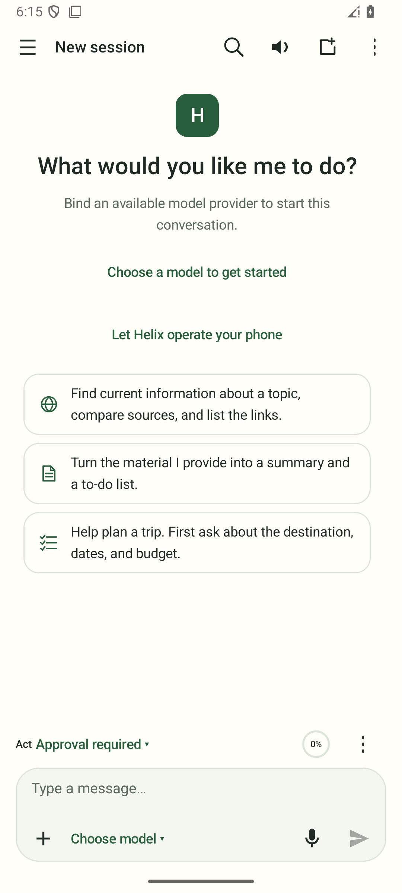
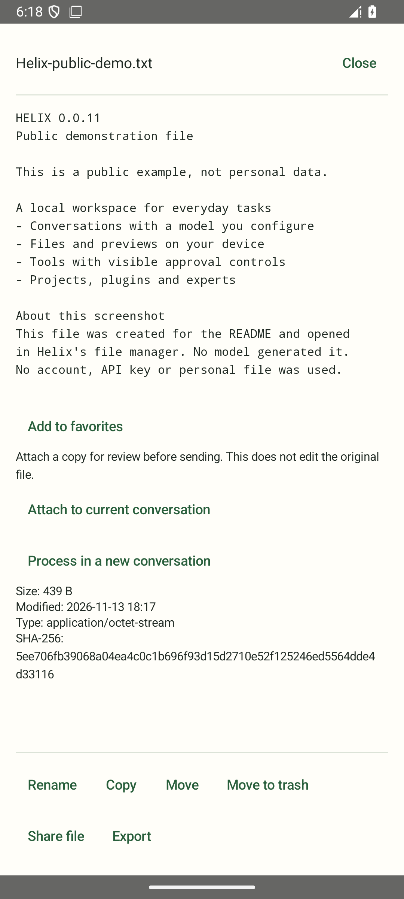
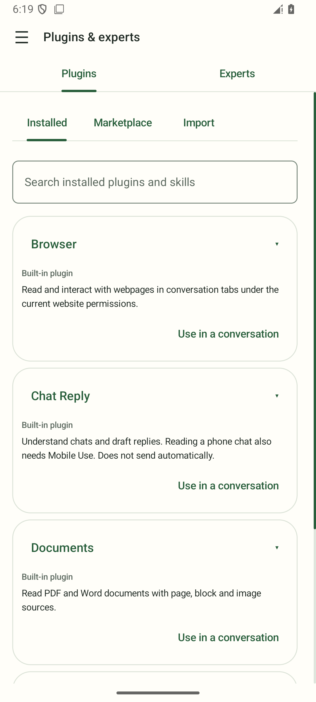

# Helix

[简体中文](README.md) | **English**

**An open-source Android AI agent that turns model responses into actions on your phone.**

Helix brings mobile interaction, a browser, files and tools into one conversation. Choose a model, project and access scope; inspect execution and continue working with the resulting files. Helix is an independent Apache-2.0 project and does not require OEM integration.

[Latest downloads: GitHub Releases](https://github.com/dollarser/helix-agent/releases) · [ModelScope](https://modelscope.cn/datasets/dollars/Helix) · [Changelog](CHANGELOG.md) · [Documentation](docs/README.md) · [Issues](https://github.com/dollarser/helix-agent/issues) · [Contributing](CONTRIBUTING.md)

> **Development preview: Android 10+, ARM64 APKs.** These are not stable releases and use a development certificate. In-place updates and historical data retention are not guaranteed. Save important material first; uninstalling removes private application data. Check the downloaded version's notes for features, signing and upgrade conditions, and the [changelog](CHANGELOG.md) for version changes.

## What it does

| Capability | Examples and scope |
| --- | --- |
| Mobile Use | Observe, find, tap, scroll and type through available Root, Shizuku or accessibility capabilities |
| Browser | Research and compare pages; separate manually opened pages from agent task pages |
| Files and results | Read/edit authorized files, preview and share results; separate external working directories from private conversation storage |
| Conversations and projects | Choose or create a project when starting a conversation, bind a directory and keep multiple conversations together |
| Local knowledge | Collect through Android sharing, manage notes and sources, select references or retrieve relevant passages without sending the whole library |
| Extensions | Select plugins, skills and experts per conversation; connect MCP services. Installing or referencing content grants no execution permission |
| Models and voice | Built-in account models, custom APIs and on-device models; dictation enters an editable draft, replies support read-aloud |
| Reminders and backup | Local reminders, optional read-only scheduled agent analysis and explicit local application backup/restore |

Results depend on the model, permissions, device and target application. Secure windows and login restrictions can prevent access. See [current status](docs/development/status.md) for implementation and validation limits.

## Interface preview

Real English-language screens from a development preview. The file preview uses a public example prepared for this demonstration, not model-generated output. No personal material or online account was used. Select an image to view it at full size.

| Conversation and approvals | Local file preview | Built-in plugins |
| --- | --- | --- |
| [](docs/assets/readme/new-conversation-en.png) | [](docs/assets/readme/file-preview-en.png) | [](docs/assets/readme/built-in-plugins-en.png) |

## First task

1. Download a channel APK from [GitHub Releases](https://github.com/dollarser/helix-agent/releases) or [ModelScope](https://modelscope.cn/datasets/dollars/Helix), verify the SHA-256 in its release notes and install it. Read the first-launch notice; optional notification, battery and overlay permissions can be skipped.
2. Sign in to use Helix's built-in models, configure your own API, or download an on-device model. Built-in availability and quotas depend on the service. Remote providers may charge for usage.
3. Start a conversation and optionally choose a project, working directory and plugins. Begin with test material:

```text
Group these tasks into morning, afternoon and evening, then save tomorrow.md:
10am meeting, mail a parcel in the afternoon, buy milk in the evening.
Do not invent additional times. Read the file back and verify the content.
```

4. Inspect the result from conversation management or the file manager, then preview or share it. A model's completion message does not replace checking the actual result.

### Mobile interaction

Use the composer's plus menu to select the Mobile Use plugin. Missing setup leads to the relevant settings and is checked again on return. You do not need every backend permission. The default scope is the whole phone; you can select specific applications. Individual calls still follow scope and approval checks.

Root, Shizuku and accessibility provide different capabilities and cannot operate every application. Advanced's ADB helper starts from an authorized computer without Root or Shizuku. See the [usage guide](docs/development/computer-adb-helper.md) for supported systems, package requirements and setup.

## Choose a package

| Channel | Package | Contents |
| --- | --- | --- |
| Standard / consumer | `com.helix.agent` | Complete base product, API/on-device models and channel-supported tools; excludes third-party subscription runtime and PRoot |
| Advanced / developer | `com.helix.agent.developer` | Base product plus advanced terminal/Linux environment and experimental third-party subscription adapters |

Capabilities follow the installed channel rather than an in-app permission tier. System grants, scopes and task approvals remain separate. Subscription adapters require eligible accounts and do not imply provider endorsement. Model and offline speech weights download separately.

## Data and control

- On-device execution does not mean fully offline operation. Remote model/voice services receive necessary messages, context, tool results, file excerpts or images. Local inference does not prevent network tools from using the internet.
- Online voice requires first-use confirmation. Dictation enters the draft without sending it. Stopping playback does not stop the agent.
- Notes and source material live under shared `Documents/Helix/library/`; conversations, memory and account credentials are private. External directories need their own grants.
- Dedicated local backups restore their allowlisted content. Ordinary chat/configuration content is not encrypted by default; static credentials are a separate, default-off encrypted option. Account/OAuth sessions, system grants, running processes and unresolved operations are not transferred or replayed. See the [backup contract](docs/adr/workspace/008-content-backup.md). Diagnostic exports are not restorable application backups.
- Incompatible databases require explicit confirmation after an impact preview; there is no automatic wipe. A compatible Room schema does not guarantee compatibility of old internal configuration payloads: read the upgrade notes.
- Stopping a task does not undo external effects. Inspect uncertain outcomes before retrying.

## Build from source

Use **JDK 17, Android SDK and Python 3.11+**. Follow the [environment guide](docs/development/environment.md) for pinned SDK/NDK versions, dependencies and runtime preparation.

```sh
git clone https://github.com/dollarser/helix-agent.git
cd helix-agent
python3 scripts/build-asr-assets.py
python3 scripts/build-tts-assets.py
./gradlew :app:assembleConsumerDebug
# After preparing the advanced runtime inputs described in the environment guide:
./gradlew :app:assembleDeveloperDebug
```

APKs are under `app/build/outputs/apk/`. Run `./scripts/check-all.sh --source` for source checks or `./scripts/check-all.sh` for the normal Debug gate. See [contributing](CONTRIBUTING.md) and [CI](docs/development/ci.md) for local hooks and layered checks. Build success is not device or live-service acceptance.

## Help and contribution

- [Documentation](docs/README.md) · [Status](docs/development/status.md) · [Architecture](docs/architecture/overview.md) · [Decisions](docs/adr/README.md)
- [Report an issue](https://github.com/dollarser/helix-agent/issues) with version, channel, device/Android, model and reproduction steps. Remove credentials and private data.
- [Contribution guide](CONTRIBUTING.md) · Maintainer: [dollarser](https://github.com/dollarser)

## License

Helix-owned source is [Apache License 2.0](LICENSE). Third-party libraries, runtimes, tools and weights retain their own licenses. [THIRD_PARTY_NOTICES.md](THIRD_PARTY_NOTICES.md) records attribution and distribution requirements, not a complete release SBOM. Each release body lists exact artifacts, checksums and corresponding-source links.
