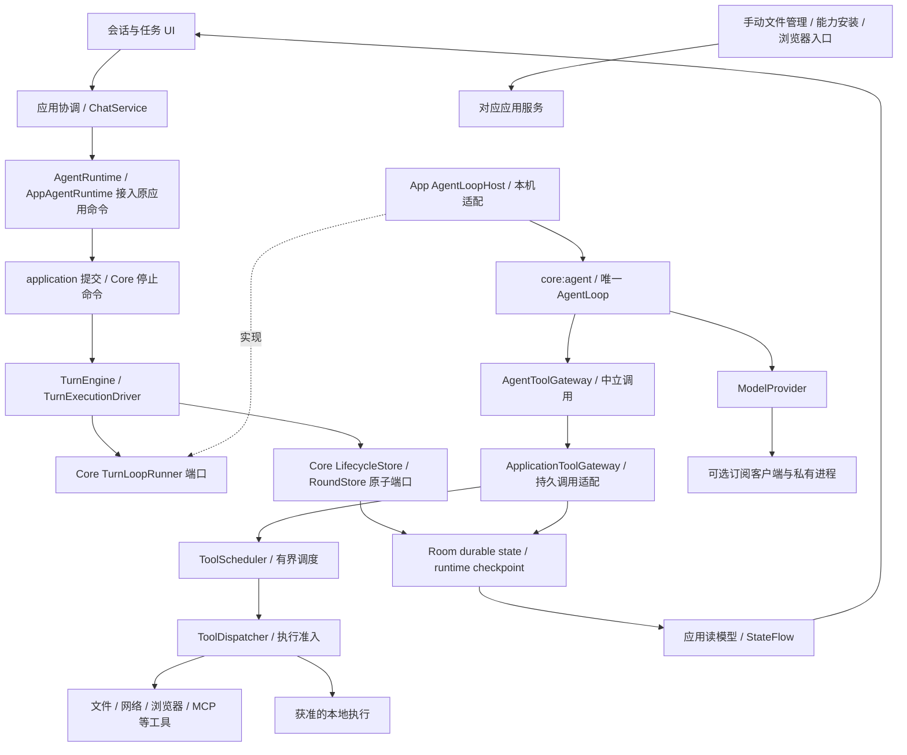
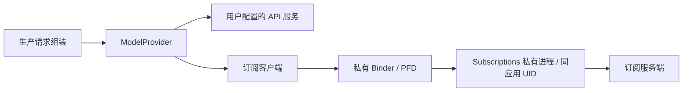

# Helix 总体架构

本文说明当前职责与已接受的演进边界；2026-10-14 定向复核执行接口、Memory、插件资源与恢复导航。实际交付以[实施状态](../development/status.md)和[完成记录](../completion-records/index.md)为准。接受设计不代表对应功能已上线；当前源码证据与重新调研见[执行引擎研究 第 10 节](../research/modules/01-architecture-and-execution-engine.md#10-2026-10-14-执行边界与新目标设计复核)，2026-10-15 评审后的单一目标设计见[Harness 方案 第 23 节](harness-refactor-plan.md#23-2026-10-14-执行边界重构提案)，已登记 HXA-286～294；286/293-A 内容接缝及 287-A/B 已交付；287-C 中立生命周期代码已接入，当前验收边界见[生命周期记录](../evidence/development/harness-stage1-lifecycle-2026-10-24.md)。

## 职责与调用路径

| 层 | 所有权 | 不承担的职责 |
| --- | --- | --- |
| UI / feature | 用户意图、导航、展示、人工操作入口，订阅应用读模型 | 直接访问 DAO、网络客户端或执行器；持有 Turn worker |
| 应用命令 / ChatService 展示适配 | application/agent 汇合提交、队列与恢复准备；停止由 Core 命令处理；ChatService 保留 composer、会话配置和 UI-facing projection，AppAgentRuntime 调命令并观察 Engine | 持有第二个 worker/startGate 或改写 Turn terminal/review |
| core:agent/runtime 的 TurnEngine / TurnExecutionDriver | durable admission/cancel/review/terminal/recovery、session blocker、runtime snapshot、live AgentLoop driver/observation | UI 导航、重新定义工具策略或 Runtime 退出事实 |
| Core Agent | 纯 JVM 的唯一 AgentLoop、TurnRoundCoordinator 运行投影、模型/工具回填及上下文预算；语义提交经 Store，Room 仍为持久事实 | 依赖 App/Room/UI、凭模型内容创建用户授权 |
| 宿主适配 | AgentLoopHost 装配端口；RoomTurnLifecycleStore/RoomTurnRoundStore 直接提交闭合原子命令；ApplicationToolGateway 实现 AgentToolGateway，ChatToolPresentation 仅显示事实 | 另建循环或取得 Turn 最终结算权 |
| ToolScheduler | 有界批次调度、真实不可重入资源约束、原调用顺序结算 | 按潜在业务结果冲突建立全局写锁、决定用户授权 |
| ToolDispatcher | schema/绑定、能力与策略、会话授权、执行前复检、期限及结果/审计处理 | 以展示就绪代替实时准入、把 Provider 请求当工具执行 |
| ToolExecutor / Runtime / 数据 | 实际操作、执行身份与物理资源、Room 持久事实、Workspace 与结果对账 | 因重连而自动重放未知副作用、将取消请求等同实际退出 |



图表示职责与调用方向，不表示每层一个进程或 Server。当前由 [ConversationComposition](../../app/src/main/kotlin/com/helix/app/composition/ConversationComposition.kt) 统一装配唯一 Engine、runtime、AgentLoopHost、gateway 及提交/停止命令，再注入 `ChatService`；[AppAgentRuntime](../../app/src/main/kotlin/com/helix/app/application/agent/AppAgentRuntime.kt) 位于 application/agent，submit 调提交准备，cancel 调 Core 停止命令。`DefaultAppContainer` 显式接收 account/knowledge，构造不启动观察；一次性 `start()` 才启动会话、screen/foreground collectors 与恢复。这里调整的是装配与启动边界，不是独立部署的 Harness。Engine 持久结算后才释放 live owner 并发布相应观察；UI 投影不反向提交终态。

输入 delivery/config/spec/reference 值归 `core:model/input`，持久 Record、状态与正文引用继续由 storage 持有；提交准备通过 `PendingSubmissionInput` 消费所需事实，队列 UI 通过 `PendingInputView` 消费展示值，均不接收整条持久输入行。原 `feature:conversation-input` 已并入 `feature:conversation`：会话 presentation/application、草稿、提交与回执状态机共用真实编译边界，通过窄端口取得宿主事实，不依赖 App、Room 或 storage 模块。共享呈现与离线预览资源由 `ui:shared` 持有；Room/ContentStore 已迁至 `infrastructure:storage`。设置、语音等 UI 的 `HelixApplication` 查询已替换为显式依赖。迁移与后续 SAF 修复的 Debug 主机、API36 有界设备验收按不同候选分别记录，不能推导新 Release 或整个产品通过，详见[实施范围与验证状态](harness-refactor-plan.md#241-结论基线与范围)。

手动文件管理、组件安装和浏览器拥有独立服务路径，不必先建立 Agent Turn。feature 通过应用接口提交动作。[ADR-AGENT-001](../adr/agent/001-turn-coordination.md)已将 live driver/observation 与 durable lifecycle 同归 TurnEngine；HXA-220/223 的交付不能继续画成 ChatService 持有 live worker 的迁移期结构。

会话应用层通过 `SessionDirectory` 消费目录/检索投影，`ComposerInputState` 持有原草稿与附件原子快照/锁，`TaskDashboardProjection` 持有任务面板六类读投影。`SessionCatalog` 定义会话元数据及模型配置的闭合命令，App 的 `RoomSessionCatalog` 保留对应原子事务；ChatService 负责用户动作与展示，`TurnSubmissionCommandHandler` 汇合普通、队列和恢复提交的准备/准入，`StopTurnCommandHandler` 汇合停止命令；权限仍在原治理链重验。App 的 conversation/chat 适配器连接同一 Room、clock、ID 及工作区恢复对象，不新增执行循环、状态副本或动作队列；历史页消费目录接口与动作回调。具体交付及验证边界见[status](../development/status.md)。

[HXA-234](../development/tasks/HXA-234.md) 已将实际 Loop、状态/预算值、执行端口与上下文选择迁入 Core，Android 侧保留适配与同一 Room 事务。应用协调、原历史编解码和权限/附件 I/O 仍在宿主；这不是把所有 App 逻辑搬入 Core，也没有创建远程 Execution Host。实现、主机与真实设备验收分别记账。

## 运行、上下文与恢复

`application/context` 组装类型化内容，打包模板由 `infrastructure/prompt` 经接口提供；插件事实不依赖 Core 编排，唯一 ContextCompiler 共同投影可选目录/Memory 内容并保留来源、省略和受控重读信息。

`ChatRequestAssembler` 实现 Core 的请求端口；`ContextCompaction` 读取有界历史快照后调用纯 `ContextCompiler`，`ContextCompactionRound` 在 Core 编排摘要，原 Turn 日志提交 checkpoint。`AgentTurnStore` 以领域命令提交终态；`ApplicationToolGateway` 适配原执行/审批/持久工具结果，`ChatToolPresentation` 负责可丢弃显示，`ChatToolMessages` 适配消息，二者不互相授予权限。
Chat、Plan、Act、Goal 共用执行循环，差异由工具曝光与 Policy 决定。生产请求组装保留持久历史、摘要、附件恢复、工具调用配对与图片绑定；整理上下文不能用旧测试 Builder 替换这些语义。MCP 已有按需发现和会话曝光，内置工具预算是独立优化。

恢复依次区分历史展示、原 Job 结果对账、用户继续和未知副作用待核查。停止使排队与等待审批的调用同样持久结算；进程死亡不等于任务成功，也不授予新的运行激活。

## 模块、权限与资源边界

`core:model`、`core:agent`、`core:policy`、`core:workspace` 是 JVM 模块；`infrastructure:storage` 是承载 Room/ContentStore 的 Android Library，不再作为 Core 模块。其 `com.helix.core.storage` 包名、JNI 符号与数据库 schema 身份保留，不代表保留旧 Gradle 模块或兼容门面。`core:agent` 通过中立端口复用，完整 TurnEngine/driver/live owner 在 Core，经闭合生命周期/round 端口工作，Room 持久适配在 App infrastructure；当前没有另一个独立 Turn Server。`feature:conversation` 只依赖所需 Core、provider:api 与 ui:shared；`ui:shared` 不依赖 App、feature 或 storage。真实模块依赖见[Gradle 声明](../../build.gradle.kts)和[模块列表](../../settings.gradle.kts)。

一次工具调用按原 Registry 绑定和 schema 校验，进入 live capability / Policy 硬约束、工具可用性与会话授权，再按需要取得精确审批；等待后开始执行前复检取消、权限和绑定。安装、会话选择、系统权限、配置就绪和某次调用的批准分别记录：系统权限满足能力条件，readiness 只说明可观察准备事实，均不能替代 Dispatcher 准入。具体规则归[权限 ADR](../adr/permissions/001-session-authorization.md)和[工具 ADR](../adr/tools/001-descriptor-contract.md)。

区分四类所有权：Engine 的 Turn live owner、Scheduler 的调用槽位、Executor/Runtime 的实际容量及原执行身份、插件/宿主的共享资源引用。完成等待可以释放观察 worker，取消或超时不能释放仍运行的 executor 容量；插件撤销也不能关闭其他消费者还在使用的后端。原执行结果/退出事实继续由原 Runtime 提供，HXA-277 只补原生贡献资源引用与释放。

UI 目前通过应用服务及 StateFlow 工作；会话页面在 `feature:conversation` 内消费状态与动作，AppConversationRoute 接入宿主语音、知识及导航能力。HXA-274 所涉恢复导航消费 RecoveryRepairDestination，由当前页面在用户操作后执行导航，不再把页面导航回调存入服务。2026-10-14 发现的工具业务与卡片/字符串耦合已在 287-B 接入独立展示 sink；Core TurnRoundCoordinator 直接实现 AgentTurnJournal，原 App coordinator 和转调 journal 已删除，本片主机及两渠道独立模拟器验收通过；工具执行请求、取消、原 Job 身份与物理容量已存在，不应再建平行框架。其他命令/读模型继续复用 HXA-257/258 的状态 owner；完整 Turn 宿主提取已与应用命令合并为 HXA-287，执行结果/Job/产物为 HXA-288，不再等待第二消费者。287-C 已实际迁移 Engine/driver/停止命令和 live 契约，删除旧 App 路径；其纯 JVM 与真实 Room 验证分别记账，不将内存 fixture 外推为所有宿主通过；[当前状态](../development/status.md)提供能力与证据事实；实施范围和顺序由当前用户任务及适用 HXA 决定。

## 专项契约

- [执行引擎详解与对比研究](../research/modules/01-architecture-and-execution-engine.md)：当前生产调用链、Codex/DSH/Claude Code 参照与端侧补足建议；研究不新增实现授权。
- [Provider](#模型-provider-与订阅通路)：模型协议、连接检测与订阅通路。
- [Agent 模式与 Goal](#agent-模式goal-与上下文)：运行准入、完成与上下文。
- [执行域](#本地执行域与恢复)：同 UID 私有进程与 isolated UID 的真实边界。
- [扩展](#mcpskillsconnector-与-a2a)：MCP、Skills、Connector、A2A。
- [终端与后台任务](terminal.md)：已有 Linux Job/手动 PTY 及各自执行、控制和验证边界。
- [安全与发布](../security/testing-and-release.md)：授权、审计与验收。
- [用户操作链](../product/task-experience.md)：工作区、输出、变更和恢复之间的导航。

本图只描述当前职责与已接受演进边界；具体功能是否已交付、仍有哪些收尾/发行任务，以[实施状态](../development/status.md)、[任务索引](../development/roadmap.md)和[完成记录](../completion-records/index.md)为准。

## 当前目录与单一权威

```text
core/agent/runtime      Engine、driver、停止命令、live/deadline/观察契约
core/agent/turn         RoundCoordinator、闭合 lifecycle/round 命令与 receipt
app/application/agent  提交准备、Queue/Goal 的应用意图与交付协调
app/application/tools  原 Dispatcher/审批/工具结果持久结算适配
app/application/context 类型化上下文贡献
app/agent              App 宿主的上下文/历史/Goal 集成适配，非 Core Engine
app/infrastructure/agent Room 事务、恢复记录、Goal ownership/edit 与 Engine 装配
app/infrastructure/prompt 打包模板适配
feature/conversation   会话表现、应用命令/查询契约、草稿与回执状态机
ui/shared              共享呈现、资源及离线预览；不读取会话或持久状态
infrastructure/storage Room、ContentStore 与原子持久实现
app/infrastructure/conversation 会话命令/查询、知识与模型的真实宿主适配
app/infrastructure/chat 附件、输入交付与恢复的真实宿主适配
app/ui/AppConversationRoute.kt 宿主语音、知识与导航接入
app/chat               剩余宿主查询及任务投影，不持有会话表现实现或 Engine
```

上述是职责目录，不要求一目录一 Gradle 模块。`feature:conversation`、`ui:shared` 和 `infrastructure:storage` 已形成实际模块，旧 conversation-input/core:storage Gradle 路径已移除；其余 App 适配目录仍在宿主模块。没有新建 common/utils 总包、旧包名兼容 facade 或第二套数据库；存储 Kotlin/JNI/schema 身份保留，迁移本身不增加旧测试数据兼容链。依赖护栏与有界真实设备结果各自证明适用边界，不承诺任意历史数据保留。

## Agent 模式、Goal 与上下文

四种模式共用模型工具循环。工具曝光和 Policy 决定允许行为，类名包含 Chat 不意味着存在四套执行器。

| 模式 | 契约 |
| --- | --- |
| Chat | 只读交互与允许的内置元数据动作 |
| Plan | 只读研究和计划元数据；审阅计划不批准所有执行期工具 |
| Act | 执行当前任务；Turn 结束与任务完成分别展示 |
| Goal | 持久目标、自动续跑轮数、显式激活后的连续运行与恢复 |

### Goal

[Goal 契约](../adr/goal/001-lifecycle-and-completion.md)统一 create/get/update/report、版本与目标编辑、激活、预算和完成语义。模型创建或编辑需要可归因的直接用户意图；Plan 不借元数据操作激活 Goal。编辑活跃目标须按修订与结算边界应用，不能覆盖正在执行的版本。

目标状态与运行激活分离；用户停止、等待输入、预算耗尽及异常均影响准入。按已接受ADR-AGENT-001，普通新输入采用Queue或显式Steer，不自动撤销Goal激活；交付范围见 [HXA-216](../completion-records/HXA-216.md)。允许离开前台后在合法后台运行窗口继续，但进程重启不自动重新激活，系统拒绝保活时如实暂停。工具仍遵守当前授权。

模型报告完成与依据，harness 在 Turn 结算消费；不恢复全局强制 verifier evidence。可继续修复的测试失败不是自动 BLOCKED。Goal 自动续跑轮数跨 run 累计，用量统计不充当已移除的累计 token/工具调用上限；调整轮数不等于自动续跑。HXA-208 的交付证据与后续剩余任务分别从[状态](../development/status.md)进入。

### 上下文与执行入口

[Turn 协调](../adr/agent/001-turn-coordination.md)、[压缩](../adr/agent/002-context-compaction.md)、[附件](../adr/agent/003-attachments.md)规定生产路径。模型请求前检查压缩，摘要完成后重建上下文，保留 tool call/result 配对、附件绑定和恢复语义。

Prompt sections 固定顺序、来源与作用域；Skill 或项目文本不会因进入 system prompt 获得可信权限。界面只能提交、取消和观察；后台入口复用同一准入边界，不能自行构造第二个 Loop。

[有界委托](../adr/agent/004-bounded-delegation.md)是受门禁约束的设计，不代表子 Agent、可执行 workflow 或递归编排已经交付。

### 模型输入、聊天与诊断的分工

[ADR-AGENT-006](../adr/agent/006-model-data-budget-boundaries.md)定义模型结果投影与预算恢复。三个视图来自同一持久事实，但不是同一份文本：

| 信息 | 发给模型 | 用户界面与持久记录 |
| --- | --- | --- |
| 用户/助手正文 | 按上下文边界与压缩规则进入 | 普通聊天气泡，原历史保留 |
| 工具调用与结果 | assistant tool call + 匹配的 TOOL 结果；不是普通助手回复 | 工具时间线可展开，完整结果保存于结果表/内容存储 |
| 大工具结果 | 短预览、明确截断标记和本地读取引用；按需分页补足 | 完整输出仍可追溯，未重跑原工具 |
| 压缩边界与摘要 | 活跃 checkpoint 参与构建，保持最新完整调用/结果组 | 边界与原消息仍持久化，不把内部 checkpoint 显示为回复 |
| 预算/用量/执行状态审计 | 不把全部审计 JSON 塞入上下文；模型仅通过其请求/工具协议获知必要结果 | 数值诊断关联 modelCallId，超限错误和估算构成可显示 |

普通 Turn 设置仅提供单次输出上限，不设置累计 token、模型调用数、工具轮数或独立输入额度。上下文窗口与压缩由精确 Provider/model 设置管理，实际用量仍保留为统计；Goal 的自动续跑轮数与工具自身的时间、输出及物理容量限制分别生效，详见 ADR-AGENT-006。

遇到输出上限时可显式调整单次输出设置；上下文超限需要有效压缩，继续请求不会扩大窗口。Goal 轮数耗尽需要用户调整或停止，不能由模型自行扩额。操作成功只说明工具执行结算成功，仍需检查结果是否符合任务预期。

## MCP、Skills、Connector 与 A2A

扩展负责提供能力描述和内容，不能授予本地权限。来源、信任级别、用户启用状态与契约版本必须贯穿发现、曝光、执行和审计。

| 类型 | 作用 | 当前契约 |
| --- | --- | --- |
| MCP | 客户端发现、会话工具曝光、远端调用 | [MCP](../adr/mcp/001-client-and-discovery.md) |
| Skill | 指令、资源和受控脚本组织 | [Skills](../adr/skills/001-authoring-and-installation.md) |
| Connector | 可迁移能力包与安装管理 | [可迁移包](../adr/connectors/001-portable-bundles.md)、[格式细节](connector-portability.md) |
| A2A | 用户配置的外部 Agent 服务 | [A2A Client](../adr/a2a/001-client-interoperability.md) |

### 发现到使用

发现结果展示来源、依赖与适用执行域；用户选择安装/启用后才能曝光。MCP 已有 tools_search 与会话曝光窗口，不另建平行注册系统。加载 Skill、项目指令或网页内容时保留来源与信任标签，排序与作用域覆盖不提升权限。

安装、修复、禁用和更新走应用服务，UI 不直接写数据库。工具禁用与授权预设按照[会话授权](../adr/permissions/001-session-authorization.md)演进；未经完成验收不能将计划中的新语义描述为已上线。

### 执行与故障

扩展工具执行仍经过统一 schema / Policy / 授权 / 限额 / 审计。MCP annotation、Skill 文本和远端 Agent 结果均不能证明效果安全或生成 Approval Proof。外部结果回到本地后的文件写入等效果必须重新分派。

A2A 仅为客户端互操作，不是 Helix Worker，也不继承本地 Secret、scope 或批准。远端任务身份、取消和 Artifact 应持久化，未知结果先对账。网络、认证和 Runtime 依赖失败要提供可定位的修复入口，不把安装成功当真实任务成功。

Connector OAuth、安装所有权与签名索引分别受已接受的 ADR-CONNECTORS-002/003/004 约束。OAuth 的 Notion/Linear 已有真实服务切片，发行身份、App Link 等未闭合范围继续由 HXA-126 记录；离线签名验证不表示在线市场或生产信任根已交付。当前任务由用户指令确定，[路线](../development/roadmap.md)只索引 HXA，不沿用旧交接顺序。

## 本地执行域与恢复

唯一决策入口：[执行域](../adr/runtime/001-execution-domains.md)、[QuickJS](../adr/runtime/003-quickjs.md)、[Root](../adr/runtime/004-root-service.md)。

| 执行域 | 打包与进程 | 真实边界 |
| --- | --- | --- |
| QuickJS | 默认非导出 isolated process；用户开启原生总开关后可选应用 UID 私有进程 | 默认无特权桥；原生包含文件/网络/Java/Android，不提供三类独立隔离；生成代码不在 UI 进程运行 |
| PRoot | developer 内置模块、私有 :proot 进程 | 共享应用 UID；可信开发者环境，不是内核沙箱，不承诺离线或只读隔离 |
| Subscriptions | developer 内置模块、私有 :subscriptions 进程 | 正常 API 隐藏 token；同 UID 不构成凭据隔离 |
| Root | 用户显式授予的可选能力 | 系统授权只满足能力条件，不能替代工具授权 |

consumer 排除 PRoot/Subscriptions 的依赖、manifest、dex 和 assets/native 制品；不得用仅隐藏入口冒充排除。Runtime 进程不重复启动主应用容器或 Room 恢复。

### 工作所有权

应用服务持有 Job、会话、scope、授权和预算；Runtime 持有进程组、执行状态和退出事实。按用户维护/登录或获准执行冷绑定，不在启动、切换设置或被动发现时执行工作。Advanced 的缺失内置 Linux 环境在首次获准新 Job 或人工终端启动时自动准备；已有环境损坏/版本不匹配需明确维护，不保留手动验证或重定基线步骤。状态读取实际安装事实，不以进程存活或旧验证记录作为可用证明。

Binder/PFD 使用有界消息与快照，校验 Job ID、generation、owner、长度与完整性。安装与修复先验证来源和制品，再提交可用环境，失败保留可解释状态；不能因依赖升级后还能编译就认为环境可执行。

输入输出绑定真实 scope 与相对路径，拒绝路径逃逸和身份错配。导回文件验证哈希、冲突与写入边界，产物入口指向实际可读取结果。不能以同 UID 模拟沙箱证明网络或文件写禁令；无法约束的执行按策略拒绝或要求合适模式。

### 应用操作与 Agent Tool 入口

同一底层服务可以有手动用户入口与模型工具入口：手动终端、环境准备、文件管理不必因存在应用 API 就注册为 Tool。模型调用仍进入 Dispatcher；可信 USER 路径也需要自己的来源、系统能力和共享资源检查，不能被模型或外部文本冒用。

工具“不可见”不是权限证明，注册也不授予权限；命令来源、有效授权和实际执行域分别检查。不要根据旧参考材料恢复独立 companion APK、旧风险等级或“仅不注册即可安全执行”的推断。原机制说明归[历史 Linux 集成参考](../evidence/research-history/helix-linux-command-integration.md)，平台机制参考见[Android 原生执行](../references/android-native-execution-mechanisms.md)。

### 取消与恢复

停止传播到排队、审批等待和进程组；所有槽位最终持久结算。Binder 断开、EOF、超时与进程死亡先查询原 Job，明确成功、失败、已取消或未知副作用。未知不得自动重试；用户核查与继续是独立动作。

持久后台 Job 必须有明确 Runtime owner、有效租期和可用 Android 后台路径，不能把普通同步命令自动升级为后台任务。日志、手动 PTY 与多会话的设计和分期见[终端](terminal.md)。[验收规则](../development/verification-matrix.md)包含真实进程重启、设备所有权和双 flavor 边界。

## 模型 Provider 与订阅通路

规范依据：[模型与连接](../adr/provider/001-models-and-connection.md)、[订阅适配器](../adr/provider/002-subscription-adapters.md)。

### 所有权

ModelProvider 负责模型请求、流事件、能力和错误归一。请求组装负责历史、摘要、附件和工具 schema；UI 展示连接结果，不自行创建协议请求。API 模型调用不经过 Tool Dispatcher；模型随后请求的工具仍逐个经过 Dispatcher。



### 协议与检测

按模型实际能力组装工具、图像、推理和 token 参数，不从显示名称猜测能力。流式消费区分可见文本、推理内容、工具调用、结束与错误；连接检测不得仅因没有 TextDelta 就否定有效 thinking 响应，也不能把空流或错误流判成功。连接检测、模型能力验证、真实工具任务分别记账。

取消、超时和流中断保留可解释错误，不返回伪成功。真实账号 smoke 采用显式 profile；未配置时 skip 不是已验证。[公共验收规则](../development/verification-matrix.md)规定默认门禁与外部证据边界。

### 订阅凭据与产品边界

developer 打包订阅模块，consumer 排除相应依赖和制品。凭据由订阅模块持有，正常 API 不返回 token；同 UID 不是凭据隔离安全边界。登录/刷新只使用自身授权，不提取其他应用 Cookie 或凭据。第三方协议适配器须如实标识，不冒充官方 CLI。

冷绑定由用户登录、验证、修复或获准工作触发，被动刷新不启动运行。身份、固定客户端标识及供应商限制以 Provider ADR 为唯一规范，不能为绕过限制随意替换。进程断开应对账请求状态，不盲目重发可能产生计费或副作用的工作。
