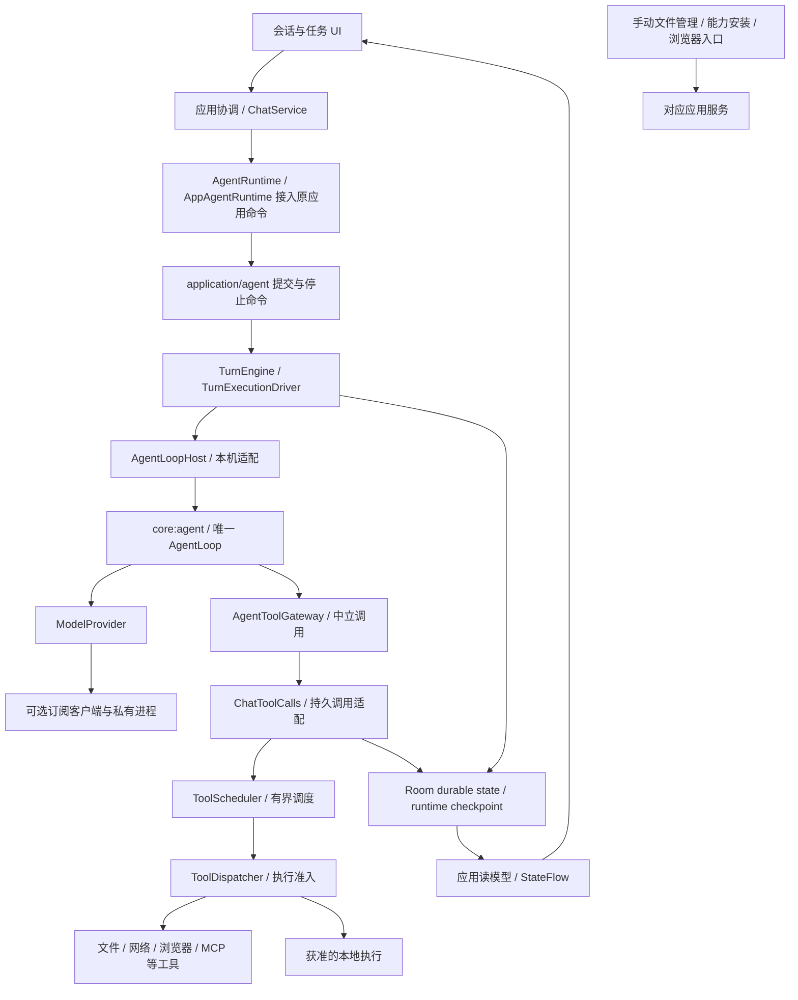

# Helix 总体架构

本文说明当前职责与已接受的演进边界；2026-10-14 定向复核执行接口、Memory、插件资源与恢复导航。实际交付以[实施状态](../development/status.md)和[完成记录](../completion-records/index.md)为准。接受设计不代表对应功能已上线；当前源码证据与重新调研见[执行引擎研究 §10](../research/modules/01-architecture-and-execution-engine.md#10-2026-10-14-执行边界与新目标设计复核)，2026-10-15 评审后的单一目标设计见[Harness 方案 §23](harness-refactor-plan.md#23-2026-10-14-执行边界重构提案)，已登记 HXA-286～294；286/287/293 的阶段 1 正在实施，完整 Turn 宿主中立化尚未完成。

## 职责与调用路径

| 层 | 所有权 | 不承担的职责 |
| --- | --- | --- |
| UI / feature | 用户意图、导航、展示、人工操作入口，订阅应用读模型 | 直接访问 DAO、网络客户端或执行器；持有 Turn worker |
| 应用命令 / ChatService 展示适配 | application/agent 汇合提交、队列、恢复与停止；ChatService 保留 composer、会话配置和 UI-facing projection，AppAgentRuntime 调命令并观察 Engine | 持有第二个 worker/startGate 或改写 Turn terminal/review |
| TurnEngine / TurnExecutionDriver | durable admission/cancel/review/terminal/recovery、session blocker、runtime snapshot、live AgentLoop driver/observation | UI 导航、重新定义工具策略或 Runtime 退出事实 |
| Core Agent | 纯 JVM 的唯一 AgentLoop、TurnRoundCoordinator 运行投影、模型/工具回填及上下文预算；语义提交经 Store，Room 仍为持久事实 | 依赖 App/Room/UI、凭模型内容创建用户授权 |
| 宿主适配 | AgentLoopHost 装配端口；RoomTurnRoundStore 直接提交 round 原子命令；ApplicationToolGateway 实现 AgentToolGateway，ChatToolPresentation 仅显示事实 | 另建循环或取得 Turn 最终结算权 |
| ToolScheduler | 有界批次调度、真实不可重入资源约束、原调用顺序结算 | 按潜在业务结果冲突建立全局写锁、决定用户授权 |
| ToolDispatcher | schema/绑定、能力与策略、会话授权、执行前复检、期限及结果/审计处理 | 以展示就绪代替实时准入、把 Provider 请求当工具执行 |
| ToolExecutor / Runtime / 数据 | 实际操作、执行身份与物理资源、Room 持久事实、Workspace 与结果对账 | 因重连而自动重放未知副作用、将取消请求等同实际退出 |

图表示职责与调用方向，不表示每层一个进程或 Server。`AppAgentRuntime` 当前由 ChatService 构造，submit/cancel 直接调用 `application/agent` 的提交/停止命令；它是端口适配，不是已经独立部署的 Harness。Engine 持久结算后才释放 live owner 并发布相应观察；UI 投影不反向提交终态。

手动文件管理、组件安装和浏览器拥有独立服务路径，不必先建立 Agent Turn。feature 通过应用接口提交动作。[ADR-AGENT-001](../adr/agent/001-turn-coordination.md)已将 live driver/observation 与 durable lifecycle 同归 TurnEngine；HXA-220/223 的交付不能继续画成 ChatService 持有 live worker 的迁移期结构。

会话应用层内部由`SessionDirectory`持有目录/检索投影、Job与取消发布边界，`ComposerInputState`持有原草稿与附件原子快照/锁，`TaskDashboardProjection`持有任务面板六类读投影。`SessionCatalog`集中元数据及模型默认/运行配置的Room事务；ChatService负责用户动作与展示，`TurnSubmissionCommandHandler` 汇合普通、队列和恢复提交的准备/准入，`StopTurnCommandHandler` 汇合停止命令；权限仍在原治理链重验，运行配置仍由原`SessionRunControlStore`保存。这些协作者共用原Room、clock、ID及工作区恢复对象，不新增执行循环、状态副本或动作队列；历史页消费目录接口与动作回调。具体交付及验证边界见[status](../development/status.md)。

[HXA-234](../development/tasks/HXA-234.md) 已将实际 Loop、状态/预算值、执行端口与上下文选择迁入 Core，Android 侧保留适配与同一 Room 事务。应用协调、原历史编解码和权限/附件 I/O 仍在宿主；这不是把所有 App 逻辑搬入 Core，也没有创建远程 Execution Host。实现、主机与真实设备验收分别记账。

## 运行、上下文与恢复

`application/context` 组装类型化内容，打包模板由 `infrastructure/prompt` 经接口提供；插件事实不依赖 Core 编排，唯一 ContextCompiler 共同投影可选目录/Memory 内容并保留来源、省略和受控重读信息。

`ChatRequestAssembler` 实现 Core 的请求端口；`ContextCompaction` 读取有界历史快照后调用纯 `ContextCompiler`，`ContextCompactionRound` 在 Core 编排摘要，原 Turn 日志提交 checkpoint。`AgentTurnStore` 以领域命令提交终态；`ApplicationToolGateway` 适配原执行/审批/持久工具结果，`ChatToolPresentation` 负责可丢弃显示，`ChatToolMessages` 适配消息，二者不互相授予权限。
Chat、Plan、Act、Goal 共用执行循环，差异由工具曝光与 Policy 决定。生产请求组装保留持久历史、摘要、附件恢复、工具调用配对与图片绑定；整理上下文不能用旧测试 Builder 替换这些语义。MCP 已有按需发现和会话曝光，内置工具预算是独立优化。

恢复依次区分历史展示、原 Job 结果对账、用户继续和未知副作用待核查。停止使排队与等待审批的调用同样持久结算；进程死亡不等于任务成功，也不授予新的运行激活。

## 模块、权限与资源边界

`core:model`、`core:agent`、`core:policy`、`core:workspace` 是 JVM 模块；`core:storage` 是承载 Room 的 Android Library。因此 `core/` 目录名不等于所有内容都可脱离 Android。`core:agent` 通过中立端口复用，完整 TurnEngine 与持久宿主仍在 App；当前没有另一个独立 Turn Server。真实模块依赖见[Gradle 声明](../../build.gradle.kts)。

一次工具调用按原 Registry 绑定和 schema 校验，进入 live capability / Policy 硬约束、工具可用性与会话授权，再按需要取得精确审批；等待后开始执行前复检取消、权限和绑定。安装、会话选择、系统权限、配置就绪和某次调用的批准分别记录：系统权限满足能力条件，readiness 只说明可观察准备事实，均不能替代 Dispatcher 准入。具体规则归[权限 ADR](../adr/permissions/001-session-authorization.md)和[工具 ADR](../adr/tools/001-descriptor-contract.md)。

区分四类所有权：Engine 的 Turn live owner、Scheduler 的调用槽位、Executor/Runtime 的实际容量及原执行身份、插件/宿主的共享资源引用。完成等待可以释放观察 worker，取消或超时不能释放仍运行的 executor 容量；插件撤销也不能关闭其他消费者还在使用的后端。原执行结果/退出事实继续由原 Runtime 提供，HXA-277 只补原生贡献资源引用与释放。

UI 目前通过应用服务及 StateFlow 工作；ChatScreen 仍依赖较宽的 ChatService，但 HXA-274 所涉恢复导航已经改成消费 RecoveryRepairDestination，由当前页面在用户操作后执行导航，不再把页面导航回调存入服务。2026-10-14 发现的工具业务与卡片/字符串耦合已在 287-B 接入独立展示 sink；Core TurnRoundCoordinator 直接实现 AgentTurnJournal，原 App coordinator 和转调 journal 已删除，本片主机及两渠道独立模拟器验收通过；工具执行请求、取消、原 Job 身份与物理容量已存在，不应再建平行框架。其他命令/读模型继续复用 HXA-257/258 的状态 owner；完整 Turn 宿主提取已与应用命令合并为 HXA-287，执行结果/Job/产物为 HXA-288，不再等待第二消费者。完整 Engine/driver 对 App/Room 的依赖仍待 287-C，不将 round 提取等同完整宿主完成；实施顺序由[当前状态](../development/status.md)决定。

## 专项契约

- [执行引擎详解与对比研究](../research/modules/01-architecture-and-execution-engine.md)：当前生产调用链、Codex/DSH/Claude Code 参照与端侧补足建议；研究不新增实现授权。
- [Provider](providers.md)：模型协议、连接检测与订阅通路。
- [Agent 模式与 Goal](agent-modes.md)：运行准入、完成与上下文。
- [执行域](local-code-execution.md)：同 UID 私有进程与 isolated UID 的真实边界。
- [扩展](extensions.md)：MCP、Skills、Connector、A2A。
- [终端与后台任务](terminal.md)：已有 Linux Job/手动 PTY 及各自执行、控制和验证边界。
- [安全与发布](../security/testing-and-release.md)：授权、审计与验收。
- [用户操作链](../product/task-experience.md)：工作区、输出、变更和恢复之间的导航。

本图只描述当前职责与已接受演进边界；具体功能是否已交付、仍有哪些收尾/发行任务，以[实施状态](../development/status.md)、[任务索引](../development/roadmap.md)和[完成记录](../completion-records/index.md)为准。
