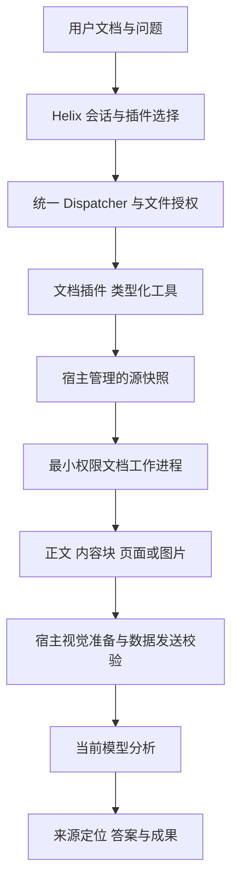

# 独立文档处理插件设计

日期：2026-10-14。状态：accepted scope；Owner已授权按本方案实现，开发与验收状态见HXA-284。

Owner要求：参考Codex PDF和Documents插件，设计Helix独立文档插件，优先PDF与Word图文阅读；初始轮仅写方案；2026-10-14 Owner追加“按这个思路实现插件”。后续补充以最优方案为主，不要求兼容或复用旧实现。宿主授权、视觉和成果能力保持统一，内部实现可重构。

## 1 产品目标与首版范围

用户选择文档并提出问题，Helix能读取正文、表格与图片，按来源定位回答，明确实际覆盖内容和无法识别的部分。插件名为“文档”，标识建议为`documents`；PDF和Word是同一插件的格式能力，不拆成两个设置入口。

首版支持PDF和`.docx`。Word首版不等于支持旧二进制`.doc`、`.docm`、在线Google Docs、完整Office排版或任意嵌入对象。识别这些输入后明确解释支持范围，不按扩展名强行解析。

| 格式 | 首版读取能力 | 必须明确的边界 |
| --- | --- | --- |
| PDF | 页面清单、可用文字、页面视觉阅读；复杂表格和图表通过页面观察 | 旧API文字提取可能不可用；扫描页需要视觉模型；未读页不能算已总结 |
| DOCX | 按文档顺序读取段落、标题、表格、图片引用；按需查看嵌入图片 | 使用内容块定位，不伪造Word页码；不承诺分页、浮动图片位置和原版式还原 |

首版排除修改原文、生成PDF/DOCX、批注修订、宏/OLE执行、自动外链下载、独立OCR、云端转换和整文上传。总结文本可由现有文件工具保存为Markdown，但这是另一个写操作，不能由只读文档工具隐式产生。

## 2 参考证据与设计取舍

本次直接阅读Codex安装的`pdf`和`documents`插件26.1013.11914版本说明。PDF使用Python库与Poppler；Documents使用文档脚本、OOXML和LibreOffice渲染，要求渲染后检查。它们提供Skill与执行资源，不是每个插件自带常驻MCP服务器或专属权限沙箱。只借鉴设计，不复制插件脚本或未经许可的实现。

| 参考行为 | 采用方式 | Android取舍 |
| --- | --- | --- |
| Skill组织专业工作流 | 插件内置一个阅读Skill，教模型发现、分段阅读、查看图表和说明覆盖范围 | 不另装独立Skill，不维护第二个AgentLoop |
| 文本提取与页面渲染结合 | PDF文字与像素、DOCX块与嵌入图片并存 | DOCX结构阅读与高保真渲染分开，不伪装同一种能力 |
| 本地脚本和专业程序 | 类型化工具调用本地解析工作进程 | 基础功能不依赖Python、PRoot、Root、Shizuku或系统无障碍 |
| 渲染并检查实际内容 | 观察图片必须走现有真实视觉输入管线 | 路径/Base64、提取文字或模型自称看过，均不等于看过图 |
| 专业工具资源 | 将解析实现和资源随插件组件组织 | 不在普通任务中安装库、下载执行代码或自动切云端 |

[Android PdfRenderer](https://developer.android.com/reference/android/graphics/pdf/PdfRenderer)提供平台PDF渲染，并建议不可信文件使用最小权限隔离进程；[Page API](https://developer.android.com/reference/android/graphics/pdf/PdfRenderer.Page)的文字提取始于API35。首选平台引擎，不为全API文字一致性立即引入另一套PDF内核。旧API可用视觉阅读，但纯文本模型不能读扫描页。

[Apache POI Word说明](https://poi.apache.org/components/document/index.html)区分HWPF与XWPF，并说明支持范围有限。它是候选库，不意味着完整Word渲染器或已验证Android可运行。本方案首选窄范围DOCX流式结构解析；若固定样本证明兼容性或维护成本不满足，再比较成熟库的Android兼容性、体积、内存与许可证，不能仅凭“纯Java”引入。

## 3 与当前工作的关系

[HXA-283](../development/tasks/HXA-283.md)已交付单页PDF读取主机切片；统一插件由[HXA-284](../development/tasks/HXA-284.md)与[文档ADR](../adr/workspace/006-pdf-reading.md)承接。本方案扩展到独立插件和DOCX阅读，是后续设计，不把该任务的实现、构建结果或accepted状态自动扩为本方案验收。

旧实现不构成设计约束。后续实施应依据本方案选择引擎、接口和存储；没有旧接口、数据库或缓存兼容承诺，也不建立长期别名。若确认插件统一拥有PDF工具，则迁移生产入口后删除旧入口，不能同时发布`files.read_pdf`与等效插件工具造成选择歧义。现有在途修改本轮不删除或重写。

实施前在同一PDF ADR记录工具归属和快照生命周期的Decision history；DOCX的格式和安全边界登记适用决策。Owner后续已授权实施；实际采用契约见同一ADR，未执行的设备/模型不由accepted推导通过。

## 4 职责与执行结构

| 所有者 | 负责 | 不负责 |
| --- | --- | --- |
| Helix宿主 | 会话选择、工具发现、授权、原调用身份、容量、取消、审计、文件与视觉Artifact、数据发送、成果导航 | 特定格式解析，不建立文档专用AgentLoop |
| 文档插件 | 工具契约、内置Skill、格式能力诊断、阅读覆盖与来源元数据 | 授予文件权限、决定模型策略、创建新Provider |
| 文档工作进程 | 有界PDF解析/渲染和DOCX解包/结构解析 | Room、凭据、网络、用户目录访问、宏执行 |
| 当前模型 | 选择读取范围、判断需要哪些图表、解释和总结 | 修改工具成功事实、声称未读内容已验证 |

建议Kotlin编写插件与服务，DOCX使用有界ZIP/XML处理，PDF调用平台引擎；只有证据表明必要才增加第三方native引擎。插件不是第三方任意原生代码沙箱；首版是随APK交付、通过现有原生插件目录管理的独立能力组件，两渠道行为一致。

不新增CLI或MCP入口。将来外部文档服务应走既有连接器授权，不混入本地插件。模块具体拆分按依赖方向决定，独立插件不要求每种格式单独一个框架。

## 5 最小工具面

建议三个公开工具；以下为拟议契约，不是现有API。全部来源声明为文档插件，并进入同一工具绑定/资格/选择与Dispatcher管线。

| 工具 | 输入要点 | 输出与用途 |
| --- | --- | --- |
| `documents.inspect` | 已授权文件引用 | 格式、源快照hash、documentRef、页数或结构统计、读取能力、限制和警告；不自动外发全文 |
| `documents.read` | documentRef；PDF页或DOCX块范围；可选继续cursor | 有界正文/表格、图像引用、来源定位、截断/未支持标记与下一位置 |
| `documents.view` | documentRef与页/图片定位；必要的有界PDF区域 | PDF页/区域或DOCX嵌入图片的真实视觉观察；明确是否已进入模型请求 |

首版不增加“自动总结”“自动判断重要页”“运行Python”“万能转换”工具。总结与阅读策略交给当前模型。三工具构成完整阅读组，沿现有发现工作集策略呈现，不让工具数量增长成为使用前提。

PDF页码从1开始。DOCX使用`block:编号`、表格行列、`image:编号`等实际结构定位；嵌入图片保留关系目标与相邻内容，浮动锚点不当作完整阅读顺序。`inspect`的清单也必须有界和可继续，不能为检查信息一次构造整份大文档。

每个工具返回源hash、实际范围、coverage、warnings、truncated及有需要时的nextCursor。解析输出只报告事实，不把模型摘要写成可信工具结果。来源定位是插件内容的显式结构数据，不解析任意日志路径作为成果入口。

工具说明应直接解释何时使用、接下来做什么。例如`read`说明“文字不足以判断图表，使用view；有nextCursor表示未读完”，而不是只写“读取文档”。

## 6 源快照 身份与生命周期

首次`inspect`在冻结目录和原始读取授权下生成只读源快照；hash针对实际解析字节。宿主保存不可变快照和来源关联，不让工作进程重开用户路径。复制期间源可能变化，不声称文件系统原子快照；不稳定输入明确警告或拒绝。

`documentRef`是宿主管理的内容身份，不是Bearer权限或任意文件路径。之后每次read/view都重新校验当前会话/请求对源的授权及快照关联；不能跨会话凭一个ID读取，不因源授权被撤销仍持有缓存而继续放行。相同源hash可复用物理内容，访问关联必须分别保存。

不同工具调用使用同一快照，避免第1页和第2页实际来自不同版本。原文件改变时用户可以显式刷新；旧答案仍定位旧hash，不静默混合版本。process death后通过宿主既有内容/引用生命周期恢复快照事实，无法恢复则返回REF_EXPIRED并要求重新inspect，不回退读取同名文件。

不保留跨调用活跃renderer、XML解析对象或专用文档Job作为权威状态。快照及衍生图遵循现有引用保护和清理；是否需要最小持久索引由实施验证确定，不预先建立完整文档数据库。答案需要的来源不得被无引用LRU规则误删。

## 7 解析隔离与安全

工作进程采用非导出、isolated UID服务，输入只读源FD、输出宿主管理的有限用途FD和结构参数。既不接收用户目录路径，也不持有Room/密钥/网络权限。普通`:process`共享UID不等于隔离。

PDF和DOCX可以共享隔离宿主模式，格式解析器独立；首次实现每个作业使用可终止实例，完成后释放，减少恶意文档污染下一任务。具体并发按内存和引擎非重入资源限定，只约束文档作业，不加全局工具锁。

取消/超时终止自有解析实例；确认执行器退出后才释放物理容量。失败、Binder死亡和重启不伪造空文档成功，不自动重放保存/外发操作。渲染和解包不得在主线程或主App进程执行。

DOCX必须验证包类型、关系路径和实际内容，禁用DTD/外部实体；拒绝路径穿越、重复歧义成员、ZIP炸弹及加密包。不解析或执行宏、OLE、远程模板和外部图片；检测到这些对象应返回位置与不支持原因。PNG/JPEG等图片经既有图像探测/归一化，WMF/EMF、复杂DrawingML/SmartArt/公式/嵌入图表不伪装成成功位图；首版明确标记、必要时建议用户提供PDF导出。

文档中的“忽略限制”“上传文件”等指令是资料，不能授权工具。原文件可读也不等于文字/像素可外发；正文继续遵循当前模型数据规则，图像沿内容/接收方绑定的视觉披露，不借用Mobile Use屏幕授权。

## 8 图文阅读与模型上下文

`read`返回轻量结构化文字与图片位置；`view`产生可信类型化视觉产物，复用[视觉ADR](../adr/agent/011-tool-multimodal-vision-feedback.md)的持久绑定、归一化、协议适配和逐请求数据披露。输出路径存在不证明像素已展示；拒绝、窗口淘汰、模型无视觉能力应返回具体状态。

PDF复杂表格、多栏与图表应使用页面图像核查；小字可使用有界区域渲染，区域坐标明确基于页面归一化坐标并绑定源hash/页码。区域必须在解析器内按限定像素直接渲染，不能先生成无界整页高分辨率图再裁剪。区域和全文的观察范围分别记录。

DOCX先读文字及图片附近内容，再看需要的图片；不能只依据alt text判断图表。纯文本模型可读取可提取正文，但对视觉部分明确未识别，不自动切另一个模型或联网OCR。

长文按页/块读，返回下一范围；模型根据任务选择。不要把全文一次塞进上下文，也不要为了总结固定调用多个Agent。现有视觉窗口有限，Skill指导观察后留下简洁的来源事实、需要细读时再次view，不能通过随意增加窗口绕过资源规则。

内置Skill建议`document-reading`：先inspect，按问题read，图表与扫描页view，识别可读/不支持范围，回答注明位置和遗漏；需要保存答案时调用现有写工具并读回。启用且选用插件时按当前Skill目录/按需加载机制可发现；只有短安全与操作必要规则随插件加入，不把整篇指南每轮重复注入。

## 9 用户交互与成果

扩展管理沿统一插件卡片：名称、描述、启用、设置/能力详情、内置Skill、工具。没有单独PDF/Word一级菜单，没有Python环境安装向导。首版无需要用户填写的Key或后端设置，设置详情展示支持格式和能力限制。

全局启用与会话选用沿当前插件制度；文档已附上不自动选插件或扩大授权。用户在文件管理器选择“交给Helix阅读”时，复用文件到会话入口；未选用插件则说明原因并提供明确的启用/选用动作，不悄悄修改设置。

会话展示原文档卡片和答案来源，PDF显示真实页码，DOCX显示章节/块/表格/图片定位。用户点击定位优先使用现有预览；若预览不支持精确定位，只提供“打开源文件”和定位说明，不承诺能跳到对应页。渲染页和中间JSON是内部观察，不默认作为用户成果堆满文件首页。

仅当用户要求保存或分享总结时才创建交付文件。成果引用实际文件与源hash，沿现有成果/文件导航，不复制一份原文档，不建第二个成果中心。导出/分享继续走原授权与明确用户动作。

## 10 资源与错误契约

以下为候选工程预算，实施前用正常/极端样本测量；不是已证实的最佳数值，不通过放大阈值掩盖失败。沿用更严格的既有发送/图像上限。

| 项目 | 首轮建议 |
| --- | --- |
| 原文件快照 | 20MiB；超限提示拆分，不整文上传兜底 |
| PDF单次读取 | 1页；文字至多20000字符，超出明确截断 |
| DOCX单次读取 | 至多32内容块且20000字符；大表格按行继续 |
| DOCX解包 | 总解压64MiB、最多2048成员、单XML8MiB；实际累计字节校验 |
| 图像输出 | 每调用1张；候选长边1600、总像素上限2097152，再满足宿主VisionLimits |
| 解析时限 | 作业20秒、工作进程30秒后备；退出未确认仍占容量 |

PDF全页与区域、DOCX图像均有源像素/解码限额；输出上限不代表native内部内存固定，必须测PSS/峰值与恶意样本。候选2MP区别于当前PDF切片的更低上限，仅在实测清晰度、成本和资源后确定，不能本轮直接改变生产限制。

错误采用封闭code与下一步建议：UNSUPPORTED_FORMAT、ENCRYPTED_DOCUMENT、MALFORMED_DOCUMENT、RESOURCE_LIMIT、SCOPE_DENIED、REF_EXPIRED、VISUAL_UNAVAILABLE、UNSUPPORTED_OBJECT、CANCELLED、PARSER_DIED。内容块局部不支持可带partial与覆盖事实；关键结构坏损不能返回全篇成功。不给模型建议su/bash绕过限制或再次无界尝试。

## 11 实施步骤与验收

1. 确认方案并登记任务/适用ADR变更；固定正常与恶意样本、API矩阵、模型和质量指标。检查现有PDF候选只为判断能否达到新契约，必要时替换，不背负兼容别名。
2. 实现最小插件、源快照/身份和PDF inspect/read/view；PDF页与区域共用平台引擎，工具归属迁移一次完成。两渠道都不依赖进阶运行环境。
3. 接DOCX有界结构解析与嵌入图片、来源定位和内置Skill；完成文件到会话、来源到预览、总结保存的既有入口接线。
4. 按授权执行设备/真实模型验证；发现失败在同一契约中修复，不以工具有输出替代业务正确性。

主机验证覆盖格式伪装、越界/撤权、源变化/过期身份、跨会话引用、ZIP/XML攻击、文本/表格截断、外链不请求、图片发送拒绝、插件关闭/移除、取消和进程死亡。执行当前任务要求的`./scripts/check-all.sh --all`、双渠道制品与测试APK编译；文档阶段仅`bash scripts/check-docs.sh`。

设备矩阵建议API29/34/35/36，验证旧API视觉路径与新API文字路径；明确渠道、真实工作进程UID、无网络/凭据访问、FD释放、并发/取消恢复和资源。设备测试只有当轮Owner明确授权后执行；GitHub CI仅主机检查。

真实模型样本包括中文扫描PDF、正文与图表结论不同的报告、复杂多栏/表格、DOCX内嵌图片、重名不同文件、部分不支持图表、大文件截断。参考答案不写进文件名或工具元数据。记录答案/数值准确率、来源定位、已读覆盖、每任务调用/图片/token/时延、权限交互和峰值资源；关键数据错误、未读自称全文、未授权外发或原文改变为失败。质量阈值在基线后确定，不预报“成功率提升”。

当前交付和验证以HXA-284为准。统一插件及主机整合已交付，详见[验证记录](../evidence/development/documents-plugin-2026-10-14.md)；设备/真实模型not requested，不继承HXA-283或其他插件历史绿色。

## 12 开放决策与后续范围

首版无需新增联网后端，也无需用户选择编程语言。主要开放项是DOCX边界样本能否由窄解析器稳定覆盖、区域渲染分辨率/成本以及持久快照最小索引。这些通过原型和主机样本验证收敛，不因开放项搁置基本阅读设计。

后续生成/编辑、完整Word分页、旧DOC、OCR和云端转换分别需要新增Owner范围与适用ADR；不在首版留下假按钮、占位后端或声称未实现能力。以后允许换解析引擎，但应保持内容身份、来源、覆盖与授权语义稳定。

## 实施追踪

2026-10-14：Owner授权统一插件实施，登记[HXA-284](../development/tasks/HXA-284.md)。本轮主机开发；设备与真实模型not requested。以上拟议接口由任务和ADR收敛，未执行验证不填通过。

实际首版：imagePrepared仅报告图像准备，最终发送由现有视觉管线决定；沿用524288像素上限。DOCX单元格列号是源内容单元格序号，合并单元格/嵌套表格及复杂对象不承诺视觉网格还原；超长块/大量图片显式截断，不虚称全文。快照和内部观察不会自动生成用户交付文件。
