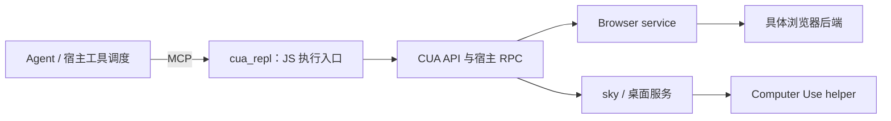

# Agent 插件架构调研与 Helix 对照

核验日期：2026-10-11。本文保存参考产品机制、本机包观察、Helix 源码基线、判断修正及来源。Helix 的改动建议、设计取舍、实施顺序和验收条件另见[优化方案](helix-plugin-architecture-optimization-2026-10-11.md)。

**证据范围。** Codex 部分使用本机安装包、已暴露工具契约、官方文档及固定版本的公开核心源码；Claude Code、Gemini CLI 和 OpenCode 部分使用官方文档；DSH 部分使用固定版本源码及文档；Helix 部分使用各轮核验时的 HEAD 加工作区。公开 Codex 核心快照不等同本机桌面版本。配置引用、源码实现、实际加载和真实任务成功分别记录。本次未执行桌面截图、系统授权变更、真实账号操作或设备验收；也未取得 Codex 私有服务的完整源码。

## 1 核验基线与判断修正

原始源码基线为 `main@542c1ca26d5a170ebb5b6549185ed83af04bf1cc` 加当时工作区。工作区含未提交的 `extensions/chat-reply` 和 Mobile Use 相关改动；这些只作为组合场景线索，不计为已交付能力。文档拆分保留原始快照；同日补充 MCP 接入方式调研时，在 `0be2f2d888668abfbf2e28e61f0a67585fee57fd` 加工作区重新核对了 §4.5 的 Mobile Use 注册路径，未据此重验全文或执行产品、设备验证。

| 前期判断 | 2026-10-11 核对结果 |
| --- | --- |
| 浏览器截图只能回传文件路径 | 已过时。`BrowserScreenshotTool` 调用 `ToolVisualPreparation` 并携带 `visualArtifact`；HXA-225 已接生产视觉通路 |
| R3 插件生命周期尚未开发 | 已过时。HXA-235 已实现统一安装目录、选择、停用、更新、卸载和修复；HXA-251 有有限 Room/设备补验 |
| Helix 没有动态工具发现 | 不成立。`tools.search` 已搜索多种来源；有精确名称优先、零命中保留与禁用过滤 |
| 每个 Codex 插件都有自己的独立 server | 不成立。PDF/Documents 可主要提供 Skill；GitHub/Outlook 引用连接器；本机 CUA 配置同时启用 browser/computer 两个 surface |
| 主流 Agent 的内置插件都应优先通过 MCP 接入 | 样本不支持这条统一规则。核心原生工具、官方组件包和宿主框架插件分属不同层级；MCP 是其中一种接入方式，详见 §2.7 |
| 内置 Computer Use 自动继承 ChatGPT 全部系统权限 | 不准确。本机 MCP 配置指向独立应用身份 `Codex Computer Use`；官方文档要求为其检查录屏和辅助功能授权 |
| Browser Use 与本机 Browser 是同一能力 | 不成立。前者提供任务启动、等待、续接；后者提供浏览器和标签页操作 |
| Codex 没有相应校验，因此 Helix 更安全 | 缺少证据。Browser client 已包含安全错误、凭据恢复和能力限制；服务端内部并未完整核验 |

依据：[HXA-225](../../completion-records/HXA-225.md)、[HXA-235](../../development/tasks/HXA-235.md)、[HXA-251](../../development/tasks/HXA-251.md)、[视觉 ADR](../../adr/agent/011-tool-multimodal-vision-feedback.md)、[当前状态](../../development/status.md)。源码入口见第 6 节。

## 2 参考产品的插件设计

### 2.1 Codex：一个交付包可以组合多种贡献

官方插件架构允许 Skill、MCP server、两者组合和生命周期 hooks，并可提供 UI。插件负责组织安装身份与资源；执行可以发生在本机宿主、隔离运行时或外部服务。Skill 提供任务步骤和结果要求，运行时提供真实能力与状态。[插件架构](https://developers.openai.com/plugins/concepts/plugins)、[Skill 概念](https://developers.openai.com/plugins/concepts/skills)。

可移植包以根 `plugin.json`、`skills/`、`mcp.json` 为基础，OpenAI 扩展配置与兼容 manifest 有独立规则；`.app.json` 对应已注册服务映射。包格式可读取与组件可执行是不同的兼容性结论。[打包说明](https://developers.openai.com/plugins/build/plugins)。

以下八项是本次具体样本；列出的运行形态只到可见接口和本机包所能证明的范围。

| 样本 | 可见入口与执行形态 | 机制特点 | 需要保留的区别 |
| --- | --- | --- | --- |
| Browser Use | `read_public_web`、`automate_browser`、`wait_browser_result`、`continue_browser_session`；返回 run/session 标识和预览，接受模型、成本和期限参数 | 只读任务与可写任务分开；等待不重启任务；延续同一会话 | 任务级委托可以由后端自行规划；工具接口不能证明内部进程或完整取消机制 |
| webcodex | 自定义插件，提供项目/Runner 工具、`tool_manifest`、`observe_jobs`、文件和执行工具 | 按意图发现精确契约；有界日志与游标；观察和执行分开 | 是该插件自己的运行时设计，不能直接称为 Codex 核心的统一实现 |
| Outlook Email | 包通过 `.app.json` 引用连接器；搜索、读取、草稿、回复、发送为不同工具 | 业务对象清晰；草拟与发送可分步完成；账号身份独立 | 写入远程草稿仍是外部写入；不等于只读或无需授权 |
| GitHub | 包引用连接器；文件、issue、PR、review、CI 等类型化操作 | 有界搜索与精确读取；读写操作明确；稳定对象 ID | 插件包里的连接器 ID 和已登录账号不能直接移植到 Helix |
| PDF | Skill 加本地工具，指导提取、生成、表单处理与渲染检查 | 文件逻辑正确性和视觉检查并重；复用通用文件执行能力 | 本机 Python/Poppler 等依赖不能假设在 Android Standard 可用 |
| Documents | Skill、脚本和按任务拆分的参考资料，指导 OOXML、修订和渲染 | 流程资料逐步加载；修改后重开并验证产物 | 不将另一插件提供的 Document Control/Spreadsheets 工具归到 Documents 名下 |
| Computer Use | 本会话通过 `cua_repl` 暴露应用观察和操作；本机配置连接桌面服务 | 系统权限、目标选择、截图/语义观察、接管与停止分层 | 本次未取得完整后端源码；不能由有客户端推定脱离宿主即可运行 |
| Browser | `browser-client.mjs` 经宿主 RPC 访问 Browser service；按 Browser/Tab 提供能力和文档 | 对象作用域明确；动态能力发现；手动接管和任务结束处理 | SDK 中有方法不等于每种后端都支持；当前实例能力才是准入依据 |

PDF 和 Documents 的“生成后检查”首先是工作流指导。只有具体检查工具能强制验证的字段，才构成执行保证。其他插件的只读说明、幂等提示和风险注解也不能代替宿主自身授权。

### 2.2 本机 Browser 和 Computer Use 的真实边界

当前安装的 `unified-computer-use` 包提供 `cua_repl` MCP server 配置；配置同时启用 browser/computer surface，并登记 browser、sky 两个可信服务。Browser 客户端的 `setupBrowserRuntime` 要求宿主提供 `nodeRepl.rpc`，通过 setup、execute、executeWithRecovery 调用服务。

这些事实表明，两项 UI 能力可以共享 REPL 入口并连接不同后端。包名、MCP server、逻辑 service 和 OS 进程是不同概念。配置引用宿主捆绑运行时及桌面服务，单独的 `browser-client.mjs` 不构成已验证可脱离宿主运行的 SDK。

Browser 与 unified-computer-use 的 manifest 还对 Stop、Interrupt、SubagentStop 注册 `turn_ended` hook。这表明存在任务结束的资源收尾入口；manifest 本身不能证明所有清理都成功。

Browser 官方说明将网站访问、下载/上传配置和敏感操作确认作为不同控制；Computer Use 建议在有结构化集成时优先采用专用插件或 MCP，再按任务使用 UI 操作。结构化集成与 UI 操作因此具有不同的使用条件。[Browser](https://learn.chatgpt.com/docs/browser)、[Computer Use](https://learn.chatgpt.com/docs/computer-use)。

### 2.3 Claude Code：组件包、调用资格与依赖

| 方面 | 核验到的机制 | 来源 |
| --- | --- | --- |
| 组件 | 插件包可包含 Skill、子 Agent 定义、hooks、MCP、LSP；Skill 使用插件限定名；提供 `claude plugin validate` | [组件](https://code.claude.com/docs/en/plugins/components) |
| Skill 调用 | 区分用户与模型调用；正文按需装载；重复内容、压缩和子上下文有各自语义 | [Skill](https://code.claude.com/docs/en/skills) |
| 插件依赖 | 支持带版本约束的依赖，跨 marketplace 来源受 allowlist 约束；可用依赖组成安装集合 | [依赖](https://code.claude.com/docs/en/plugins/dependencies) |
| MCP 身份 | 工具名包含插件名和服务器名；限定名用于权限规则、Skill、子 Agent 工具限制和 hooks；配置不变时可保留连接 | [MCP](https://code.claude.com/docs/en/mcp#plugin-provided-mcp-servers) |
| 数据归属 | `CLAUDE_PLUGIN_ROOT` 指向版本内容，`CLAUDE_PLUGIN_DATA` 保存跨更新数据 | [路径与数据](https://code.claude.com/docs/en/plugins-reference#environment-variables) |
| 子 Agent | 定义可携带模型、工具配置和独立上下文，由宿主创建执行实例 | [子 Agent](https://code.claude.com/docs/en/sub-agents) |

插件 MCP 工具的完整形式为 `mcp__plugin_<plugin>_<server>__<tool>`；包依赖使所需组件可获得，不等于任意插件代码自动拥有另一服务的客户端或执行授权。Claude 文档中的 `allowed-tools` 有宿主授权语义；这与 Helix 当前仅保留不可信声明的行为不同。

### 2.4 DSH：宿主插件、服务依赖与实例生命周期

| 方面 | 核验到的机制 | 来源 |
| --- | --- | --- |
| 宿主装配 | Cordis `apply(ctx)` 注册服务和事件；Profile/Bundle 装配插件树；Agent Loop 自身也是插件 | [架构](https://github.com/deepseek-ai/deepseek-harness/blob/d743267388641bc76f17c45ce8b4c231aed1d32c/docs/architecture.md) |
| 服务复用 | `inject` 等待必要服务；消费者通过 `ctx.<service>` 调用；服务可按组隔离实例 | [服务](https://github.com/deepseek-ai/deepseek-harness/blob/d743267388641bc76f17c45ce8b4c231aed1d32c/docs/user/develop/framework/service.md) |
| 依赖失效 | 必要服务消失时卸载消费者，服务恢复后重新加载 | [生命周期](https://github.com/deepseek-ai/deepseek-harness/blob/d743267388641bc76f17c45ce8b4c231aed1d32c/docs/user/develop/framework/index.md) |
| Skill provider | `ctx.skills` 汇集嵌入和文件等来源；统一发现、读取，并区分 `modelInvocable`、`userInvocable` | [Skill registry](https://github.com/deepseek-ai/deepseek-harness/blob/d743267388641bc76f17c45ce8b4c231aed1d32c/packages/skill/skill/README.md) |
| 注册与释放 | `ctx.effect` 将注册和清理归属到实例；Fiber 管理装配和卸载 | [Fiber](https://github.com/deepseek-ai/deepseek-harness/blob/d743267388641bc76f17c45ce8b4c231aed1d32c/vendor/cordis/src/fiber.ts) |
| 事件 | 区分 emit、serial、waterfall；事件通知、按序处理和转换具有不同语义 | [events](https://github.com/deepseek-ai/deepseek-harness/blob/d743267388641bc76f17c45ce8b4c231aed1d32c/docs/user/develop/framework/events.md) |

Plugin Manager 分别反馈保存、应用、失败和待重启：HMR 开启时可应用配置变化，未开启时保留当前装配至重启；替换已加载包代码另报 `restart-required`。Agent preset 更新影响之后创建的 Agent，已有实例保持原组合。因此旧版本“修改后一律重启”的经验不能泛化到当前机制。[Plugin Manager](https://github.com/deepseek-ai/deepseek-harness/blob/d743267388641bc76f17c45ce8b4c231aed1d32c/packages/boot/plugin-manager/README.md)、[Agent preset](https://github.com/deepseek-ai/deepseek-harness/blob/d743267388641bc76f17c45ce8b4c231aed1d32c/packages/preset/agent-preset/README.md)。

Skill 的 model-facing consumer 会将目录更新记录为替换消息，空目录也能撤下旧名称；这涉及内容失效而非仅安装发现。[tool-skill](https://github.com/deepseek-ai/deepseek-harness/blob/d743267388641bc76f17c45ce8b4c231aed1d32c/packages/skill/tool-skill/README.md)。

实例清理和外部副作用结束仍是不同事实。异步 disposer 可并发执行，依赖顺序需要显式等待；服务组隔离是实例解析边界，不等同操作系统沙箱。框架机制的存在不证明所有场景都已可靠执行。

### 2.5 Agent、插件与运行时的分工

插件可以是用户能力包，也可以是宿主基础模块。Helix 当前 `HelixPlugin` 不拥有 AgentLoop；DSH 的宿主插件则可以实现循环。Claude 插件携带 Agent 定义，由宿主创建上下文。**定义一个 Agent、创建执行实例和维护执行循环是不同职责。**

模型通常接收指导与工具 schema，产生工具名和参数；宿主执行调用并回传结果。插件可以提供指导、执行器或客户端配置。Browser JavaScript client 运行在宿主管理的工具环境中，不代表主模型自己持有网络连接。外部服务还可能包含自己的 Agent 和内部循环，工具接口本身不能证明其内部实现。

运行时承载代码、连接和资源；编排负责发现能力、安排调用、等待结果、处理取消并继续任务。两者不要求位于同一进程，插件包也不与 server 或 OS 进程一一对应。

### 2.6 Computer Use 使用 MCP 的机制与设计收益

**可以确认的实现。** 本机 `unified-computer-use/26.1007.21159` 的 `.mcp.json` 将 `cua_repl` 配置为由宿主捆绑 Node 运行的服务，启用 `js`、`js_reset`、`turn_ended` 三个入口。环境配置同时启用 `browser,computer`，登记 `@oai/browser-desktop/service` 和 `@oai/sky/service`；manifest 的 Stop、Interrupt、SubagentStop 调用 `turn_ended`。文件身份见 §6.2 和 §6.4。

逻辑调用关系如下。箭头表达职责和调用关系，不表示每一层都是独立 OS 进程：

MCP 处于宿主到工具入口的边界。内部 API 到 Browser/sky 的调用不能一概称为 MCP；共享 REPL 也不能证明共享同一个执行进程。官方插件架构允许 Skill、MCP 或组合，Codex 的 MCP 客户端支持本地 stdio 与远程 HTTP；协议本身没有要求内置插件必须选择其中一种部署方式。[插件架构](https://developers.openai.com/plugins/concepts/plugins)、[Codex MCP](https://developers.openai.com/codex/mcp)。

**为什么这样设计有价值：以下是基于实现的工程推断。** 本次没有找到说明这一具体选型动机的公开决策记录，不能把收益分析写成 OpenAI 官方原因。

| 可见机制 | 可推断的收益 | 结论边界 |
| --- | --- | --- |
| 用 MCP 发布少量工具入口 | 可以接入宿主已有的工具配置、发现、调用与结果通路 | 具体批准和审计如何覆盖内部动作仍需宿主实现；MCP 本身不提供这些保证 |
| Node 工具入口连接桌面/浏览器服务 | 可以让客户端接口与平台执行实现分别演进 | 本机包仍依赖捆绑运行时、私有 RPC 和服务；未证明可独立分发或脱离宿主运行 |
| 一个 REPL 访问多个 surface | 可以复用调用入口和 JS 组合方式 | REPL、对象 API、状态保持是该工具的设计，不是 MCP 固有能力；未做 token 或延迟收益测量 |
| 生命周期事件调用 `turn_ended` | 为中断、结束后的资源收尾提供统一入口 | hook 被配置不代表每种故障下清理均已完成 |

MCP 包装不会自动取得截图/辅助功能授权，也不会自动隔离所运行的 JS。工具入口的可用 API、目标范围和实际执行服务仍需各自约束。Computer Use 的系统授权归属见第 3 节；“能通过 MCP 调用”与“拥有可移植、独立运行的 Computer Use 引擎”是两项不同结论。

### 2.7 主流 Agent 是否优先用 MCP 接入内置能力

比较前先区分三个层级：

1. **核心内置工具**：产品直接提供的 shell、文件读取/编辑等工具。
2. **随产品提供或官方发布的插件包**：可以携带 Skill、MCP 配置、hooks、LSP 等组件。
3. **宿主框架插件**：通过代码注册工具、服务甚至 Agent Loop，例如 DSH 的 Cordis 插件。

核心工具存在原生路径，足以否定“所有能力必须通过 MCP”，但不能单独证明官方插件包的接入偏好。因此下表分别记录这些层级；本次未统计各产品全部官方插件，不能据此给出 MCP 占比或普遍优先级。

| 产品 | 核心工具或宿主内接点 | 插件/扩展与 MCP 的关系 | 核验结论与来源 |
| --- | --- | --- | --- |
| Codex / ChatGPT | 公开 Codex 核心由 `build_core_tool_registry` 直接注册 `ExecCommandHandler`、`WriteStdinHandler`；`ApplyPatchHandler` 与 `McpHandler` 有各自实现 | 本机 CUA 插件使用 MCP；官方包模型也允许只提供 Skill；桌面私有服务不在公开核心核验范围内 | 样本呈现混合接入，不能把 CUA 的选型推广到所有工具或包。[原生注册](https://github.com/openai/codex/blob/8c0f7011674145da7e10627769fb221c74fbf7a0/codex-rs/core/src/tools/spec_plan.rs)、[MCP handler](https://github.com/openai/codex/blob/8c0f7011674145da7e10627769fb221c74fbf7a0/codex-rs/core/src/tools/handlers/mcp.rs)、[插件组成](https://developers.openai.com/plugins/concepts/plugins) |
| Claude Code | 文档将 Bash、Read、Edit、LSP、Skill 等内置工具与 MCP 扩展区分 | 插件可提供 Skill、agents、hooks、MCP 或 LSP；官方代码智能插件可通过 `.lsp.json` 配置语言服务器 | 连官方插件组件也不限于 MCP；LSP 仍使用自身协议。此结论来自文档，未核验闭源内部执行代码。[工具](https://code.claude.com/docs/en/tools-reference)、[插件组件](https://code.claude.com/docs/en/plugins/components) |
| Gemini CLI | 内置工具进入 `ToolRegistry`；MCP 发现通过 `discoverMcpTools()`，以 `DiscoveredMCPTool` 包装外部工具 | extensions 可组合提示、MCP、命令、主题、hooks、子 Agent 和 Skill | 是共享工具注册表加多种来源；文档没有要求全部内置能力先转换为 MCP。[工具](https://geminicli.com/docs/reference/tools/)、[MCP 集成](https://geminicli.com/docs/tools/mcp-server/)、[扩展](https://geminicli.com/docs/extensions/) |
| OpenCode | 有内置工具；插件可返回 `tool` 定义及直接执行的 `execute` 回调 | custom tools 与 MCP 都是扩展入口，插件代码不必先启动 MCP server | 存在直接注册执行器的插件路径；未据此统计随产品提供的插件比例。[工具](https://opencode.ai/docs/tools/)、[插件工具](https://opencode.ai/docs/plugins/#custom-tools) |
| DSH | `tool-bash` 在 `apply(ctx)` 中直接 `ctx.tools.register(...)`，通过 `inject` 使用 shell 等宿主服务 | 独立 `mcp-client` 插件连接外部 server，并把发现的工具桥接到 `ctx.tools` | 宿主框架插件与 MCP adapter 共存，原生工具无需绕行 MCP。[Bash 插件](https://github.com/deepseek-ai/deepseek-harness/blob/d743267388641bc76f17c45ce8b4c231aed1d32c/packages/shell/tool-bash/src/index.ts)、[MCP 插件](https://github.com/deepseek-ai/deepseek-harness/blob/d743267388641bc76f17c45ce8b4c231aed1d32c/packages/mcp/mcp-client/src/index.ts) |

**综合判断：本次样本支持“统一工具接入与管理，允许多种执行适配”，不支持“内置插件普遍优先 MCP”。** MCP 适合跨宿主共享工具契约、对接外部服务或让执行环境与宿主分开；本机可信实现可以直接注册，跨进程能力也可以先使用平台 IPC。Skill、hooks、LSP 又解决不同问题。是否使用 MCP，应说明需要跨越的运行和互操作边界。

此判断不意味着 MCP 只用于第三方或远程服务：本机 CUA 正是内置能力采用本地 MCP 的实例。Helix 的具体选择另见[优化方案 §6.5](helix-plugin-architecture-optimization-2026-10-11.md#65-按执行边界选择原生ipccli-或-mcp)。

### 2.8 插件与执行分层的总体合理性复核

2026-10-11 进一步对照公开客户端/宿主接口，判断已有 Helix 分层及 HXA-272～279 的合理性。Helix 依据同日[源码分层分析](../modules/01-architecture-and-execution-engine.md#9-2026-10-11-分层复核与优化承接)与 `161f5776293fc2f8fd32d89ea4e814e5a48c3237` 的计划；本节新增外部证据和取舍分析，没有重新执行产品或性能验收。

| 公开机制与来源 | 可以支持的判断 | 对 Helix 的适用边界 |
| --- | --- | --- |
| [Codex App Server](https://learn.chatgpt.com/docs/app-server) 提供会话、审批和流式 Agent 事件，用于接入丰富客户端；使用双向 JSON-RPC 接口 | 客户端展示与执行宿主可以通过稳定命令/事件契约分工 | 支持 AgentRuntime 与 Engine 读投影的方向；不能由此推导 Android 单设备产品必须立即部署独立 server，也不能把 App Server 协议直接等同 MCP |
| [OpenCode Server](https://opencode.ai/docs/server/) 提供 HTTP/OpenAPI 接口，TUI 作为客户端接入 | 独立宿主有利于多客户端和程序化调用 | Helix 完整 Turn 宿主仍依赖 App/Room，独立运行的完成度有差异；是否提取取决于真实消费者和部署需求 |
| [OpenAI 插件架构](https://developers.openai.com/plugins/concepts/plugins) 允许仅含 Skill 的包，MCP 和 UI 按需组合 | 插件交付身份、内容贡献和工具执行应分别表达 | 支持 HXA-272 的零工具插件；插件数量不决定 server/进程数量，原生能力仍按实际边界接入 |
| [Claude Code Skills](https://code.claude.com/docs/en/skills) 区分用户/模型调用、按需读取正文，并说明重复调用与压缩行为 | 调用资格与上下文装载是独立契约 | 支持 HXA-273/278；外部字段的可读取性不导入该宿主的授权语义，Helix 按自身 ADR 执行 |
| [DSH 架构](https://github.com/deepseek-ai/deepseek-harness/blob/d743267388641bc76f17c45ce8b4c231aed1d32c/docs/architecture.md) 通过 Cordis 装配服务，连 Agent Loop 也可作为宿主插件 | 服务贡献、注册撤销与实例归属可以统一管理 | 支持 HXA-277 的最小资源契约；Helix 当前能力插件与 DSH 宿主插件层级不同，全面动态替换核心服务需要额外消费者 |

**综合判断。** 当前方案与样本中的内容/工具分离、客户端/宿主分工、明确状态和资源归属等原则一致。AgentLoop、TurnEngine、调度、执行准入和插件资源分别解决不同问题；同进程类型化接口可承载这些边界。公开样本未提供必须合并这些职责、替换 Room 或增加通用插件容器的依据。

架构合理性、功能完成度和真实任务效果分别评价。当前优先补齐的是插件作者路径、可解释状态、共享资源释放和观察/装载质量；不能以模块数量、减少正文 token 或其他产品使用某协议推导任务收益。Helix 的采用范围与验收映射见[优化方案 §2.1](helix-plugin-architecture-optimization-2026-10-11.md#21-总体合理性与收敛尺度)，尚需产品选择的事项见[待决策索引](../../development/candidate-decisions.md#本轮插件与分层评审的决策结论)。

## 3 系统权限归于执行后端，内置与 MCP 是不同维度

**已核实的本机事实。** `unified-computer-use/26.1007.21159/.mcp.json` 用 ChatGPT 捆绑的 Node 启动 `cua_repl`，登记 `browser`、`sky` 两个服务；`SKY_CUA_SERVICE_PATH` 指向 `Codex Computer Use.app`。该应用的 Info.plist 声明 `CFBundleIdentifier=com.openai.sky.CUAService`、`CFBundleName=Codex Computer Use`。因此当前内置能力本身就有 MCP 入口，也包含独立的 helper 应用身份。

官方 Computer Use 文档要求 macOS 的 Screen Recording 和 Accessibility；Appshots 排错进一步明确检查 **Codex Computer Use** 的这两项权限。合理结论是：多个受支持的入口可以复用宿主管理、已获系统授权的执行服务，不必按 Skill 或工具名重复申请；首次授权、撤销后的恢复和操作系统要求仍然适用。不能概括成“内置包继承 ChatGPT 的全部权限”。本次只检查包配置及应用身份，未读取系统授权数据库，也未验证当前开关状态。[Computer Use 设置](https://learn.chatgpt.com/docs/computer-use#set-up-computer-use)、[Appshots 权限说明](https://learn.chatgpt.com/docs/appshots#limits-and-troubleshooting)。

| 维度 | 解决的问题 | 不能由它推导的结论 |
| --- | --- | --- |
| 内置包 / 外部安装包 | 谁交付、更新、适配依赖 | 内置必然同进程，或外部必然另申请每项系统权限 |
| 原生 port / IPC / MCP / CLI | 如何调用执行能力 | MCP 自带系统权限或进程沙箱；CLI 必然无结构化输出 |
| App / helper / 本地子进程 / 远程服务 | 代码在哪执行、由谁管理生命期 | 一个插件对应一个进程，或同一入口对应同一执行后端 |
| 系统身份与平台授权 | 哪个应用、服务或身份能截图、输入、访问文件 | 获得系统授权就允许任意会话、目标或账号操作 |
| 宿主批准与账号权限 | 当前任务能用哪些动作、数据与账号 | 安装或声明依赖就已经获得执行批准 |

本地 MCP/CLI 如果使用自己的桌面捕获实现，需要满足该执行路径的系统要求；如果通过有明确接口和调用方校验的已授权 helper 执行，可以复用它的能力。仅仅是 ChatGPT 的子进程或安装在插件目录内，不能证明它能使用该 helper。远程浏览器的捕获发生在远端；浏览器自身页面渲染截图也不等同于操作系统桌面录屏。

相关权限分为三层独立事实：**系统允许执行后端做什么；宿主允许本次任务做什么；目标应用/账号允许访问什么**。企业应用 allowlist 同样不能替代安装、系统权限或具体动作批准。[OpenAI 本地权限边界](https://learn.chatgpt.com/docs/enterprise/chatgpt-work-local-security#computer-use-and-application-approvals)。

## 4 Helix 调研时的实现与差距

### 4.1 已有基础和证据边界

| 领域 | 调研时事实 | 差异或验证边界 |
| --- | --- | --- |
| 工具绑定 | R1 已统一 descriptor/executor、绑定身份与撤销，各来源共用治理路径 | 绑定唯一性不等于语义去重 |
| 安装生命周期 | R3 已处理安装、选择、更新、停用、修复与局部失败投影 | 有限 Room/设备证据未覆盖完整在途引用、撤销和进程死亡矩阵 |
| 原生插件 | 贡献工具、bundledSkills、preferredTools、scope 和图像范围 | 无统一服务依赖/实例释放接口；已有领域清理逻辑仍存在 |
| Browser | 12 个 `browser.*` 工具，为 BuiltInOrigin；已有 WebView bridge 和生产视觉链 | 与 Mobile Use 的插件归属不同；当前没有完整 tab list/close、wait 和 role/label locator 组合 |
| Mobile Use | 已有 Skill、目标范围、语义/截图/手势、后端选择、停止和悬浮交互 | 设备/OEM与真实任务质量仍按具体证据判定 |
| 图像 | HXA-225 已接 view_image、browser.screenshot、VisualArtifact 和 Provider 编码 | 文件保存、像素准备、发送和识别是不同事实 |
| 发现 | 多来源 tools.search、窗口和精确名称优先已存在；HXA-252 已交付发现提示 | 原生 bundled Skill 仍整段注入；有限模型对照不能外推 |
| 异步执行 | J1/J2 已支持本地原 Job 观察、等待和后台释放 | 外部委托任务的 provider 不是自动获得支持 |
| 执行环境 | Android 原生、隔离 QuickJS、PRoot/CLI 各有边界 | 桌面 Skill 依赖不等于 Android Standard 已具备依赖 |

### 4.2 设备服务与系统权限

内置 native 插件通过 APK 已知工厂装配，可以复用同一 `AutomationPermissionCenter` 和设备服务。当前 Accessibility 截图实现调用 `takeScreenshot`，API 34 起在适用范围调用 `takeScreenshotOfWindow`，服务配置声明 `canTakeScreenshot`。这一路径与 `MediaProjection` 不同；不能把后者每次投屏会话需用户同意的规则套在所有截图后端上，也不能将已有 Accessibility/Root/Shizuku 授权理解为任何插件自动获准。插件选择、目标 scope、动作授权和截图向模型披露仍按本请求检查。[截图实现](../../../extensions/mobile-use/src/main/kotlin/com/helix/extensions/mobileuse/automation/AutomationScreenshotCapture.kt)、[服务配置](../../../extensions/mobile-use/src/main/res/xml/helix_accessibility_service.xml)、[Android MediaProjection](https://developer.android.com/media/grow/media-projection#user_consent)。

原生同进程模块的接口约束不等于恶意代码隔离。Helix 当前只装配 APK 已知、可信的 native 工厂；插件 manifest 不构成第三方可执行代码的系统隔离边界。

### 4.3 Skill 激活与调用规则

`selectedRuntimes` 要求插件已有 published tools；`PluginRegistry.instructions` 又从已准入 descriptor 反查插件，再拼接所有 bundled skill 正文。可移植 Skill 已有独立路径，但原生插件的纯指导能力难以独立激活，长 Skill 也容易增加每轮输入。

`SkillLoader` 目前将 `disable-model-invocation`、`user-invocable` 等保存到 `additionalFields`；`SkillCatalogEntry` 和 `SkillRepository.read` 没有相应调用方策略。因此不能把现有全局/会话启停称为已经实现“仅用户可调用”。`SkillKey(source, name, snapshotHash)` 已提供精确身份，应保留。

### 4.4 MCP 身份与工具冲突

MCP 规范将工具名称唯一性的范围限定在单个 server，聚合客户端应消除跨 server 名称歧义；`serverInfo.name` 也不是可靠的全局身份。[MCP Tool Names](https://modelcontextprotocol.io/specification/2026-07-28/server/tools#tool-names)。Helix 已通过 `mcp.<serverId>.<tool>` 隔离来源；`ToolBindingStore` 以 `(name, version)` 检查冲突，冲突时保留原快照。这是绑定唯一性机制，不是语义去重或自动择优。[McpToolSource](../../../tools/framework/src/main/kotlin/com/helix/tools/framework/ToolSource.kt)、[ToolBindingStore](../../../tools/framework/src/main/kotlin/com/helix/tools/framework/ToolBindingStore.kt)。

### 4.5 Mobile Use 的原生注册路径

同日补充核验时，Developer 变体的 [AutomationModule](../../../app/src/developer/kotlin/com/helix/app/automation/AutomationModule.kt) 构造 `MobileUsePlugin`，再调用 `plugins.register(plugin)`。[MobileUsePlugin](../../../extensions/mobile-use/src/main/kotlin/com/helix/extensions/mobileuse/MobileUsePlugin.kt) 实现 `HelixPlugin`，使用 `ToolOrigin.PluginOrigin`，将描述符和执行器组成 `List<ToolBinding>`；设备工具复用 `AutomationPermissionCenter`。这是 APK 已知 native contribution 的注册路径，没有通过 MCP server 发现这些工具。

注册关系可以概括为：`AutomationModule → MobileUsePlugin → PluginRegistry → ToolBinding / ToolRegistry`；实际调用进入既有 Dispatcher 链。相对地，外部 MCP 能力通过 [McpDynamicToolBridge](../../../extensions/mcp/src/main/kotlin/com/helix/extensions/mcp/McpDynamicToolBridge.kt) 适配进同一工具执行体系。设备后端内部采用什么 Android 服务或 IPC，不改变上层工具来源的分类。

这解释了 Helix 与本机 CUA 的差异：两者都能由插件贡献设备能力，但当前使用的工具适配方式不同。此处只证明注册机制，未验证设备任务成功，也不表示 Helix 已能把 Mobile Use 作为 MCP server 对外提供。后者与现有 MCP 客户端导入工具是相反方向的能力。

## 5 跨产品共同点与复用结论

### 5.1 共同管理对象与实现差异

| 共同管理对象 | 实现差异 |
| --- | --- |
| 插件身份、版本、来源与组件归属 | Skill-only、APK 已知 native、远程 MCP 等实现方式 |
| 会话选择、工具发现和请求中的精确绑定 | 本地函数、Android IPC、远程协议的 transport |
| 模式、权限、副作用和数据披露 | 各领域动作与错误语义 |
| 调用身份、取消结算、审计和产物归属 | WebView tab、Android target、远端 session/job 的资源形态 |
| 用户可理解的配置和修复入口 | 文档渲染、浏览器预览、移动悬浮窗等展示 |

### 5.2 合并和复用不是单一操作

| 操作 | 含义 | 边界 |
| --- | --- | --- |
| 包组合 | 用依赖组成安装集合 | 包身份、配置和版本仍各自存在 |
| 能力归组 | 将相似工具放入同类发现入口 | 描述或 schema 相同不证明语义等价 |
| 实现共享 | 多个消费者调用同一服务 | 需要明确调用上下文、状态及资源归属 |
| 提供方替换 | 同一接口选择不同后端 | 目标、账号、权限和结果语义必须相容 |

桌面截图、WebView 页面截图和远程浏览器截图可以同属截图类别，但执行位置、登录态、坐标与授权不同。相同服务 URL 也不足以证明两个连接可合并，认证身份、配置和生命周期仍可能不同。

跨插件复用可观察为三类：Skill 指导宿主 Agent 调用另一插件工具；可信模块通过服务接口直接复用；复合工具或代理显式连接另一个服务。同一 Agent 连接两个 MCP server，并不会自动给 server A 提供调用 server B 的入口。包依赖、运行时服务注入和授权委托是不同机制。

### 5.3 产品差异汇总

| 系统 | 已核实的复用方式 | 尚不能由证据推导的结论 |
| --- | --- | --- |
| Codex/ChatGPT | CUA 共享入口连接 Browser/桌面服务；系统 helper 与插件/任务批准分层 | 任意插件可直接调用私有服务，或所有等价工具会自动合并 |
| Claude Code | 依赖包、限定工具名、Skill/子 Agent 工具组合和 MCP 连接生命周期 | 包依赖等同进程内服务注入或自动授予系统权限 |
| DSH | `inject`、`ctx`、服务作用域以及消费者卸载/重载 | 服务组隔离就是 OS 沙箱，或 dispose 完成就代表业务副作用结束 |
| Gemini CLI | 原生工具与 MCP 包装进入 ToolRegistry，扩展可组合多种组件 | 全部内置或官方扩展优先采用 MCP |
| OpenCode | 原生工具、插件 execute 回调和 MCP 均可扩展能力 | 同名覆盖就是等价能力合并，或所有官方插件采用同一种路径 |
| Helix | 构造注入、统一权限中心、MCP 命名空间、精确绑定及领域后端 | 已有通用依赖求解、语义去重或受控跨工具嵌套执行 |

本表是事实和证据边界的比较。采用哪些机制、先实现哪些增量，由[Helix 优化方案](helix-plugin-architecture-optimization-2026-10-11.md)承接。

## 6 证据与复核入口

### 6.1 Helix 当前源码和契约

| 证据 | 对应结论 |
| --- | --- |
| [PluginRegistry](../../../extensions/plugin/src/main/kotlin/com/helix/extensions/plugin/PluginRegistry.kt) | 原生贡献、工具发布、selectedRuntimes 与 native readiness |
| [PluginExecutionContext](../../../extensions/plugin/src/main/kotlin/com/helix/extensions/plugin/PluginExecutionContext.kt) | scope、图像范围与 bundled Skill 注入逻辑 |
| [SkillDocument](../../../extensions/skills/src/main/kotlin/com/helix/extensions/skills/SkillDocument.kt) / [SkillLoader](../../../extensions/skills/src/main/kotlin/com/helix/extensions/skills/SkillLoader.kt) | 当前元数据及附加字段，尚未类型化用户/模型调用资格；allowed-tools 不授予权限 |
| [SkillRepository](../../../extensions/skills/src/main/kotlin/com/helix/extensions/skills/SkillRepository.kt) / [SkillTools](../../../extensions/skills/src/main/kotlin/com/helix/extensions/skills/SkillTools.kt) | 现有 source/name/snapshotHash 身份、会话/全局启停和资源读取 |
| [PluginService](../../../app/src/main/kotlin/com/helix/app/plugin/PluginService.kt) / [PluginInstallationService](../../../app/src/main/kotlin/com/helix/app/plugin/PluginInstallationService.kt) | 已有安装、选择、启停、修复及连接配置 |
| [PluginReadinessSnapshot](../../../app/src/main/kotlin/com/helix/app/plugin/PluginReadinessSnapshot.kt) / [CapabilityReadiness](../../../app/src/main/kotlin/com/helix/app/readiness/Readiness.kt) | 现有就绪投影，不能等同具体请求的执行批准 |
| [BrowserTools](../../../tools/browser/src/main/kotlin/com/helix/tools/browser/BrowserTools.kt) / [BrowserOutputTools](../../../tools/browser/src/main/kotlin/com/helix/tools/browser/BrowserOutputTools.kt) | 12 工具与 built-in 来源；截图 VisualArtifact |
| [ToolVisionServices](../../../app/src/main/kotlin/com/helix/app/vision/ToolVisionServices.kt) / [ToolVisualFeedback](../../../app/src/main/kotlin/com/helix/app/chat/ToolVisualFeedback.kt) | 生产浏览器视觉注册及请求历史图像恢复 |
| [BrowserController](../../../feature/browser/src/main/kotlin/com/helix/feature/browser/BrowserController.kt) / [Browser 生命周期 ADR](../../adr/platform/002-browser-lifecycle.md) | Activity-owned WebView 与逻辑 tab 的分工 |
| [MobileUsePlugin](../../../extensions/mobile-use/src/main/kotlin/com/helix/extensions/mobileuse/MobileUsePlugin.kt) / [android-ui-task](../../../extensions/mobile-use/src/main/assets/plugins/mobile-use/skills/android-ui-task/SKILL.md) | Android 工具、截图/手势指导、接管与收尾 |
| [McpToolDiscovery](../../../app/src/main/kotlin/com/helix/app/mcp/McpToolDiscovery.kt) | 跨来源检索、精确名称优先、零命中与窗口行为 |
| [ToolBindingStore](../../../tools/framework/src/main/kotlin/com/helix/tools/framework/ToolBindingStore.kt) / [McpToolSource](../../../tools/framework/src/main/kotlin/com/helix/tools/framework/ToolSource.kt) | 精确绑定冲突拒绝和 MCP 来源命名空间；不等于语义去重 |
| [McpDynamicToolBridge](../../../extensions/mcp/src/main/kotlin/com/helix/extensions/mcp/McpDynamicToolBridge.kt) | MCP 执行进入 Dispatcher 后调用；endpoint/schema 变化、取消和期限保留原事实 |
| [HXA-252](../../completion-records/HXA-252.md) | 通用发现提示已交付；有限模型对照不代表其他任务或模型的普遍收益 |
| [HXA-235](../../development/tasks/HXA-235.md) / [HXA-251](../../development/tasks/HXA-251.md) / [status](../../development/status.md) | 插件生命周期已交付与尚未关闭的验证范围 |
| [Harness 方案](../../architecture/harness-refactor-plan.md) / [候选索引](../../development/candidate-decisions.md) | Job、Code Mode、远程与文档等能力的既有承接边界 |

### 6.2 Codex 样本身份

本机包路径以下列 marketplace/name/version 表示，避免把机器路径写入仓库。包内容支持版本化观察，不代表公开源码或跨宿主可运行。

| 样本 | 本次身份与观察材料 |
| --- | --- |
| Browser | `openai-bundled/browser/26.1007.21159`；manifest、docs/api.json、Browser 文档与 client/service 脚本 |
| Computer Use | `openai-bundled/computer-use/1.0.1001425`；manifest；本会话 CUA 工具契约 |
| CUA 共享入口 | `openai-bundled/unified-computer-use/26.1007.21159`；manifest 中的 hooks、.mcp.json 中的 server/surface/service 配置；所指向 helper 的 Info.plist 身份为 `Codex Computer Use` / `com.openai.sky.CUAService`，未检查当前系统授权状态 |
| PDF | `openai-primary-runtime/pdf/26.1007.11041`；manifest、skills/pdf/SKILL.md |
| Documents | `openai-primary-runtime/documents/26.1007.11041`；manifest、skills/documents/SKILL.md 与任务资源目录 |
| GitHub | `openai-curated-remote/github/0.1.12-5f7cd798dc99`；manifest、.app.json、当前工具声明 |
| Outlook Email | `openai-curated-remote/outlook-email/0.1.8`；manifest、.app.json、当前工具声明 |
| Browser Use | 本会话 `browser_use_*` 四个工具声明；没有据此核验服务端部署或物理进程 |
| webcodex | 本会话 `webcodex_*` 工具声明，特别是 tool_manifest、observe_jobs；未据此推导它就是 Codex 内部架构 |

本机 Browser/Computer Use manifest 虽声明 skills 路径，本次 Browser 的该目录没有实际 SKILL.md；比较使用包内 docs、客户端和当前工具文档，不将声明路径当作读到 Skill 的证明。PDF/Documents 的 SKILL.md 则已实际读取。

关键包文件 SHA-256：

- Browser `scripts/browser-client.mjs`：`ce253a7fdaaac7f1845283be71a57510feda7422e7e7b2194a72eb2b2ba1522e`。
- Browser `scripts/browser-service.mjs`：`1539788b8be0b5ebbf50b9a635511dd6513902527b2960837882c50f7cec7dc5`。
- Unified Computer Use manifest：`ad7df426996e2628655ea2efb7789491feb9e6e3ac8d6ab1c7bbcd0eec9d398d`。
- Unified Computer Use `.mcp.json`：`f5214891c4557a54a6edeb749b0c759bf2fff20d86626f07c5dc85cb0d922ae8`。
- PDF `SKILL.md`：`a6e20f4ae66364a06d577dd51e0ce66ee2ef955be129cbe195e0a27f403daaf8`。
- Documents `SKILL.md`：`c9b9ba61ac15f20a600220bc10a380c7753992bbd3c323bfe33fae864adefc21`。

官方资料核验日期均为 2026-10-11。私有接口与本机包只支持上述可见行为；服务实现、平台兼容性和任务成功率分别需要源码或运行证据。

### 6.3 Claude Code 与 DSH 的补充证据

Claude Code 使用同日官方在线文档，不将文档描述称为本机实测。重点是[组件](https://code.claude.com/docs/en/plugins/components)、[Skill](https://code.claude.com/docs/en/skills)、[依赖](https://code.claude.com/docs/en/plugins/dependencies)、[hooks](https://code.claude.com/docs/en/hooks)、[子 Agent](https://code.claude.com/docs/en/sub-agents)及[manifest](https://code.claude.com/docs/en/plugins-reference)；未来版本变化按字段重新核对，不能混用 Claude Code、Claude 网页端与其他宿主的支持范围。

DSH 使用官方仓库 `deepseek-ai/deepseek-harness`。本地 checkout 为 `c69f1613fde6f01631452e18f5cd79cf90db98ad`；本次只读核对远端 `master` 为 `d743267388641bc76f17c45ce8b4c231aed1d32c`，下列相关文件与该上游版本无差异，因此外部链接固定到上游 SHA。没有启动 DSH、安装包或执行真实模型任务。

| 源码 | 支持的判断 |
| --- | --- |
| [Cordis Fiber](https://github.com/deepseek-ai/deepseek-harness/blob/d743267388641bc76f17c45ce8b4c231aed1d32c/vendor/cordis/src/fiber.ts) | 实例状态、effect 注册与等待卸载；不等于业务副作用回滚 |
| [Skill registry](https://github.com/deepseek-ai/deepseek-harness/blob/d743267388641bc76f17c45ce8b4c231aed1d32c/packages/skill/skill/src/index.ts) | 嵌入 Skill 与 provider 统一入口、调用资格、作用域和旧注册失效 |
| [Plugin Manager](https://github.com/deepseek-ai/deepseek-harness/blob/d743267388641bc76f17c45ce8b4c231aed1d32c/packages/boot/plugin-manager/src/index.ts) / [结果类型](https://github.com/deepseek-ai/deepseek-harness/blob/d743267388641bc76f17c45ce8b4c231aed1d32c/packages/boot/plugin-manager/src/types.ts) | 已保存变更与 applied/restart-required/overridden/failed/cancelled 分开 |

采用的是具体机制及约束，不是“某产品更先进”的整体判断。DSH 文档也记录了 provider 失效、同名覆盖和异步清理等限制，不能把 framework 的存在当作所有场景已可靠运行的证据。

### 6.4 本轮 MCP 接入方式补充证据

补充核验日期为 2026-10-11。Codex 公开仓库使用读取当时的 `8c0f7011674145da7e10627769fb221c74fbf7a0` 固定链接；此 SHA 不用于代表本机 Codex/ChatGPT 私有运行时。DSH 的两处工具接入文件与 §6.3 所列上游 SHA 无差异。Claude Code、Gemini CLI、OpenCode 使用同日官方文档；没有在本机运行这三个产品验证调用。

| 证据 | 定位与支持范围 |
| --- | --- |
| [Codex spec_plan.rs](https://github.com/openai/codex/blob/8c0f7011674145da7e10627769fb221c74fbf7a0/codex-rs/core/src/tools/spec_plan.rs#L1295) | `UnifiedExec` feature 分支直接注册 ExecCommandHandler 与 WriteStdinHandler，证明存在原生工具接点 |
| [Codex apply_patch.rs](https://github.com/openai/codex/blob/8c0f7011674145da7e10627769fb221c74fbf7a0/codex-rs/core/src/tools/handlers/apply_patch.rs#L284) / [mcp.rs](https://github.com/openai/codex/blob/8c0f7011674145da7e10627769fb221c74fbf7a0/codex-rs/core/src/tools/handlers/mcp.rs#L133) | 两类 ToolExecutor/CoreToolRuntime 实现，McpHandler 另走 MCP 调用；不推定本机版本启用了哪些 feature |
| Unified Computer Use `.mcp.json` 与 manifest | 三个入口、两个 surface、可信服务映射及结束 hooks；文件哈希见 §6.2，不包含私有服务实现或系统授权实测 |
| [Claude 工具](https://code.claude.com/docs/en/tools-reference) / [插件组件](https://code.claude.com/docs/en/plugins/components) | 内置工具、MCP 扩展及官方 LSP 插件组件的区分 |
| [Gemini 工具](https://geminicli.com/docs/reference/tools/) / [MCP](https://geminicli.com/docs/tools/mcp-server/) / [extensions](https://geminicli.com/docs/extensions/) | ToolRegistry、MCP discovery/wrapper 与多组件扩展 |
| [OpenCode 工具](https://opencode.ai/docs/tools/) / [plugins](https://opencode.ai/docs/plugins/#custom-tools) | 内置工具、自定义 execute 和 MCP 并存；文档允许插件同名覆盖，Helix 不据此采用覆盖策略 |
| [DSH tool-bash](https://github.com/deepseek-ai/deepseek-harness/blob/d743267388641bc76f17c45ce8b4c231aed1d32c/packages/shell/tool-bash/src/index.ts#L542) / [mcp-client](https://github.com/deepseek-ai/deepseek-harness/blob/d743267388641bc76f17c45ce8b4c231aed1d32c/packages/mcp/mcp-client/src/index.ts) | 前者通过 ctx 注册工具并注入服务，后者单独桥接 MCP；未启动连接或执行 Bash 工具 |
| Helix Developer AutomationModule 与 MobileUsePlugin | §4.5 所列 HEAD 加工作区的原生注册关系；原始调研快照与本轮核验范围分开记录 |

后续若要判断某产品“优先”哪种接入方式，应再统计该版本随产品提供的插件清单，逐项区分组件类型，并寻找官方选型准则；当前样本只用于核实可行路径及反例。

### 6.5 总体合理性复核的补充来源

§2.8 的 Codex App Server、OpenAI 插件架构、Claude Skills 和 OpenCode Server 均使用 2026-10-11 读取的官方在线文档；DSH 沿用 §6.3 的固定版本架构证据。新增的是公开宿主接口与 Helix 分层的比较，没有据此确认私有 Computer Use 后端实现，也没有在这些产品上运行对照任务。在线文档后续可能变化，实施时应重新核对涉及的协议与字段。
