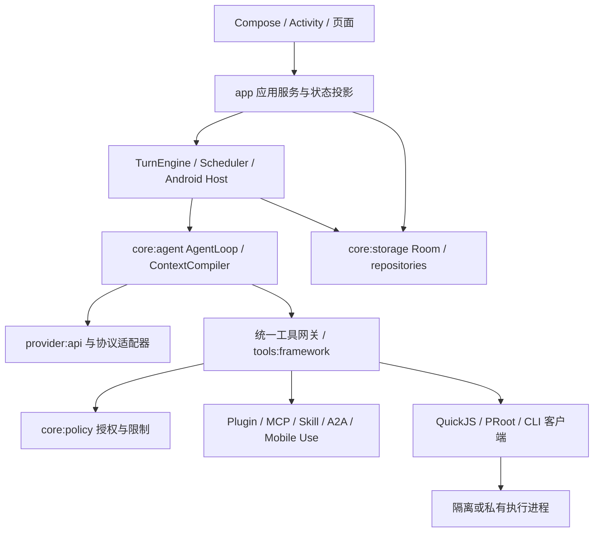

# 代码架构、文件组织与测试留存审查（2026-10-10）

本轮是所有者要求的全系统结构分析和整理建议，不是新增实现计划或架构决定。实施范围仍由 [status](../../development/status.md)、当前 HXA 和 accepted ADR 决定。本轮没有修改生产代码、删除测试、操作设备或调用真实模型。

## 1. 结论与证据范围

需要有界整理，优先处理应用层职责聚集、UI 数据接口、测试入口和夹具。现有模块已经覆盖核心循环、协议适配、授权、持久化、工具、扩展和隔离 Runtime；没有足够证据支持推倒重写、全面合并模块或引入新框架。

基线为 `5d3f89e0765d4adb255a21c4fdd0da967d64606e`。读取根 AGENTS、产品说明、当前 status、开发/留存规则、架构概览、Gradle 配置、相关入口和测试；使用现有 CodeGraph CLI 1.6.0 查询候选关系，并核对当前源码。索引的符号关系不是所有运行时调用的证明；没有把大量字段/导入节点当作独立调用者，也没有据此认定代码不可达。

统计来自当前 `git ls-files`，不是整个磁盘，也不是测试方法数：

| 项目 | 规模与口径 |
| --- | --- |
| Gradle | 默认 34 个项目，另有 3 个 opt-in spike；根项目不计入 |
| Kotlin | `main` 1,373，consumer/developer 合计 89；debug/developerDebug 合计 9；测试 source set 合计 1,136 个文件 |
| app | `main` 532，developer 79，consumer 10；JVM 测试 215，设备测试 415 个文件 |
| 脚本 | 根目录稳定 Python/Shell 入口 93；日期目录已跟踪 568、未跟踪 229 个 Python/Shell 文件 |
| 文档 | 已跟踪 completion-records 207、bug-fixes 143、evidence 272 个 Markdown 文件 |

Kotlin 数量包含已跟踪 spike/历史实验 source set，不能当作默认 APK 的编译规模。未跟踪脚本数是盘点瞬时值，含本轮一次性盘点脚本，不能作为可删除清单。行数只用于定位阅读候选，不是拆分类的验收标准。

本地明细和源码 SHA256 在忽略的 `build/architecture-audit-20261010/inventory.json`；主机测试输出在同目录 `python-tests.log`。长期结论在本文，机器路径、用户数据和生成制品不进入文档。

## 2. 当前系统结构与应保留的边界

下图是职责关系，省略具体子模块和回调，不是完整 Gradle DAG。

| 区域 | 判断 | 整理方向与边界 |
| --- | --- | --- |
| `core:model` / `core:policy` / `core:agent` | 保留 | 值与契约、授权、模型/工具循环不同；纯核心不吸入 Android UI、Room 或执行基础设施 |
| `core:storage` / `core:workspace` | 保留 | 前者是 Android 持久化实现，后者是工作空间/产物职责；`core` 名称不代表每个模块都是纯 JVM。UI 应接应用读模型，避免扩大 `HelixStorage` 暴露 |
| provider API、Chat、Responses、Anthropic | 保留 | 协议编码、流式终止和错误处理是独立回归边界；仅合并证明同语义的解析/诊断辅助，不合并协议分支 |
| tools 与 feature/browser、feature/files | 保留 | 工具策略入口与用户可见功能不同；browser bridge 方向已有约束，不把 UI 放入工具引擎 |
| plugin / skills / mcp / a2a / mobile-use | 保留已统一目录和 binding | 安装、发现、快照、会话选择、设备执行不是同一职责。R1/R3 已交付，不另建第二套注册表或安装状态 |
| runtime `*-core` / `*-ipc` / `*-client` / `*-app` | 保留 | 客户端、IPC、执行进程不是冗余目录；manifest 实际声明 `:proot`、`:subscriptions`、`:model_runtime` 等非导出私有进程，QuickJS 另有 `isolatedProcess` 服务。共享 UID 不等于凭据隔离 |
| Standard / developer source sets、`files-allfiles`、root | 保留平台/渠道差异 | 同名实现可能是渠道替代，不能按重复文件直接删除；必须以 merged manifest 和 variant boundary 校验 |
| `DefaultAppContainer`、`MainActivity` | 保留 composition/navigation 主入口 | 它们集中接线有合理性；只提取真实 feature factory/route，保持共享实例、生命周期与初始化顺序 |
| spikes、testing | 分开标记实验与支持面 | 普通构建排除实验，但全量 host gate 显式覆盖；没有证据支持整体删除实验或把测试辅助并入生产核心 |

## 3. 有源码依据的整理项

### A. 收敛 ChatService 的应用层职责（高价值，较高回归风险）

[`ChatService.kt`](../../../app/src/main/kotlin/com/helix/app/chat/ChatService.kt) 当前 4,612 行。它同时持有会话列表/搜索、草稿/附件/分享、会话配置、Goal 和恢复、活动/工具/计划等界面状态、提交与运行协调。已经存在 `ChatScreenProjection`、`SessionActionQueue`、`ChatToolCalls`、附件辅助和 `AgentLoopHost`；这些是真实拆分基础，不能重新实现已有功能。

建议逐个迁移完整状态与操作所有权：

1. 会话应用服务：列表、搜索、归档、分支、模型和会话配置；保留现有 `SessionActionQueue` 的动作协调，不误把队列当成已完成的业务服务。
2. 输入协调器：草稿、附件暂存、分享和排队输入；同一状态只保留一个 owner，避免复制锁、队列和 pending send。
3. 界面投影：复用已有 projection，拆分对话、任务/活动、Goal 读模型和刷新职责，保留持久事实驱动。
4. 最后让 ChatService 成为薄接线/兼容入口；迁移后的调用者使用窄接口，不能留下永久两套 owner。

**不合并** `AgentLoopHost`、`TurnCoordinator`、`TurnEngine`：前者是 Android/Core ports 接线，中间承载 Turn 状态操作，Engine 是运行/提交/结算唯一 owner。改变文件布局不应产生第二个模型循环或改变恢复重放语义。验收需包含精确提交重试、跨会话输入、取消/UNKNOWN、Steer/Queue、附件/分支及进程恢复；编译通过不足以验收。

### B. 整理 UI 数据接口和文件归属（高价值，适合先做小切片）

审查时 `EgressRuleSection.kt` 接收 `HighSensitivityRuleRepository`，在 Composable 内构造授权规则并读/存/撤销；`SettingsScreen` 和 `MainActivity` 沿链传递仓储。它实际使用 `Dispatchers.IO`，不能把它描述为已证实的主线程数据库阻塞或直接 DAO 访问。问题是页面同时承担业务校验与持久操作编排，测试和变更边界不清晰。HXA-255 的迁移入口为当前 [`permissions/ui/EgressRuleSection.kt`](../../../app/src/main/kotlin/com/helix/app/permissions/ui/EgressRuleSection.kt)，验收状态以 status 为准。

审查时 [`ProjectSessions.kt`](../../../app/src/main/kotlin/com/helix/app/projects/ui/ProjectSessions.kt) 已通过 `ProjectService` 操作，但显示状态仍是 `List<SessionEntity>`，泄露 Room 层类型。建议提供必要字段组成的会话读模型；权限页面通过应用 service/state/action 接口保留 fail-closed 校验、错误反馈和取消语义。

文件布局先在现有 app 模块内按功能归属 `chat/ui`、`projects/ui`、`permissions/ui`、`provider/ui`、`extensions/ui`；把通用布局留在共享 UI 包。这是目标示例，不要求一次性重命名所有文件，也不新建几十个 Gradle 模块。迁移检查内部可见性、字符串/Compose testTag、导航和 consumer/developer 调用者。禁止把重排目录说成性能修复。

### C. 移除生产代码中的测试专用结算桥（中高价值，中风险）

[`TurnCoordinator.kt`](../../../app/src/main/kotlin/com/helix/app/agent/TurnCoordinator.kt) 的 `settleFixtureTerminal`、`parkFixtureForReview`、`completeResponseOrContinueFixture` 明确 deprecated 为 fixture-only，但当前多个设备测试仍调用它们。它们直接创建 `TurnSettlement` / `TurnReviewParking`，是已知测试迁移债，不是无人使用的死代码。

先区分两类：验证完整 admission/terminal/review 的旅程应走真实 TurnEngine；仅需准备持久状态的测试使用命名清晰的测试源集夹具。复用现有测试提交辅助，不让所有 repository 单测启动完整 Engine。迁移后核对所有调用者、原断言和失败/恢复路径，再移除生产桥；不得直接删掉调用它们的测试或用简单内存标志替代真实 Room 事实。

### D. 对齐 Python host 测试入口（优先、风险低）

审查基线中 [`check-all.sh`](../../../scripts/check-all.sh) 的 source gate 逐项枚举测试文件，CI 的 `test_ci_*.py` 另行 discovery。18 个 `scripts/tests/test_*.py` 中以下 5 个没有被此入口选中，限定检查 `.github`、`scripts/ci`、开发文档和稳定脚本说明也未发现额外明确选中入口：

- `test_public_oauth.py`：扫描豁免只允许精确声明。
- `test_export_codex_mcp.py`：导出脱敏、非法 TOML/大小边界。
- `test_emulator_input.py`：只改指定配置，设备调用用 Mock。
- `test_cli_result_owner_runner.py`：组件状态解析与 Android user 隔离。
- `test_summarize_android_tests.py`：空结果、失败、skip 和重复尝试不能当成功。

它们不是过期测试。2026-10-10 本轮执行 `python3 -m unittest discover -s scripts/tests -p 'test_*.py'`，**143 项通过**，没有启动设备、读取真实配置或调用模型。建议统一 discovery（保留独立 `test-review-gates.py`），或让明确清单对遗漏文件 fail closed。CI 只执行这些 host fixture 测试，不执行实际设备 runner。不要为了避免新增测试被发现而维持易遗漏的长清单。

### E. 构建接线与复杂执行类（次优先）

根 [`build.gradle.kts`](../../../build.gradle.kts) 同时包含项目分类、依赖 map、Android/JVM convention 和多项模块特例。建议先修正过时注释、为新模块接入补齐稳定门禁；当一个独立切片证明多处规则重复时才提取本仓 convention，保持锁文件、verification metadata 和渠道校验。没有依据现在全面改为新构建框架或升级依赖。

`ToolDispatcher` 1,319 行、`ProotJobRunner` 1,024 行、`WorkspaceArtifactStore` 935 行、`ProviderService` 753 行是后续阅读候选，**本轮没有证明其中每项需要拆分或性能有缺陷**。优先观察 Dispatcher 的 schema→policy→authorization→limits→verification/audit 顺序，以及 Job/产物的持久身份；辅助解析可下沉，权威状态不可按技术步骤碎片化。文件长度本身不能授权修改执行语义。

## 4. 历史测试、脚本与结果：哪些能整合或删除

遵循既有 [唯一留存规则](../../development/README.md#git-跟踪与留存) 和 [debug 入口](../../../scripts/debug/README.md)。本轮不做批量删除；全系统盘点不足以证明 568 个历史脚本逐个无依赖。

| 类型与当前实例 | 判断 | 清理/整合条件 |
| --- | --- | --- |
| 当前生产契约回归，含早期 Turn/权限/恢复/协议用例 | 保留 | 年龄不能证明过期；已改变契约的断言迁移到 accepted 决定，并保留取消、边界和恢复覆盖 |
| `AttachmentE2eDeviceTest`（2,077 行）、附件重试等大设备套件 | 可按行为拆分 | 用共享夹具减少初始化重复，保持测试名称、结果身份与原断言；JVM fake 与真实 Room/设备验证不是自动重复 |
| TurnCoordinator fixture-only 桥调用测试 | 迁移后清理桥 | 见 C；覆盖契约保留，不能用删除测试消除 deprecated 提示 |
| `scripts/debug/2026-09-09/extract-chat-responsibilities.py` 等一次性源码编辑器 | 不作为当前迁移入口 | 该实例按旧字符串位置写源码，不能在当前源码重跑。可在核对历史引用、已有 cleanup 记录和可从 Git 恢复后移出活跃树；保留可读来源指针。不能由此推断所有日期脚本都如此 |
| `scripts/debug/2026-09-09/run-owned-emulator.py` | 当前为薄兼容 shim | 实现已在稳定根入口，不是重复引擎；新引用用根入口，旧路径等引用迁移后再考虑删除 |
| 日期目录中的复现 runner、夹具和有效评测输入 | 保留或提升稳定入口 | 能复现独有缺陷/边界的工具保留；真正通用 runner 提升并测试，原路径仅做兼容，不新增第二套实现 |
| 未跟踪的一次性编辑脚本 | 逐项确认、默认 local | 229 的瞬时计数不代表垃圾；保留他人/未完成工作，先确认来源与唯一内容，再按政策本地归档 |
| 可重建 APK、Gradle cache、重复 build 输出 | 本地可清理 | 确认无人使用、无唯一失败证据；不跟踪生成制品，不清整个 build/debug 目录 |
| 唯一失败 logcat、trace、截图、真实模型原始回执 | 保留所需证据 | Git 不会恢复未跟踪原始证据；先摘要、脱敏并保存必要原件/哈希/来源。不能只保留最终绿灯 |
| completion/bug-fix/evidence 文档 | 改进索引，不按日期删除 | 原记录证明当时的范围；最新 baseline 摘要链接旧记录，独有失败与身份保留，不能把历史未测改成后来通过 |
| 条件 `assumeTrue` / skip | 分清前提，不认定过期 | 缺少可选真实 profile 是 skip；提供了无效输入必须失败。设备编译、host 通过、历史结果均不替代本轮设备 pass |

建议用“当前契约→测试层级→稳定命令→最新合适证据→历史独有缺陷”的索引组织，而不是再建一个可变总完成日志。只合并可重复的搭建和报告逻辑，不合并不同协议、渠道、进程死亡或平台限制的独立断言。

文档导航确有状态漂移：research 入口仍把手机整屏截图列为候选，而 [HXA-243](../../development/tasks/HXA-243.md) 已交付无障碍截图，[HXA-244](../../development/tasks/HXA-244.md) 已接会话持久授权；本轮更新该承接链接。PackageInstaller 专题索引的“尚待收口”也需明确为研究当时的边界，当前实现/有限验证以 status 和对应后续任务为准，不能删除原始节点缺失失败证据。

## 5. 桌面与移动参考：采用原则与限制

外部资料于 2026-10-10 查询，使用公开官方文档/仓库源码；链接 `main` / `dev` / `master` 是移动引用，不是固定 commit 或复现快照。本轮仅作设计比较，没有复制竞品代码，也没有以研究更新授权契约。

| 参考 | 查到的机制 | 适用于 Helix 的选择与限制 |
| --- | --- | --- |
| 桌面 OpenCode | 官方 [AGENTS](https://raw.githubusercontent.com/anomalyco/opencode/dev/AGENTS.md) 要求 Client 依赖 Schema/Protocol 而不依赖 Core/Server；区分 durable prompt admission、advisory wake 和执行，测试真实实现，避免提前抽象 | 保持 UI/应用/执行窄接口、单一持久 owner；复用现有结构，不引入 Effect 或服务器集群，也不采用其尚未实现的崩溃续跑语义 |
| 桌面 Codex | [core 模块](https://raw.githubusercontent.com/openai/codex/main/codex-rs/core/src/lib.rs) 将请求、上下文、会话、策略、工具等分区；[集成测试入口](https://raw.githubusercontent.com/openai/codex/main/codex-rs/core/tests/all.rs) 聚合 suite | 借鉴按契约组织测试和职责文件，统一入口并保留行为覆盖；不照搬 Rust crate 数量或网络服务部署。[Apache-2.0](https://raw.githubusercontent.com/openai/codex/main/LICENSE) 不免除采用代码时的来源义务 |
| Android RikkaHub | [ChatService](https://raw.githubusercontent.com/rikkahub/rikkahub/master/app/src/main/java/me/rerere/rikkahub/service/ChatService.kt) 接仓储与生成循环；[ConversationSessionManager](https://raw.githubusercontent.com/rikkahub/rikkahub/master/app/src/main/java/me/rerere/rikkahub/service/ConversationSessionManager.kt) 单独管理运行会话及 acquire/release | 可参考 Android 运行态与页面订阅职责拆分；它是原生聊天客户端参考，不是完整全机 Agent 安全等价物。进程内状态不能取代 Helix Room；[AGPL-3.0](https://raw.githubusercontent.com/rikkahub/rikkahub/master/LICENSE) 代码不复制 |
| 移动执行 Open-AutoGLM | [PhoneAgent](https://raw.githubusercontent.com/zai-org/Open-AutoGLM/main/phone_agent/agent.py) 分离 ModelClient、ActionHandler、device factory；上下文与步数存在内存，提供敏感动作确认/接管回调 | 观察、决策、执行的边界值得参考；其外部手机自动化循环不能替代 Helix 的设备内生命周期、持久授权、撤销与 UNKNOWN 处理 |
| Android 官方架构建议 | [建议](https://developer.android.com/topic/architecture/recommendations) 支持 UDF、仓储、复杂场景的分层读模型和按需 domain 层，测试真实层边界 | 页面消费状态与动作；仅在复杂边界提取 service，不为每个点击造一层 use case，也不因推荐列表而更换现有 DI/导航框架 |

这些是本轮选择的证据和推论，不代表对闭源桌面/移动 Agent 内部实现已完成核验，也不证明参考产品在所有方面优于 Helix。

## 6. 建议实施顺序与验收边界

进入实施时在现有授权任务中选取一个切片；以下是依赖建议，不另行替代 status 的 next task。

1. **测试入口与文档导航**：补齐遗漏发现，保留 143 项 host fixture 回归、source gates；明确不会在 CI 执行设备 runner。
2. **一页 UI 接口 + 测试桥迁移**：先权限页或项目会话读模型；再按 fixture 类别迁移 deprecated 桥。每项独立差异、原断言清单和边界检查。
3. **会话应用服务与输入/投影 owner**：ChatService 分切片减责，同时迁移调用者和测试；不改变 Engine/Core/恢复权威。
4. **有证明的历史整理**：对一次性编辑器/兼容 shim 形成路径级清单、引用检查、保留来源和恢复办法，再清理；共享测试夹具和报告实现独立验证。
5. **结构之外的性能验收**：主线程/渲染、启动、长会话投影、资源回放与并发执行需要专门测量。已报告真机卡顿/黑屏仍是真实缺陷，当前没有实体设备证据，不能归因于长文件，也不能用本报告或模拟器旧结果关闭。

本轮主机 `scripts/tests` 全量 143 项通过；`./scripts/check-all.sh --source` 通过，覆盖既有 Python 选择入口、文档、ADR、国际化和秘密扫描，输出在 `build/architecture-audit-20261010/source-gates.log`；`git diff --check` 通过。本轮只涉及研究与导航文档，不重跑全仓 Gradle/协议/设备验收。设备状态 **not requested**，真实模型 **not requested**；没有确认所有函数不可达、所有历史脚本无引用、所有功能正确或所有 OEM 性能通过。

## 7. 后续实施承接（2026-10-10）

上文的行数、143项及not requested是原审查基线，不覆盖随后授权的实施/验证。当前顺序由[status](../../development/status.md)维护；本表仅把本报告建议与后续具体交付对应，不另建计划权威。

| 建议 | 当前承接 | 仍开放的部分 |
| --- | --- | --- |
| D 主机入口 | [HXA-253](../../completion-records/HXA-253.md)统一发现、防空/漏测；HXA-256之后153项host回归 | 原独立断言保留，没有按日期删除测试 |
| B 项目及权限应用接口 | [HXA-254](../../completion-records/HXA-254.md)项目会话读模型；[HXA-255](../../completion-records/HXA-255.md)外发规则应用服务及permissions/ui；[HXA-259](../../completion-records/HXA-259.md)22个项目/Provider页面按功能包归属、主机通过 | 本轮目录迁移设备not requested；不把编译或旧设备结果当本轮页面验收 |
| C 生产测试桥 | [HXA-256](../../completion-records/HXA-256.md)：32文件原163项保留，桥仅在AndroidTest，真实Engine/clock/ID保持；双渠道原受影响回归与真实进程恢复有限交付 | 不把此次范围称所有设备或完整产品验收 |
| A 会话应用层 | [HXA-257](../../completion-records/HXA-257.md)已交付目录/搜索、原draft与附件锁、任务面板完整状态owner及历史页窄接口；[HXA-258](../../completion-records/HXA-258.md)集中元数据与模型默认原子事务 | ChatService尚未成为最终薄facade；不凭行数继续拆文件，不将职责收敛称性能收益 |
| D 历史路径整理 | [HXA-260](../../completion-records/HXA-260.md)删除一份失效编辑器并保存Git来源/哈希/恢复指针；仍被引用的shim和独有协议保留，两个实际入口路径修正 | 不推导所有日期目录均已逐文件审计，不批量清目录 |
| E 大类/构建与性能 | HXA-260逐项核对构建及Dispatcher/PRoot/产物/Provider，保留已有状态owner；修正取消容量说明；[HXA-261](../../development/tasks/HXA-261.md)准备有界性能夹具与采集 | 实际大列表/长会话和启动测量设备not requested；真机黑屏缺实体设备，条件评估/编译不称已测性能收益 |

最新通过、失败尝试、制品身份及边界以各HXA证据为准；后续用例按已批准DSH契约更新旧累计预算断言，不删除用量、取消、权限或256轮验证。
