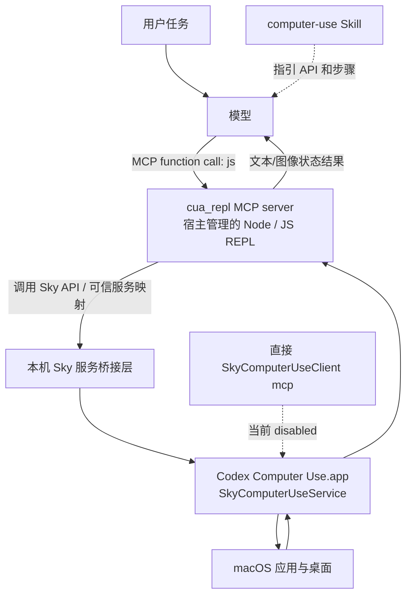

# Computer Use 调用链与 Helix 开发参考

核验日期：2026-10-12。本文件记录当前 Codex 桌面环境中 Computer Use 的包、模型入口、桌面服务和本机配置，并提炼 Helix Mobile Use 可复用的边界设计。它是固定环境的架构研究快照，不是 Codex 公共 API 保证，也不代表 Helix 的实现任务授权。

## 1. 结论先行

当前这台机器上存在两条 Computer Use 接入路径：

1. **插件工作流路径**：模型可见的 `cua_repl` MCP server 暴露 `js` 等入口；JavaScript 在宿主管理的 REPL 中调用 Sky API，由可信服务映射连接到本机 Computer Use 服务，再操作桌面。
2. **直接服务端路径**：桌面应用内的 `SkyComputerUseClient mcp` 可直接把本机服务作为 MCP server 暴露。当前 `~/.codex/config.toml` 中这条 `computer-use` MCP 配置为 `enabled=false`。

因此，“禁用直接 MCP”只表示关闭第二条入口，不等于退出 Computer Use 插件、不等于关闭桌面服务，也不等于 `cua_repl` 无法使用 Sky 服务。**MCP 是模型与工具入口之间的协议边界；Sky API/可信服务映射及桌面服务是其后的本机调用层。**“宿主内置”说明能力由宿主提供或管理，不说明它一定以某一种协议暴露。

## 2. 本机组件和目录

下表中的版本号、路径及启用状态是 2026-10-12 本机快照。`~` 指当前用户目录；实际安装位置会随 Codex 版本变化。

| 组件 | 本机位置 / 标识 | 作用 |
| --- | --- | --- |
| `computer-use` 插件包 | `~/.codex/plugins/cache/openai-bundled/computer-use/1.0.1001425/` | 产品插件身份和 Computer Use Skill；本机缓存里的目录含 `.codex-plugin/plugin.json`、图标。 |
| Computer Use Skill 源 | `~/.codex/.tmp/bundled-marketplaces/openai-bundled/plugins/computer-use/skills/computer-use/SKILL.md` | 给模型提供 Sky API 用法、观察—动作—复核流程及操作约束。临时 marketplace 源副本和缓存包内容不完全相同。 |
| `unified-computer-use` 插件包 | `~/.codex/plugins/cache/openai-bundled/unified-computer-use/26.1007.30912/` | 声明 `cua_repl` MCP server、本机可信服务映射和生命周期 hooks；本机主调用路径由此接入。 |
| 插件 MCP 配置 | 上一目录的 `.mcp.json` | 配置本机 `cua_repl` stdio 入口、允许工具、Node 运行时和受信服务映射。 |
| 桌面 Computer Use 服务 | `~/.codex/computer-use/Codex Computer Use.app/Contents/MacOS/SkyComputerUseService` | 本机桌面操作服务进程。应用身份为 `com.openai.sky.CUAService`，显示名 `ChatGPT Computer Use`。 |
| 直接 MCP 客户端 | `.../Contents/SharedSupport/SkyComputerUseClient.app/.../SkyComputerUseClient` | 服务自带客户端；`cua mcp` 可将其作为直接 MCP server 启动。当前 Codex 配置未启用这条入口。 |

插件 manifest 负责把资源组织为插件；实际可操作能力分布在 Skills、MCP 配置、宿主运行时和桌面服务中。插件目录本身不是桌面操作服务进程，也不是所有底层 API 的集合。

## 3. 当前调用路径

这是逻辑调用图。MCP server 配置、服务映射和进程清单能确认调用职责及入口；它们不能证明每一条箭头对应独立进程，也没有公开此本机桥接层的完整线协议。故文中称“服务桥接层”，不把未知部分描述成特定 IPC 协议。

### 3.1 模型实际看到什么

这台环境当前可见的 MCP 调用入口为 `cua_repl` 的 `js`。模型不是直接在 OS 层调用鼠标或键盘，也不是直接调用每个 Sky API 方法对应的独立 function tool；它先调用 `js`，由 REPL 执行 JavaScript，再通过宿主提供的 Sky 能力到达桌面服务。

插件 `.mcp.json` 还声明 `js_reset` 和 `turn_ended`：

| MCP 工具 | 职责 | 一般桌面任务中的使用 |
| --- | --- | --- |
| `js` | 在持久 JavaScript REPL 中运行代码，是主要调用入口 | 调用 Sky API 的主要工具调用 |
| `js_reset` | 重置 REPL 状态 | 运行环境恢复/清理用途，不是桌面动作 API |
| `turn_ended` | 结束回合相关清理入口 | 由插件 Stop、Interrupt、SubagentStop hooks 接入生命周期 |

`computer-use` Skill 中列出的 Sky API 是 JavaScript 执行环境内的函数，不等于模型工具列表中分别存在 11 个工具。Skill 负责教模型如何用，MCP schema 才定义外层可调用入口。

### 3.2 Skill 引导的 Sky API

本机 Skill 描述的 API 包括：

| Sky API | 用途概述 |
| --- | --- |
| `get_app_state` | 获取指定应用的可访问性状态和截图；通常先用它了解当前界面 |
| `list_apps` | 查询可用应用 |
| `click` | 按控件或位置执行点击 |
| `drag` | 拖动操作 |
| `scroll` | 滚动 |
| `press_key` | 按键或组合键 |
| `type_text` | 输入文本 |
| `paste` | 粘贴文本/内容 |
| `set_value` | 设置控件值 |
| `select_text` | 选择文本 |
| `perform_secondary_action` | 执行控件支持的辅助操作 |

具体参数、对象形式及调用示例应以安装版本对应的 Skill 为准；Skill 会变化，避免把某次参数签名固化成 Helix API 契约。

## 4. 观察—动作—复核的调用时序

常见工作流可概括为：

1. **读取指导**：模型依据 Computer Use Skill 确认可用 API、任务步骤和边界。
2. **观察桌面**：调用 `js` 执行 `list_apps` 或 `get_app_state`，检查可访问性树和截图。
3. **选择一项动作**：使用当前观察得到的控件信息调用 click、type、scroll 等 API。
4. **等待调用返回**：REPL/服务返回动作结果或错误；超时、取消和结果未知不能解释为动作一定未发生。
5. **刷新观察并复核**：重新读取界面状态，核对目标变化后再继续。动作后复核能减少基于过期坐标/控件继续操作的风险。
6. **生命周期清理**：宿主回合结束、中断或子代理停止时，可由 hooks 调用 `turn_ended` 做 REPL 生命周期处理。

这是一种模型通过工具进行闭环控制的结构。MCP 负责入口调用与结果返回；界面理解和下一步选择仍由模型与 Skill 指引完成；本机服务负责执行系统交互。

## 5. 直接 MCP 与插件 REPL 路径的区别

| 维度 | `unified-computer-use → cua_repl` | `SkyComputerUseClient mcp` |
| --- | --- | --- |
| 外层 server | 插件声明的 `cua_repl` | 桌面服务随附的 `SkyComputerUseClient` |
| 模型入口 | 当前配置提供 `js`、`js_reset`、`turn_ended` | 服务客户端作为 MCP server 暴露的工具，以实际客户端版本为准 |
| 中间调用 | JavaScript REPL + Browser/Sky 可信服务映射 | MCP 客户端直接连接 Computer Use 服务 |
| 扩展组合 | 可组合 `browser` 与 `computer` surface，并受插件生命周期管理 | 直接接入计算机服务，不等同于组合插件里的所有 surface |
| 本机配置状态 | `unified-computer-use` 插件启用，`.mcp.json` 声明 server | `[mcp_servers.computer-use]` 存在但 `enabled=false` |
| 关键含义 | 禁用 direct entry 不会自动禁用此路径 | 启用它才会增加单独的 MCP 接入路径 |

配置可以证明声明及开关状态，不能单独证明某次请求成功。要确认一项能力当前可用，还需结合运行时实际暴露、服务运行与 macOS 授权等事实。

## 6. 服务与权限边界

- `SkyComputerUseService` 属于本机桌面应用，不等同于模型进程或插件包。
- `.mcp.json` 将 `@oai/sky/service` 映射到本机服务路径，显示插件 REPL 如何寻址该能力；配置文本不是服务内部实现源码。
- macOS 对录屏、辅助功能等能力有单独授权主体。插件启用、MCP 工具可见、服务进程存在，不应被描述为系统权限已经有效或操作已成功。
- Skill 中的确认规则属于模型操作指导；不能将它视为宿主 Dispatcher/执行服务的强制授权检查。
- `enabled=false` 是 direct MCP server 的配置事实，不能推出桌面服务关闭或其他调用路径不可达。
- 本机上下文中观察到 `cua_repl` 可调用，不足以推导“显式引用插件前后工具注入规则相同”或其他通用注入策略。宿主内部的上下文组装策略未从这些包文件中完整确认。

## 7. 对 Helix Mobile Use 的参考

Helix 当前 Mobile Use 是另一种接入形态：宿主已知的 Kotlin `MobileUsePlugin` 注册多个类型化 `ToolBinding`，通过普通 Helix Dispatcher 执行；具体能力由 Automation/Device tools 和 permission center 提供。它包含 `ui.apps`、`ui.launch`、`ui.snapshot`、`ui.find`、`ui.click`、`ui.click_match`、`ui.set_text`、`ui.scroll`、`ui.back`、`ui.wait`、`ui.device`、`ui.screenshot`、`ui.gesture`、`android.open_uri` 等工具。

两种设计面向的调用形态不同：

| 对比项 | Computer Use 的 `js` 入口 | Helix Mobile Use 的类型化入口 |
| --- | --- | --- |
| 模型接口 | 一个通用 JS 执行入口，Sky API 由 Skill 引导 | 多个明确 schema 的领域工具 |
| 组合方式 | 一次脚本可组合多次 API 调用，依赖 REPL/脚本运行时控制 | 一次调用表达一个已知领域动作，更易逐工具绑定目标、授权和审计 |
| 主要优势 | 灵活组合、共享 API、可承载 Browser 与 Computer 工作流 | 参数清晰、工具级策略和拒绝原因更易显式化、运行事实易审计 |
| 主要成本 | 需治理脚本范围、嵌套工具调用、期限、取消、预算和未知副作用 | 工具数量、schema 维护与跨工具多轮编排成本更高 |

给后续 Helix 开发的建议：

1. **保留当前类型化 Mobile Use 工具为默认路径。** Android UI 操作强依赖会话授权、目标绑定、能力分类、审批、Dispatcher 和调用审计；单个万能脚本入口会把这些策略压进脚本解释层。
2. **不要按工具数量推断先进程度。** Computer Use 的工具少，是把较多操作语义放在 JS API 与 Skill 中；Mobile Use 工具多，是把领域动作分别放在模型可选的 schema 中。两者是在不同层选择接口粒度。
3. **只在真实需求出现时增加组合执行入口。** 若以后需要降低多次往返或支持用户定义复合动作，应把它作为受限编排能力评估：明确允许调用集合、参数再校验、同一会话和目标绑定、总时限/预算、取消传播、每个子动作授权和审计，以及结果不确定时的只读核查。
4. **复用可信执行路径，不直接开放底层 Android API。** 复合入口内部仍应调用现有类型化 executor/dispatcher 或明确受控的 domain port；不能仅凭 Skill 的提示替代宿主权限检查。
5. **把传输协议与执行边界分开决策。** Helix 使用本机 IPC 并不要求 MCP；接入 MCP 也不自动形成隔离。若要让外部 Agent 远程控制设备，必须新建服务端接入、安全身份和撤销设计，现有 MCP client 或本机插件不意味着远程控制已实现。

Computer Use 插件文件含有专有组件。本文件只记录可观察架构并提炼设计经验，不复制其代码或私有协议。

## 8. 核验范围和复查入口

本机快照核对了插件 manifest、`.mcp.json`、Skill、Codex 配置、桌面应用 bundle 元数据和客户端帮助输出，并观察到当前任务提供的 `cua_repl` 工具。没有逆向桌面服务、观察内部网络/IPC 流量、修改系统授权或做真实桌面操作验收。

| 证据项 | 本机快照 / 用途 |
| --- | --- |
| `computer-use` manifest | `~/.codex/.tmp/bundled-marketplaces/openai-bundled/plugins/computer-use/.codex-plugin/plugin.json` |
| Computer Use Skill | `~/.codex/.tmp/bundled-marketplaces/openai-bundled/plugins/computer-use/skills/computer-use/SKILL.md` |
| `unified-computer-use` MCP 配置 | `~/.codex/plugins/cache/openai-bundled/unified-computer-use/26.1007.30912/.mcp.json` |
| `unified-computer-use` lifecycle/manifest | 同目录 `.codex-plugin/plugin.json` |
| 当前插件开关及 direct MCP 开关 | `~/.codex/config.toml`；Computer Use 与 Unified Computer Use 插件启用，direct `computer-use` server 禁用 |
| 桌面服务身份 | `Codex Computer Use.app/Contents/Info.plist`：`com.openai.sky.CUAService`，版本 `26.1005.1001425` |
| Helix Mobile Use 注册 | [`MobileUsePlugin.kt`](../../../extensions/mobile-use/src/main/kotlin/com/helix/extensions/mobileuse/MobileUsePlugin.kt) |

详细背景见[Agent 插件架构调研 §2.6](agent-plugin-architecture-research-2026-10-11.md#26-computer-use-使用-mcp-的机制与设计收益)和[Helix 插件优化方案 §6.5](helix-plugin-architecture-optimization-2026-10-11.md#65-按执行边界选择原生ipccli-或-mcp)。
