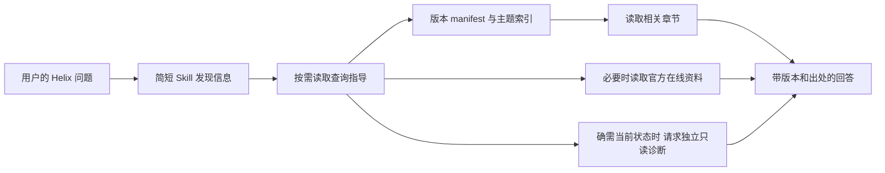

# helix-docs：官方用户文档查询能力设计

> 设计与实现记录：设计基线为 2026-10-14 的 `main` / `667a81bcad8c4d34f1bf84e9b4aaf23d697ab5d0` 加当时工作区。Owner 后续授权并实施了内置 Skill＋版本化离线章节、资源发现及默认模型读取路径；实现边界和阶段结果见本文 §11。内容仍是随包开发预览，不能据此声称静态帮助 UI、官方在线服务、双语正文或正式发行已交付。当前总体状态见 [status](../../development/status.md)。

## 1. 产品定位与结论

`helix-docs` 回答 **Helix 自身的功能、配置和排障问题**，例如“Standard 能否使用终端”“如何选择 Mobile Use 后端”“为什么找不到某个插件工具”。它使用官方用户文档并给出可核查出处；PDF／Word 读取继续归已有 `documents` 插件。

推荐首版采用 **轻量内置 Skill＋随 APK 打包的版本化用户文档资源＋现有工具**。策略与文档正文分离，默认只暴露简短发现信息，需要时读取索引和少量章节。官方在线资料作为可选补充，不替换安装版本的能力事实。无需先部署 MCP 服务、向量库、文档 Agent 或另一套执行循环。

首版最重要的工作是整理可靠的用户文档、建立版本与来源标识，以及验证发现／引用链路。Skill 文件本身只是这一能力的入口。

## 2. 当前仓库可复用能力及缺口

| 方面 | 已核实实现 | 设计影响 |
| --- | --- | --- |
| Skill 正文与资源 | [SkillTools](../../../extensions/skills/src/main/kotlin/com/helix/extensions/skills/SkillTools.kt) 提供 `skills.list/read/read_resource`；[SkillRepository](../../../extensions/skills/src/main/kotlin/com/helix/extensions/skills/SkillRepository.kt) 校验启用、来源和调用资格，内置资源也走同一路径 | 复用 `source/name/snapshotHash`，不新建文档专用读取协议作为前提 |
| 内置资源完整性 | [SkillLoader.loadBuiltIn](../../../extensions/skills/src/main/kotlin/com/helix/extensions/skills/SkillLoader.kt) 把资源路径、长度和字节纳入内容 hash；资源只允许 references／assets，拒绝路径穿越 | 可将 manifest、索引、帮助章节打包为资源；包内更新必须更新内容身份 |
| 装载边界 | [PluginRegistry.instructions](../../../extensions/plugin/src/main/kotlin/com/helix/extensions/plugin/PluginExecutionContext.kt) 区分目录、必要短指导和已激活正文；[BrowserPlugin](../../../extensions/browser/src/main/kotlin/com/helix/extensions/browser/BrowserPlugin.kt) 已示范 APK 内 Skill＋参考资料 | 可复用包装方式。当前 packaged resources 是内存字符串 map，按需进入模型不等于资源 IO／内存完全懒加载；MVP 控制包大小 |
| 工具发现 | [McpToolDiscovery](../../../app/src/main/kotlin/com/helix/app/mcp/McpToolDiscovery.kt) 的 `tools.search` 按名称／描述／来源等发现工具，新 schema 在下一请求生效 | 工具检索不等于 Skill 内容检索。Skill 身份来自 `skills.list` 或真实目录；不能让模型猜 hash，不能在同一响应搜索后立即调用尚未曝光工具 |
| 初始可发现性 | [ModelToolExposureOrder](../../../app/src/main/kotlin/com/helix/app/chat/ModelToolExposureOrder.kt) 默认集合包含 `skills.read` 和 `skills.read_resource`，不包含所有 Skill 的全文或 `skills.list`；`helix-docs` 的简短目录提示由插件装配，其他插件目录仍受会话选择约束 | 新增 SKILL.md 本身不保证自然语言发现；当前短元数据、默认工具及真实模型按需读取已完成有界验证，见 §11 |
| 网页访问 | [http.fetch](../../../tools/android/src/main/kotlin/com/helix/tools/android/HttpFetchTool.kt) 支持有界 GET／HEAD，返回 finalUrl、状态、类型和截断标记；实现按重定向检查 SSRF／DNS／目标范围 | 可取官方 Markdown 页面；不是互联网搜索引擎，也没有现成的“仅官方文档”语义过滤或版本解析 |
| 浏览器 | [browser.snapshot](../../../tools/browser/src/main/kotlin/com/helix/tools/browser/BrowserInspectionTools.kt) 返回有界页面语义树、URL、origin 和 generation | 仅在已选 Browser 插件、确实需要渲染页面时采用；URL／标题不是正文证据，不为简单帮助问题启动浏览器操作 |
| 官方入口 | [README](../../../README.md) 和 [AboutHelixSection](../../../app/src/main/kotlin/com/helix/app/ui/AboutHelixSection.kt) 指向 `github.com/dollarser/helix-agent`、发布页与问题页 | 已有官方仓库身份。未发现本轮可依赖的独立官方帮助站配置，不发明 `docs.helix…` 域名或假链接 |
| 版本信息 | [app/build.gradle.kts](../../../app/build.gradle.kts) 当前为 versionName `0.0.5`、versionCode `1`；About 显示 PackageInfo，consumer／developer 有不同应用 ID | 版本名不足以区分开发构建；当前 manifest 记录 app version/versionCode、distribution 集合和 docs revision，但不记录 buildId、sourceRevision、dirty 状态或实际渠道 flavor，因此不能识别某个安装候选 |
| 当前状态诊断 | [DiagnosticReportService](../../../app/src/main/kotlin/com/helix/app/diagnostics/DiagnosticReportService.kt) 是用户触发的无正文支持快照；[ui.device](../../../extensions/mobile-use/src/main/kotlin/com/helix/extensions/mobileuse/tools/AutomationDeviceTools.kt) 是插件领域的当前观察 | 没有据此证明存在统一、模型可调用的 App 版本／权限诊断工具。UI 诊断不能直接冒充模型接口，文档也不能证明当前设备已授权或连接成功 |
| 用户文档 | [文档中心](../../README.md) 同时索引产品、架构、ADR、任务、研究和历史证据；[product](../../product/README.md) 也混合已实现行为与产品方案 | 尚不适合作为整库用户问答语料。先明确发布白名单和用户说明来源，防止把 accepted 设计或历史报告当可用功能 |

既有 [ADR-SKILLS-001](../../adr/skills/001-authoring-and-installation.md) 和 [Plugin 归属契约](../../adr/connectors/003-ownership-and-installation.md) 已允许零工具内容包，`allowed-tools`、安装、启用和来源声明均不授予执行权限。设计不需要绕过这些契约。

## 3. 一手竞品依据与采用范围

本节整合主会话于本轮独立核验并提供的一手资料；本仓库审查未重复外部调研或运行竞品。网页和 `main` 源码是日期化证据，不保证所有发行版本相同。

| 参考 | 已核实机制 | 对 Helix 的选择 |
| --- | --- | --- |
| [OpenAI Docs MCP](https://developers.openai.com/learn/docs-mcp)、[OpenAI Docs Skill](https://developers.openai.com/learn/developers-codex-plugin) | 官方提供只读文档搜索／页面访问 MCP；Codex 有 bundled OpenAI Docs Skill。可选 MCP 不等于所有客户端默认内置 | 分开查询指导与内容访问；先用已有本地／HTTP 能力，确需跨客户端复用检索后再考虑服务 |
| [Claude Code guide](https://code.claude.com/docs/en/sub-agents) | 官方内置 `claude-code-guide` 用于功能问题 | 借鉴专门的帮助查询职责；简单问题不必启动子代理，也不猜其内部工具白名单 |
| [Claude 文档 MCP](https://code.claude.com/docs/en/mcp-quickstart)、[文档目录](https://code.claude.com/docs/llms.txt) | 提供可选、无需认证的官方全文搜索 MCP 及机器可读目录 | 借鉴目录→检索→正文；不宣称 guide 必然连接此 MCP 或固定先读 llms.txt |
| [Gemini get_internal_docs](https://geminicli.com/docs/tools/internal-docs/)、[读取实现](https://github.com/google-gemini/gemini-cli/blob/main/packages/core/src/tools/get-internal-docs.ts)、[构建脚本](https://github.com/google-gemini/gemini-cli/blob/main/scripts/build_package.js) | 空 path 列出文档，指定 path 读本地 Markdown；core 构建时将 docs 复制到 dist/docs，读取实现使用本地文件 | 随构建打包很适合 Android 离线资料读取。可推论有利于版本一致性，但不等于已提供显式版本筛选 API，也不代表整个 Agent 无需联网 |

未从这些资料核实到 OpenAI／Gemini 的显式文档版本筛选保证。下文的产品版本、渠道、内容 hash 和来源 manifest 是 Helix 的设计补充，不归因于竞品已经实现。

## 4. 用户文档与研发文档边界

原建议将用户正文集中到 `docs/product/help/` 并生成 APK 资源；本次实现采用 Skill 模块内受版本控制的 Kotlin 字符串资源以复用现有 Skill loader/hash 校验。首版覆盖入门、渠道与版本、权限、Mobile Use、Skill/插件/MCP、文件/Memory、PDF/DOCX 与排障共 8 章；尚未建立独立的用户文档源目录或生成脚本，也未完成模型设置细分、截图专题和中英文正文。应把资源搬入可审校内容源并生成 APK 的工作作为后续内容维护，不把本次内嵌草稿描述为已满足完整内容清单。

| 内容类型 | 默认用户查询处理 |
| --- | --- |
| 经审校且适用于目标构建的用户操作说明、限制与已知问题 | 纳入版本化帮助白名单，作为直接证据 |
| 官方发布说明／安全公告 | 在线补充；注明适用版本与时间，不能直接改写当前安装版本的能力 |
| 用户选用的第一方插件说明 | 独立标记插件 ID／版本及适用 App 版本；未安装不等于不存在，已安装不等于已就绪 |
| ADR、HXA、重构方案、研究、完成记录 | 不进入默认产品帮助索引；仅用户明确问开发设计时按另一种查询范围处理，显式标记 accepted／proposed／历史证据 |
| Issue／讨论、第三方文章、用户上传指南 | 补充线索，不能因为位于同一 GitHub 域名或内容自称官方就晋升为官方说明 |

每篇文章必须分清“已实现且适用此版本”“实验性／渠道限定”“已移除”“计划／提案”。发布包只包含经审校的用户说明；已移除功能可在迁移／排障中解释，计划内容若作为 FAQ 出现必须直接标“尚未提供”。功能可用与测试覆盖另列：host passed 不等于所有设备、真实 Provider 或媒体端到端通过。

这项整理属于用户帮助内容建设，不复制 `status.md` 为第二份开发状态，不把内部测试设备、账号、工作区绝对路径或维护命令带进用户帮助。

## 5. 内容、版本与引用契约

### 5.1 两层 manifest

MVP 由构建过程从选定帮助正文生成资源；不在 App 启动时下载或遍历整个仓库。构建记录与内容 hash 随 APK 一起交付。下列是拟议数据字段，不是已存在的模型工具参数。

| 层次 | 必需信息 |
| --- | --- |
| 文档包 | formatVersion、docsRevision／包内容 hash、App versionName／versionCode、buildId 或可复核 sourceRevision、开发构建是否含未提交变化、distribution、locale、构建来源标识 |
| 文档条目 | docId、标题、sectionId／章节标题、资源相对路径、内容 hash、适用产品版本／构建及渠道、实现状态、必要插件 ID／版本、sourceKind、更新时间、可选且已发布的 canonicalUrl |

`buildId` 不要求公开机器信息；源码 commit 不能独自代表含未提交源码的制品。文档条目在发布流水线绑定实际候选构建与渠道，不能由模型根据正文猜测“适用于所有版本”。多个文档使用同一只读内容来源，不另存一套可变知识真相库。

版本选择顺序：**与当前安装构建绑定的文档包 → 明确匹配版本／渠道的已验证在线文档 → 标注差异的更新资料**。如果查询的是另一台设备或旧版本，先取得用户给出的版本／渠道；当前包不能假装已覆盖目标版本。匹配失败返回未知或范围差异，不静默回退到 latest。翻译落后时可回退到同版本源语言并说明，不能用更高版本的译文填空。

当前 bundled manifest 能识别帮助正文 revision 和产品版本标签，但 `distributions` 是支持变体集合，不是实际 APK 渠道证明；也没有 About 新入口或构建身份快照。若查询依赖具体安装候选、dirty 构建或渠道差异，模型必须询问用户或取得另一个可信状态源，不能从此 manifest 推断。

### 5.2 引用与答案

最终答案中，关键操作步骤／限制／配置项必须由实际读取的章节支持。引用至少可追溯到 **文档 ID、标题／章节、内容版本、适用 App 版本／渠道、来源类型**；内部审计再关联资源 hash、工具调用与请求身份。搜索摘要、标题命中和模型记忆不能替代正文。

- 在线引用只使用已实际访问或经发布清单确认的 URL／锚点，保留最终 URL 和访问时间；不拼接不存在的帮助站地址。
- 离线引用可写“随 App 内置：《Mobile Use 准备》§后端，docId=…，docsRevision=…，适用 Standard／Advanced …”。没有现成的 App 内文档查看路由时使用清晰来源文字，不输出不能打开的伪链接；可点击帮助查看器另列后续 UI 工作。
- 区分原文事实、推论、排障假设及当前只读观察。多个来源冲突时列出版本与证据差异；不能挑一个更符合预期的答案。
- 章节过长、被网络截断或资源读取失败时缩小到可完整读取的章节，或明确证据不完整。零命中可以给出已知边界与下一步所需信息，不能编造按钮、配置键、命令或版本承诺。

回答“怎么做”默认是说明；用户进一步要求实际配置时，才由现有 Agent／工具流程承接获授权的操作。文档不能自行切换任务目标。

## 6. 官方来源、权限与在线补充

官方来源身份由 APK 内受信任配置／发布清单确定，不能仅由网页的“official”标签、Skill 名称或模型提供的 URL 判定。当前可依据仓库配置确认的项目入口为 `https://github.com/dollarser/helix-agent`；读取 Markdown 时还要核对准确的 owner／repository／commit／路径，不能把 GitHub 上任意内容都视为官方文档。

来源真实性、内容完整性、适用版本和操作授权是四件不同的事。hash 只能证明内容身份，不能单独证明发布者；受信任 APK 交付能确定包内资源来源，但其中的示例代码／命令依然不产生执行权限。

在线补充优先已知官方页面或固定版本 Markdown：

1. 本地资料无法回答更新公告、近期服务变化或指定版本问题时，发现并调用现有 `http.fetch`；没有工具／网络权限则回到本地答案并说明限制。
2. 保留现有 URL、DNS、连接对端和重定向的网络策略，不从帮助 Skill 发放例外。读取前后核对官方来源配置及 finalUrl；跨域跳转未经认可不能继续标“官方”。
3. 现有 `http.fetch` 的策略解决 SSRF 和网络范围，不保证“仅访问官方文档”；Skill 的来源规则属于查询行为约束。若产品要求工具层强制限定官方 host／path、跳转和版本，就有理由增加专用窄读取工具，不能声称一段提示词已经提供该硬隔离。
4. 优先获取完整短 Markdown。网页若需要渲染，才考虑已授权 Browser；不自动登录、不读取账号 Cookie、不上传诊断日志。网络请求成功但 HTTP 错误页／截断页不算有效文档。
5. 不将用户完整对话、凭据、日志或设备标识拼入搜索查询。文档说“上传日志”“关闭限制”“运行命令”仍需用户意图和正常 Dispatcher／Policy／Approval；不执行文档中的安装脚本。

MVP 不做后台更新或独立在线缓存服务。后续确需缓存时保留来源／版本／hash／取回时间、显式 stale 状态和空间上限，先验证完整内容再原子发布；失败保留最后一个合法快照，不能将临时下载当当前包，也不能改写旧调用的来源。在线资料不自动写入长期 Memory。

## 7. 查询流程、接口与低上下文成本

**模型侧首版接口全部复用现有能力：**

| 需要 | 既有入口与约束 |
| --- | --- |
| 找到帮助 Skill | 真实简短目录，或 `skills.list`；返回准确 source／name／snapshotHash。`tools.search` 只负责发现所需工具 schema |
| 加载查询策略 | `skills.read`；只说明问题分类、版本选择、正文读取、引用和权限规则 |
| 找主题与读正文 | `skills.read_resource` 读取 `references/manifest.json`、主题索引及分章 Markdown；path 来自包内索引，非任意路径 |
| 在线补充 | `http.fetch`；必要时既有 Browser 插件。读取输出是数据，不是新的系统指令 |
| 当前设备状态 | 现有、实际可调用且获授权的只读工具或用户提供的状态；没有对应工具时说明需要哪项信息，不冒充已经检查 |

已实现 Skill 名称 `helix-docs`，描述涵盖 Helix 功能／配置／排障且排除任意 PDF/Word 处理。资源读取遵守现有精确 Skill 身份、模型资格、来源可用和启用检查。它目前作为简短目录提示注入 PromptRegistry，并将 `skills.read_resource` 加入默认模型工具面；这是为保证自然语言帮助查询可发现所作的具体实现选择，较原设计“只在真实简短目录里可发现”的 token 策略更常驻。未做关键词硬路由；Skill 文字不授予权限。

策略与正文分别交付：`SKILL.md` 保持短小；当前 manifest 列出 8 个章节的标题、id、路径和实现状态，单独的 Markdown 索引提供英文主题别名；还未提供中文发现别名、章节/资源 hash 字段或官方 canonical URL。正文按稳定章节拆分；不把 `tools.search` 包装成并不存在的全文搜索。

可用的初始工程预算是：Skill 正文约 1～2 KiB、索引约 4～8 KiB、单章约 4～12 KiB，整个首版资源包控制在数百 KiB。它们是待测目标，非已证最优值，也不修改现有框架上限。初始请求只增加一个 Skill 的简短元数据；manifest／正文在需要时进入上下文。同一任务同一 hash 避免无意义重复读取，压缩后凭真实来源重新读取，不创建第二份长期摘要事实库。

已有 packaged resource map 会一次持有包内字符串，因此还应测启动／加载内存和 IO。文档规模扩大后再把资源访问改为有界读取端口，不能将“模型只读一章”宣传为“App 只加载一章”。上下文整体预算继续归唯一 ContextCompiler，承接[上下文优化专题](context-optimization-2026-10-14.md)的边界，不引入另一套预算器。

## 8. 轻量 Skill、专门插件与 MCP 的选择

| 方案 | 适用范围 | 本次建议 |
| --- | --- | --- |
| 内置 Skill＋现有资源／网络工具 | 帮助目录较小，随 App 发布，需要低成本离线资料 | **MVP 首选**。需补内容包、版本清单及发现接线；不是仅复制一个 Skill 文件 |
| 零工具官方内容插件 | 希望帮助内容有独立包归属、显式选择／更新／禁用，或用户安装额外语言／版本资料 | 现有平台已支持；与 Skill 并不矛盾，但独立更新必须校验 App 适用性，不能自动启用或覆盖当前版本 |
| 专门原生文档插件 | 实测目录／加载成本过高，或需要工具层来源强校验、稳定搜索分页、多个版本与缓存管理 | 触发条件成立后增加窄 `search/read`，继续返回同一来源契约，仍走现有 Dispatcher；无需新 AgentLoop 或 Android 后台服务 |
| 官方 Docs MCP 服务 | 多种外部客户端需要共享服务端全文索引，且发布／部署／可用性有明确 owner | 后续可选。Helix 首版不依赖服务器、OAuth 或向量数据库；服务停机仍保留包内帮助 |

后续若增加工具，建议用不与 `documents.*` 冲突的候选名称 `helix.docs.search(query, filters, cursor)` 与 `helix.docs.read(docId, revision, sectionId)`；返回稳定 docId／revision、适用性、来源、hash、截断／分页状态。名称与字段仅为设计草案。查询不能接受模型自报 `official=true`、任意本机路径或自选高权限网络 scope，也不返回“请替用户执行”的控制指令。

不同时保留两个互相竞争的文档索引或读取结果真相。后续演进替换所需接缝；Skill 仍提供查询指导，内容来源和执行权限由各自 owner 管理。

## 9. 阶段、工作量与现有任务衔接

以下只用于范围评估，不是新 HXA 排期或承诺工期。假设首版约 10～15 个短主题、中英文发现别名、以一种正文语言先交付，复用当前资源路径；不含完整双语翻译、帮助站发布、真实模型／设备评测或远程服务部署。

| 阶段 | 交付与退出条件 | 粗略工作量 |
| --- | --- | --- |
| A：资料与身份 | 整理帮助白名单，已实现／计划／实验／移除状态分开；构建与文档 manifest、章节引用规则确定 | 约 2～4 人日；内容审校是主要变量 |
| B：可用 MVP | 内置 Skill、生成的包内资源、真实发现路径、版本选择和失败答案；复用现有读取工具 | 约 2～3 人日，前提是 A 的内容范围稳定 |
| C：首版主机验收 | 打包／hash／渠道门禁、无网与错配夹具、发现／读取链路和引用核验；提供后续模型评测集 | 约 1～2 人日；与 B 的测试开发可交错 |
| D：在线与规模扩展 | 按实测缺口引入限定来源读取／缓存／检索或帮助查看器；分别验证 | 单个窄扩展约 2～5 人日起，需重新估算，不和 MVP 捆绑 |

MVP 合计初估 **5～9 人日**，表示工作量而非日历工期；未知用户文档质量、翻译及当前代码并行变化可能增大范围。专用 MCP／向量检索不包含在此估计，也不是进入 MVP 的条件。

此能力属于内容贡献与应用查询，复用现有 Skills／Plugin／资源工具契约；本次没有增设 HXA、专用插件、后台服务或新 Agent Loop，不修改并行 HXA-126 OAuth 验收，也不增加后台 Memory Agent。

## 10. 验收矩阵

| 用例 | 必须观察到的行为 | 证据层 |
| --- | --- | --- |
| 自然语言问“Helix 怎么配置模型” | 实际发现 `helix-docs` 并读对应版本章节；无需常驻全文或启动子代理 | 主机装配／工具夹具；真实模型召回另测 |
| “读取这个 PDF” | 使用已有 documents 能力，不因“文档”关键词误激活帮助查询 | 路由评测样本；真实模型另测 |
| Skill 禁用、模型调用资格关闭、同名第三方包 | 遵守原资格及准确身份，不猜 hash，不自动启用第三方同名内容 | JVM／注册与来源契约 |
| versionName 相同、构建或渠道不同 | 匹配构建清单／渠道；不将 developer 能力宣称 consumer 可用；未知时解释范围 | 打包元数据＋主机夹具 |
| 旧 APK 与最新版网页、已移除功能、翻译滞后 | 先回答当前适用行为，单列更新／移除差异；不默认升级、重装或清数据 | 内容审校＋版本夹具 |
| 文档提案写“已接受” | 默认用户索引不命中内部提案；明确查询设计时标注未交付，不冒充实现 | 发布白名单与状态门禁 |
| 引用检验 | 引用章节实际支持相邻结论；docId／revision／hash可解析，锚点存在；没有官网时不造链接 | 确定性引用契约＋人工／模型语义评测 |
| 离线、网络被拒、无命中、404、超限／截断 | 本地资料仍可读取；明确资料范围与缺失，不伪造读取或答案，不无限重试 | 主机假网络与资源夹具 |
| 恶意文档、假官方域名、跨域跳转、资源路径穿越 | 不产生授权、系统指令或本地执行；来源错误不得标为官方；保留已有网络／文件边界 | 主机安全夹具；强来源过滤若新增须专项验证 |
| 询问“我现在有没有无障碍授权” | 文档解释要求；实际状态来自独立只读观察或用户信息，附观察时间，不猜测 | 状态适配夹具；真实设备另行授权 |
| 请求自动修改配置、上传诊断、登录服务 | 仅在用户意图范围内进入正常工具权限路径；查询帮助不自动授权这些操作 | Dispatcher／审计契约 |
| 隐私与资源 | 不发送凭据／完整会话／诊断正文到文档搜索，不后台写 Memory；包大小、初始提示、读取次数和内存有界 | 主机输入／日志检查；端侧性能另测 |
| 内容更新／压缩后重读 | 原引用仍指原版本，校验失败不静默替换；当前选中内容／权限变化重新验证 | JVM＋持久适配，设备恢复另测 |

效果评测固定 APK／渠道／docsRevision／模型和问题集，比较回答正确率、引用支持率、版本误配、无依据断言、加载 token、读取往返与时延。先用关键错误为零的约束验收，再评估检索和成本；只有文档可离线读取不等于端到端离线问答，后者还要求可用的本地模型及其独立验证。

模型未配置或无法运行时，不能依赖 `helix-docs` Agent 自举解决所有设置问题。现有 README／设置说明仍需保留人工入口；完全离线且无需模型的用户查阅体验属于静态帮助查看器的范围，不能因 APK 内已有资源就宣称该 UI 已交付。

## 11. 审查与实现记录

保存了起始分支／HEAD、完整工作区状态与已有 diff；只读核查 AGENTS、README、当前状态／验收入口、Skills／Plugin ADR，并以 CodeGraph 定位后复核当前源码。主会话提供的一手竞品来源已在 §3 明确归属和限制。产出为本专题及研究导航，不修改生产实现、当前任务、accepted ADR 或并行 OAuth 文件。

本地证据目录：`build/helix-docs-design-2026-10-14/`，含 `baseline-head.txt`、`baseline-status.txt`、`baseline.diff` 和 `source-sha256.txt`。本轮实际验证：`./scripts/check-docs.sh` exit 0（866 份 Markdown、268 项 HXA 导航）；`./scripts/verify-adr.sh` exit 0（37 份当前 ADR）；`git diff --check` 通过。日志分别为 `docs-check.log`、`adr-check.log`；9 份关键源码 SHA-256 结束复核一致。

2026-10-15 Owner 授权继续完成内置帮助 Skill 和预览准备。实际改动位于 `extensions/skills`、默认工具曝光、插件提示装配及相关测试：manifest 从章节资源稳定计算 SHA-256 revision；每个 Skill snapshot hash 同时覆盖 Skill 正文、manifest、索引和章节；`skills.read_resource` 只能按精确 hash/相对路径从已启用且模型可读的 Skill 取回内容。默认目录只加入一条简短 `helix-docs` 元数据，正文按需读取。章节目前是模块内英文源文本，不是从 `docs/product/help/` 生成；内容审校、渠道/dirty build 绑定、完整引用语义评测和静态帮助查看器均未完成。当前用户要求暂不改最终版本号、不覆盖真机；0.06 的版本映射和 OnePlus 保留数据安装决定仍待回复。

本阶段定向验证命令 `./gradlew :extensions:skills:test --tests com.helix.extensions.skills.BuiltInSkillsTest :extensions:plugin:test --tests com.helix.extensions.plugin.PluginRegistryTest :app:testDeveloperDebugUnitTest --tests com.helix.app.chat.ModelToolExposureOrderTest` exit 0；skills 2 项、plugin 20 项及 App 指定测试通过。覆盖资源 revision/hash、默认可读章节、路径穿越/错误 hash/禁用拒绝、插件规则及默认工具面。该主机阶段未执行设备、真实模型、长稳、全仓回归或正式发布验收；设备与模型的后续结果另记如下。保留早期失败尝试，不把定向测试扩张为完整 §10 验收。

2026-10-15 后续验收：新建独占 API36 模拟器上的 `HelixDocsDeviceTest` 1/1 通过，本机 `Qwen3.8-27B` 的 `HelixDocsLiveModelDeviceTest` 1/1 通过。真实模型按需读取 manifest、索引和渠道章节，引用版本、章节和完整 revision，并明确 OnePlus 保留数据覆盖安装行为尚无文档依据。两渠道 `0.0.5` debug preview 的制品哈希、早期失败与实际运行目录见[预览记录](../../development/helix-docs-preview-2026-10-15.md)。该证据不覆盖真机升级、全章节语义评测、长稳或正式发行。
