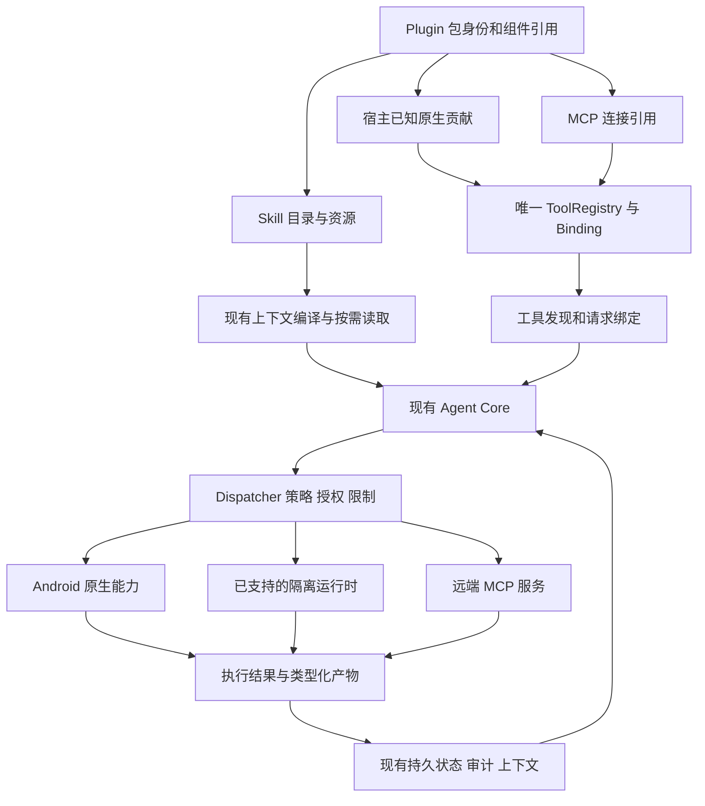

# Helix 插件架构优化方案

日期：2026-10-11。本文保存 Helix 的差距、建议、设计取舍、实施顺序及验收条件。参考产品机制、样本身份、权限事实和来源集中在[Agent 插件架构调研](agent-plugin-architecture-research-2026-10-11.md)；本方案引用该证据，不另行维护外部产品说明。

当前实施顺序由 [status](../../development/status.md#插件优化队列2026-10-11)维护；安装生命周期和异步执行沿用 [Harness 方案](../../architecture/harness-refactor-plan.md)。2026-10-11 所有者要求结合当前代码将建议拆为具体任务，HXA-272～275 已有界本地交付，276～279 已登记并按当前授权继续实施；最新进度以 status 为准；F/G 和其他有进入条件的能力留在候选索引。本文维护设计取舍与研究映射，不另维护第二份排期。

2026-10-11 所有者进一步要求同步 ADR：新增任务的目标决定已写入四份现有主题 ADR，见 [HXA→ADR 归属表](../../adr/README.md#插件优化任务的-adr-归属2026-10-11)。本文保留研究依据，当前有效契约以对应 ADR 为准；设计接受不等于实现或验收完成。

任务主线：**Skill 内容与调用规则 → 配置生效和组件诊断 → Browser 原生贡献及资源收尾 → 上下文与 UI 交互增量**。已有工具绑定、安装生命周期、工具图像与本地 Job 通路继续复用。具体优先级与可独立推进项见 status。

## 1 方案基线与边界

原始源码依据为调研时的 `main@542c1ca26d5a170ebb5b6549185ed83af04bf1cc` 加当时工作区；未提交的 Chat Reply 和 Mobile Use 改动只作为组合场景线索。同日补充核验在 `0be2f2d888668abfbf2e28e61f0a67585fee57fd` 加工作区确认了 Mobile Use 原生注册路径，未重验全部差距。本次更新调研和设计建议，没有新增应用功能或设备验收。完整判断修正见[调研基线](agent-plugin-architecture-research-2026-10-11.md#1-核验基线与判断修正)。

**本轮计划决定。** 所有者明确要求不兼容旧版：按单一目标实现替换旧 Skill 注入、Browser built-in 注册和受影响的内部接口；不安排旧数据库、旧会话、旧工具批准迁移，也不保留双写、双注册或兼容 adapter。开发期存储沿用现行 baseline 规则。当前外部包格式的互操作支持、同次执行身份和权限不变量继续保留。这里只更新计划，不执行代码变更或数据操作；§7.1 记录最新代码复核范围。

| 已有基础 | 对本方案的约束 |
| --- | --- |
| R1 统一绑定、身份和撤销 | 保留 ToolRegistry/Dispatcher 的唯一执行链 |
| R3 安装、选择、停用、更新和修复 | 补诊断及未覆盖矩阵，不重建安装系统 |
| Browser 与 Mobile Use 已有截图和视觉回传 | 复用 ToolVisionServices、VisualArtifact 及图像披露 |
| 多来源 tools.search 与 HXA-252 发现提示 | 在已有发现投影上降低选择与上下文成本 |
| 本地异步 Job 与取消结算 | 外部长任务按真实 provider 接入，不新增平行任务框架 |

依据：[HXA-225](../../completion-records/HXA-225.md)、[HXA-235](../../development/tasks/HXA-235.md)、[HXA-251](../../development/tasks/HXA-251.md)、[视觉 ADR](../../adr/agent/011-tool-multimodal-vision-feedback.md)。当前状态以实时任务和 ADR 为准；历史调研快照不恢复已关闭缺口。

## 2 调研结论的采用与取舍

| 研究输入 | Helix 采用方向 | 本方案的约束 |
| --- | --- | --- |
| Codex 组件包与共享执行入口 | 统一包身份和发现，允许 Skill、native、MCP 复用宿主能力 | 不要求每插件一个 server；私有客户端不直接作为可移植 SDK |
| Claude Code 的组件、依赖和调用规则 | 逐字段兼容诊断、用户/模型调用资格、必要/可选依赖与作者样例 | 读取 manifest 不等于完整兼容，不把导入字段变成批准 |
| DSH 的服务依赖与实例所有权 | 明确 port、服务就绪、注册与释放归属 | 保留 Core/Android 分层、Room 事实及现有执行 owner |
| Codex、Gemini CLI、OpenCode 与 DSH 的混合工具接入 | 多种 adapter 汇入同一工具契约和执行体系；按运行与互操作边界选择协议 | Computer Use 的 MCP 用法不构成全量迁移依据，具体取舍见 §6.5 |
| 文件插件的产物检查流程 | 复用 Workspace、Artifact 与领域检查步骤 | 普通任务结果仍由用户和模型验收 |
| 系统权限与任务批准分层 | 共享已授权执行后端，每个请求检查目标及动作范围 | 插件选择、系统授权、账号能力分别表达 |

参考：[产品调研](agent-plugin-architecture-research-2026-10-11.md#2-参考产品的插件设计)、[权限机制](agent-plugin-architecture-research-2026-10-11.md#3-系统权限归于执行后端内置与-mcp-是不同维度)、[复用比较](agent-plugin-architecture-research-2026-10-11.md#5-跨产品共同点与复用结论)。

Helix 当前能力插件贡献领域工具和指导，不拥有第二个 AgentLoop。DSH 的宿主基础插件可实现循环，是不同层级的扩展机制。Helix 继续使用能力包、宿主已知 native contribution 和既有 provider adapter；按真实需求开放最小 port，不向每个业务插件暴露整套 ModelClient、数据库和批准服务。

### 2.1 总体合理性与收敛尺度

2026-10-11 的[主流 Agent 总体对照](agent-plugin-architecture-research-2026-10-11.md#28-插件与执行分层的总体合理性复核)支持现有架构与 HXA 主线。以下是对已接受边界的解释，不新增执行域或改变 ADR 状态：

- **稳定执行分工。** AgentLoop 管模型/工具循环，TurnEngine 管持久生命周期，Scheduler 管有界调度，Dispatcher 管执行准入，插件及实际后端持有各自资源。已有 Core 和 Runtime 接口继续复用，完整 Turn 宿主按真实消费者进入条件处理。
- **统一贡献与治理。** Skill、APK 已知 native、MCP 汇入现有身份、选择、权限和结果体系；接入协议按执行位置和互操作需求确定。纯内容插件无需运行实例。
- **每种事实只有明确权威。** 保存、加载、请求生效、系统权限和本次批准有各自含义；readiness 消费这些事实。HXA-274 删除重复推导与页面导航回调，HXA-277 消费原执行退出事实，不生成第二份可写执行状态。
- **按实际消费者提取接口。** Browser/Mobile Use 足以验证本轮资源 port；接口需要让调用者依赖更少、旧入口可删除。暂不以通用容器、模块数量或 ChatService 行数作为完成条件。
- **用任务结果评价增量。** 作者能完成纯 Skill/native/MCP 样例，用户能恢复不可用能力，模型能正确发现与调用，取消后资源和状态一致，才构成对应范围的交付。效率收益还需固定任务的模型/设备对照。

现有 ADR 已决定的事项、实施时应冻结的验证输入及条件性产品选择统一见[待决策索引](../../development/candidate-decisions.md#本轮插件与分层评审的决策结论)。本轮评审没有发现阻塞 HXA-272 开工的新架构裁决；后续真实实现约束若与 accepted 契约冲突，再修改相应主题 ADR。

## 3 优化要解决的具体差距

| 差距 | 优化落点 |
| --- | --- |
| 原生 bundled Skill 激活依赖工具发布，用户/模型调用规则未完整执行 | 5.1 统一已有 Skill 读取与内容身份 |
| Browser 与 Mobile Use 的归属及选择体验不同 | 5.2 统一 native 贡献与 PluginOrigin，直接删除旧 built-in 注册，不迁移旧会话或批准 |
| 包可用、服务已加载、系统授权与请求有效能力容易混淆 | 5.3 细化只读状态与修复路径 |
| UI 操作的定位、等待和观察成本仍需任务证据 | 5.4 按基线补最小能力 |
| 外部包字段、运行依赖与账号归属缺少完整说明 | 5.5 兼容矩阵；5.9 作者样例 |
| 共享服务依赖、注册和释放缺少统一契约 | 5.8 实例所有权；6.1–6.4 权限和复用设计 |

这些差距以[调研时的 Helix 实现](agent-plugin-architecture-research-2026-10-11.md#4-helix-调研时的实现与差距)为依据。领域已有的停止/释放路径不因接口未统一而视为不存在；不将有限设备或模型证据外推为全部任务表现。

## 4 建议保留的总体结构

这是现有结构的职责归纳。外部异步 provider、独立 Skill 激活等增量须按后面的切片接入，不因图中存在一条通路就视为已实现。

Agent 负责选择观察与动作、根据结果继续任务。Harness 负责精确调用身份、当前权限、资源准入和事实结算。插件提供领域工具与指导；Android adapter、隔离 runtime 或远程服务执行实际操作。UI 展示执行事实和用户控制，不自行修改执行结论。

这里的“运行时”指实际承载代码、连接和资源的环境；“编排”指发现能力、安排调用、等待结果、处理取消并继续任务。两者不必由同一个进程实现。具体通信分为三个层次：

| 层次 | 输入与输出 | Helix 的对应路径 |
| --- | --- | --- |
| 模型与 Harness | 模型收到指导和工具 schema，产生工具名/参数；Harness 返回工具结果及可用图像 | 上下文编译、Agent Core、Dispatcher、结果回填 |
| Harness 与能力实现 | 原生执行器接收类型化调用；远程工具通过 MCP 请求/响应；必要时经 Android IPC | ToolBinding 的 executor 与既有 adapter/client |
| 能力实现与目标系统 | 操作 WebView、访问系统观察后端、调用服务 API 或管理远端任务 | 各领域自己的 bridge、连接和资源管理 |

因此，主模型通常不直接持有 server 客户端或网络连接。宿主执行调用；插件可以提供执行器、客户端配置或指导资源。Codex 的 Browser JavaScript 客户端是另一种受宿主管理的工具入口，Helix 采用它的设计思路不要求同时引入 REPL。

任务可以按以下方式组合：

- 本机网页：选择 Browser 能力 → 打开或选取 tab → snapshot/find → 动作 → 新观察验证 → 按用户意图保留页面或返回会话。
- 可见聊天辅助：选择流程 Skill → 使用已授权 Mobile Use 读取当前聊天 → 主模型生成建议。真正发送是另一次有外部副作用的动作；纯指导插件无需复制屏幕读取和模型客户端。
- 文档生成：选择领域 Skill → 在实际可用的执行环境生成文件 → 确定性检查与可用的渲染检查 → 回传产物和已验证范围。
- 远程长任务：启动工具返回真实远端标识 → 绑定现有调用 → 只读等待/查询 → 收取结果。若响应丢失，先核查原任务；continuation 是否启动新 run 由具体服务契约决定。

## 5 优先优化的增量

### 5.1 原生 Skill 激活与工具贡献解耦

**现状。** `selectedRuntimes` 要求插件已有 published tools；`PluginRegistry.instructions` 又从已准入 descriptor 反查插件，再拼接所有 bundled skill 正文。可移植 Skill 已有独立路径，但原生插件的纯指导能力难以独立激活，长 Skill 也容易增加每轮输入。

`SkillLoader` 目前将 `disable-model-invocation`、`user-invocable` 等保存到 `additionalFields`；`SkillCatalogEntry` 和 `SkillRepository.read` 没有相应调用方策略。因此不能把现有全局/会话启停称为已经实现“仅用户可调用”。`SkillKey(source, name, snapshotHash)` 已提供精确身份，应保留。

**建议。** 优先让纯流程使用已有 portable Skill/SkillRepository。确需随 APK 捆绑时，使其 Skill 身份和不可变内容也进入现有 Skill 读取路径；安装可用、会话选择、内容版本和请求装载由现有 catalog/context compiler 共同确定，不以增加占位工具作为激活条件。安全执行仍只由工具准入链控制。

元数据先说明适用任务，正文和参考资料在需要时读取。Mobile Use 每次操作都必须知道的简短规则可以保留在必要上下文中，安装、长流程示例等资料再按需读取。该分层属于提示策略变更，应进入 R2-B 对照，不直接删掉已证明有用的指导。

增加最小的用户/模型调用规则：从明确支持的格式归一化两种调用资格，分别用于列表、选择入口和实际读取。显式选择绑定 SkillKey 与本次参数；网页、邮件或工具结果中出现 Skill 名称，不作为用户主动调用。调用 Skill 仍不扩大工具权限。对尚不支持且影响调用或执行的字段给出诊断，避免默默当普通正文使用。

内容处理复用现有上下文和历史：同一 snapshot 避免无意义重复注入；更新、停用与目录清空使后续发现失效，同时保留历史调用中的原版本事实；压缩后按预算恢复当前任务需要的指导。DSH 的 model-facing consumer 将目录更新记录为替换消息，空目录也能撤下旧名称，说明“删除后的上下文”同样需要处理；Helix 应接入已有编译/持久化机制。[DSH tool-skill](https://github.com/deepseek-ai/deepseek-harness/blob/d743267388641bc76f17c45ce8b4c231aed1d32c/packages/skill/tool-skill/README.md)。

**落点。** `extensions/plugin/PluginRegistry.kt`、`PluginExecutionContext.kt`，现有 SkillRepository 和上下文编译入口。先明确 bundled Skill 的内容 revision、停用失效和压缩后重新读取规则，避免建第二个 Skill 数据库。

**退出条件。** 一个不提供工具的流程插件可被发现、选择、读取并完成任务；用户/模型调用资格分别有效；同名来源无误选；停用后不再注入；更换版本不误读旧内容；已有 Mobile Use 任务行为保持。评估正文 token、发现往返和任务完成率，不能只验收输入缩短。

### 5.2 将 Browser 纳入一致的插件使用体验

**现状。** Browser 工具为 BuiltInOrigin，通过应用装配注册；Mobile Use 已有插件归属和独立会话选择。差异是组织和交互路径，不是 Browser 缺少执行器或图像能力。

**建议。** HXA-276 为 Browser 建立宿主已知 native contribution，复用现有 12 个工具、bridge、WebView 和 ToolVisionServices。目标模块 `:extensions:browser` 负责贡献与 Skill，App 注入已有 bridge，Activity 继续拥有 WebView；提供现有插件管理入口，保持手动浏览器功能。

目标新会话默认集合包含 Browser，用户通过现有面板调整；直接切换为唯一 PluginOrigin 发布并删除旧 built-in 注册。改变 provenance 后按新 contractHash/批准身份执行，不转换旧批准，不设计旧会话或旧数据迁移。普通浏览器 UI 的打开、书签和手动导航独立于 Agent 插件选择。

**增量功能按任务补齐。** 当前 12 工具没有 Agent-facing tab list/close 或 browser.wait，也没有完整的 role/label locator 组合。先用真实旅程确认困难来自找不到 tab、节点歧义还是等待，再选择最小新增工具。优先考虑可发现 tab、明确歧义和有界等待；不预先移植整套 Playwright API。

**退出条件。** 安装身份、会话选择、工具发现、截图和产物打开在同一旅程可用；停用只阻止后续 Agent 准入；现有 token、origin、generation、取消和视觉披露不退化；没有 Activity host 时返回真实不可用信息。平台生命周期继续遵守 [Browser ADR](../../adr/platform/002-browser-lifecycle.md)。

### 5.3 把运行条件和恢复信息提供给用户及模型

**现状。** `PluginComponentReadiness` 已显示组件数量、就绪数量和局部失败；native `ready()` 主要核对目录与已发布工具投影。本轮复核还确认 HXA-271 已补 Mobile Use 选择前检查、授权恢复，并在阶段9提供配置不足的说明与设置引导；这些不重新开发。WebView host、服务连接、模型视觉能力及保存/加载/请求生效事实仍需统一投影，不能都用 ready 表示可执行。

**建议。** 扩展现有只读投影，按真实来源提供组件状态和下一步：未配置、未连接、目标不可用、会话未选择、能力暂不可用等；同时说明原因来自包、连接、系统还是具体请求。工具权限仍按当前请求解析，预检查不能预授批准。

还应分清**安装内容、已保存配置、当前加载版本、本请求有效能力**。例如“设置已保存，将在下次请求生效”和“更新已安装，需要重建连接”是不同结果；全局停用、会话取消选择和停止当前任务也应分别显示。展示方式由该组件的真实实现决定，不统一要求重启 App。

配置生效时点的调研依据见[DSH 生命周期](agent-plugin-architecture-research-2026-10-11.md#24-dsh宿主插件服务依赖与实例生命周期)。Helix 按各组件真实加载机制给出反馈，不统一要求重启 App。

展示“Mobile Use 已选中，但当前没有可用观察后端”或“截图已保存，本次模型未收到像素”，比增加一个总开关更有帮助。只读检查不能顺带申请系统权限、启动 OAuth、连接 Root 或运行模型；显式操作才进入已有修复路径。

**落点。** PluginService、PluginComponentReadiness、现有 CapabilityReadiness 与各后端只读状态。只有已经有可靠事实和处理逻辑的原因才映射结构化值，不先造一个所有插件必须实现的巨大状态枚举。

**退出条件。** 每个不可用状态能定位来源；状态过期后执行仍重新准入；不会把配置可用或工具已发布宣称为设备操作成功。

### 5.4 减少 UI 任务中的无效观察与重试

**现状。** Mobile Use 的 Skill 已指导 observe/act/wait/verify、token 更新、未知结果只读核查、截图坐标映射及返回原会话；Browser 已有 token 校验。仍需实测的是具体网站/App 上的定位、等待和信息量。

**建议。** 保留执行器为事实提供方，优先完善结果中已经有意义的匹配数、歧义、截断、实际后端、观察失效和像素状态。点击前使用当前观察；动作后用可核查的页面/包状态确认。只有截图实际提供了像素，才进入基于该图的坐标选择。

等待应受期限和取消控制，返回条件命中或超时事实；不得在等待超时后自动重复发送、安装或支付动作。语义树、截图、HTTP/API 是互补信息源，选择由任务和当前授权决定，后端变化不能绕过拒绝或重放未知效果。

**退出条件。** 对固定任务记录无效调用数、重复观察数、人工介入、完成率和耗时；重复错误减少且未知副作用的处理保持正确。没有节点不能被直接归类成敏感内容，没有可见变化也不能自动证明动作从未发生。

### 5.5 完善兼容矩阵和连接器可用性

**现状。** Helix 已支持包解析、Skill、远程 MCP、局部失败与连接配置；原生贡献限于 APK 已知工厂。Codex 插件的 `.app.json`、宿主 RPC、Node 模块或服务映射并不天然是可移植后端。

**建议。** 在安装预览中说明可用部分和不支持部分，复用现有 diagnostics，而非按插件名字推断能力。至少区分 portable Skill、remote MCP、需要桌面依赖的脚本、stdio 配置、OpenAI 注册服务映射、host-native 组件、hooks 和可选 UI。每项标明本次格式版本以及所需执行环境。

兼容矩阵还应包含 **Agent 定义、命令入口、LSP、依赖声明、配置 schema，以及 Skill 的调用/工具/子上下文字段**。逐项标明“保留元数据”“可执行”“需用户配置”“不支持”；不能把 Claude 的 `context: fork` 展平到主 Agent 后宣称兼容。Claude 文档中的 `allowed-tools` 有宿主授权语义；Helix 当前仅将其作为不可信声明，不能在导入时变成批准。差异必须在预览中明确。[Claude Skill 字段](https://code.claude.com/docs/en/skills)。

Claude 支持带版本约束的插件依赖，并区分跨 marketplace 的依赖来源；DSH `inject` 则声明运行时服务依赖。Helix 应先区分“包是否存在”和“当前后端是否就绪”，为缺失的必要依赖给出原因；全自动依赖安装、版本求解和服务热替换等到有真实需求再立项。[Claude 插件依赖](https://code.claude.com/docs/en/plugins/dependencies)。

保留包内容、用户配置、凭据和运行产物各自的归属。Claude 用 `CLAUDE_PLUGIN_ROOT` 指向版本内容、`CLAUDE_PLUGIN_DATA` 保存跨更新数据；Helix 应复用已有安装快照、配置存储和 Workspace/Artifact，明确更新保留项及卸载清理项，不在不可变包目录写运行状态。[Claude 路径与数据](https://code.claude.com/docs/en/plugins-reference#environment-variables)。

GitHub/Outlook 类插件通过 Helix 自己支持的 MCP/认证通道接入；账号、endpoint、token scope 和插件身份独立。新增工具必须通过统一 schema/副作用/授权链；远端 readOnlyHint 不是信任凭证。将远程草稿归为外部写入，发送则绑定明确收件人和内容。

**退出条件。** 含“可用 Skill＋未配置 MCP”的包仍能使用 Skill，失败组件可单独修复；未知原生扩展或 hooks 不被执行；更新取消保留原安装及用户选择；账号不因 URL 相同而被错误共享。

### 5.6 在具体服务需要时扩展异步 provider

**现状。** Helix 的 J1/J2 已支持本地执行身份和等待释放；Browser Use、webcodex 展示了外部 run/job 的另一种生命周期。需要的是 provider 适配，而不是再建后台任务框架。

**建议。** 首次接入真实外部长任务时，明确 start/status/wait/collect，以及服务实际支持的 cancel/continue。远端标识绑定原会话、调用、账号/endpoint、授权和预算；只读观察沿用原身份，结果导入保持幂等。不要把所有能力都强制做成长任务。

断连、HTTP 超时和用户 Stop 都不能直接宣称远端已停止；没有 cancel 能力时如实报告“本地停止等待，远端停止未确认”。任何继续写入都须按语义重新准入。若启动请求的结果未知且服务没有可靠幂等键/查询机制，应保持未知并核查，不重新启动同一任务。

**进入条件。** 有一个明确需要的服务、可见协议、身份和取消语义，以及受控验证环境。该增量需进入现有 Job/权限主题决策，不能由本方案自动扩展为远程设备平台或生产子 Agent。

### 5.7 为文件插件复用产物和验证流程

**建议。** 采用 PDF/Documents 的具体流程：保存后重新打开，检查必要结构，有渲染能力时检查页面。复用 Workspace、Artifact 和 view_image；明确哪些格式在当前渠道可处理、哪些执行依赖缺失。

检查结果应说明实际完成的验证，例如“字段已检查、页面未渲染”；文件存在、结构可读、页面清晰和业务内容正确分别表达。高成本渲染/OCR按需运行，原始文件可保留可编辑副本。普通任务继续由用户和模型验收，不增加通用强制业务 verifier。

**进入条件。** 先确定一项文档任务与 Standard/Advanced 的实际依赖路径，再立项文件格式支持。导入一个桌面 Skill 不等于手机已经拥有 LibreOffice、Poppler 或完整 Node 环境。

### 5.8 将注册和资源释放归属到具体实例

**现状。** `HelixPlugin` 有工具、Skill 和范围贡献，尚无统一的服务依赖声明或实例释放接口；各执行域已有自己的停止/释放逻辑，不能由这个接口缺项推导为整个系统没有清理能力。

**建议。** 在 Browser 迁移或首个确实持有监听器、连接、临时观察资源的插件上，列清包、插件实例、会话和调用各自拥有的资源。优先让注册返回可释放句柄或使用既有 scoped owner；停用先撤下新准入，当前调用依原契约结算，最后释放不再被引用的资源。旧实例回调不得修改同名新实例。必要服务不可用时停止新使用，恢复也要重新检查当前选择和批准。

DSH 的 Fiber/effect 模型可作为这种所有权的参考，但卸载开始、清理完成和外部副作用结束不能合并成一个状态。其异步 disposer 可并发执行，依赖顺序需要在同一清理步骤内显式等待；Helix 不应假定调用 dispose 就已完成全部释放。

**事件与 hooks。** 先提供满足当前插件需要的类型化宿主通知。通知、可阻断检查、按序转换和资源释放要各自说明顺序、超时、失败处理及是否持久化；不可仅用一个名称叫 `hook` 的回调混合这些职责。DSH 区分 emit/serial/waterfall，Claude hooks 又有自己的并发及返回规则；二者都不是通用串行任务队列。[DSH events](https://github.com/deepseek-ai/deepseek-harness/blob/d743267388641bc76f17c45ce8b4c231aed1d32c/docs/user/develop/framework/events.md)、[Claude hooks](https://code.claude.com/docs/en/hooks)。第三方脚本 hooks 仍需单独设计执行环境与权限，不能借注册回调绕过现有 Dispatcher。

**退出条件。** 重复启停不重复注册；延迟回调不影响新实例；实际执行未结束前不提前释放容量；停用不删除历史所需内容；清理失败能定位原资源。纯 Skill 插件无需为统一接口创建空运行实例。

### 5.9 给插件作者提供最小完整样例

先基于现有工具链提供三种样例：纯 Skill、宿主已知 native、远程 MCP。每个样例说明目录、来源身份、需要的配置、会话选择、指导如何加载、结果如何呈现、停用与更新如何影响它；把安装预览中的诊断用于同一套静态检查，避免维护第二个解析器。

验收覆盖加载与首次调用，也覆盖不支持字段、同名组件、缺失依赖、旧版本在途和取消更新。固定夹具检查确定性行为，任务对照检查指导是否有效；不要仅用“插件可安装”衡量完成。该工作随 A/E/B 的实际样例交付，暂不建立通用 SDK、市场发布平台或新的评测引擎。

## 6 运行时与安全设计取舍

| 选择 | 建议与原因 |
| --- | --- |
| 每个插件一个进程或 server | 按隔离和部署需求选择。纯 Skill 无需进程，本地原生工具可直接走 port，远程 MCP 复用既有连接 |
| 通用插件 server 管理器 | 等出现第二个真实、可运行且需要宿主管理的服务再评估；目前不建立空泛生命周期层 |
| JS 组合 Browser/Mobile Use 调用 | 属于 Code Mode 新能力，需要受控嵌套调用、原绑定、取消、预算和隔离设计；当前 QuickJS 无特权桥的边界保持 |
| 生命周期收尾 | 将实际资源归属到实例，复用原 Turn/Job 停止与引用释放路径；停用、调用结束、资源清理分别记录，不用统一 Stop 代替 |
| 跨插件组合 | 任务通过 Agent、Skill 和已授权工具组合；宿主模块可通过明确 port 复用服务。插件说明或服务依赖都不能授予执行权限 |
| DSH 式 all-plugin 宿主 | 借鉴依赖与资源所有权，按真实需要扩展 native 接点；保留现有 Core/Android 分层及执行事实 owner，不重写为通用 Cordis 容器 |
| Agent 定义与执行实例 | 可在兼容矩阵识别 Agent 定义；支持子 Agent 必须另有上下文、权限、预算、取消及父子结果设计，不能从导入成功推导可执行 |
| UI 和预览 | 先复用 Helix 原生会话、产物预览、审批和悬浮窗；任意第三方插件 Web UI 属于独立信任/运行时设计 |
| 外部模型服务 | 可以作为受限能力接入；应说明数据目的地和费用，外部服务内部规划不能扩大 Helix 授权 |
| Browser/Computer Use 源码复用 | 按包许可和宿主依赖判断；本次 Browser/Computer Use 包标注 Proprietary，架构参考不构成复制授权 |

### 6.1 共享执行后端，分别表达系统与任务权限

Computer Use helper 与 Android 截图的核验事实分别见[系统权限调研](agent-plugin-architecture-research-2026-10-11.md#3-系统权限归于执行后端内置与-mcp-是不同维度)和[Helix 设备服务](agent-plugin-architecture-research-2026-10-11.md#42-设备服务与系统权限)。Helix 应采用以下分工：

| 责任 | 建议归属 |
| --- | --- |
| 系统能力与授权状态 | 实际 Android 执行服务及后端 |
| 插件安装、启停与选择 | 现有 Plugin catalog 和会话选择 |
| 目标、动作与图像披露 | 本次请求的策略、批准和 scope |
| 账号、endpoint 与数据范围 | 对应连接及凭据 owner |
| 资源存活和清理 | 服务实例与在途调用的明确 owner |

Chat Reply 等领域插件复用 `AutomationPermissionCenter` 和设备服务，通过带会话/目标上下文的接口调用；不复制系统授权申请或获取原始 Root/Accessibility 执行对象。服务仍按调用检查当前授权，宿主选择不替代系统授权。

运行状态应说明缺失的是插件配置、服务连接、系统权限还是本请求范围；只读检查不能顺带申请权限。内置 native、MCP 和 CLI 保持各自真实执行边界，不按包类型推断权限或强制分配独立 server。

同进程模块接口不构成恶意代码隔离。未来若开放第三方可执行代码，应单独确定进程、UID、文件和 IPC 边界；当前只使用 APK 已知 native 工厂及已接受的隔离运行时。

### 6.2 相同能力可以归组或共享，但要保留提供方身份

“合并插件”至少包含四种不同操作：

| 操作 | 适用场景 | Helix 建议 |
| --- | --- | --- |
| 将多个包组成安装集合 | 一个工作流需要若干插件 | 可声明必要/可选依赖及版本；保留各包归属和配置 |
| 将相似工具在发现界面归组 | 多个插件都能搜索、读取或截图 | 展示对象、账号、后端和就绪状态，降低选择成本 |
| 多个插件共享一个实现服务 | 聊天辅助和手机操作均需观察界面 | 复用 Mobile Use 的设备服务、授权与产物链；不复制截屏实现 |
| 在可替代后端之间选择 | 同一领域接口支持多个设备后端 | 按能力、目标与当前授权选择；调用绑定到实际提供方 |

名称、描述和 JSON schema 相似不构成等价证明。桌面截图、WebView 页面截图和远程浏览器截图的执行位置、目标、登录态、坐标与权限不同。统一为用户可理解的能力类别可以，静默把它们替换成同一个动作不合适。替换后端需满足原任务范围；已拒绝的动作不能换后端重试，副作用结果未知时先核查。

现有来源命名空间与绑定冲突检查已具备，事实见[调研 §4.4](agent-plugin-architecture-research-2026-10-11.md#44-mcp-身份与工具冲突)。能力归组应作为现有发现投影的增量，不替换原工具身份。

若将来增加能力归组，先在现有发现投影上补充领域对象、必要能力和提供方信息。执行继续解析原 `ToolBindingRef`，保留 owner、版本、实现、账号/endpoint、目标与会话。服务连接复用还要匹配认证身份、配置和生命周期；相同 URL 不足以合并。首次需求只覆盖真实的 Browser/Mobile Use/Chat Reply 组合，不提前建设通用语义路由器。

### 6.3 跨插件复用有三条路径

1. **工作流组合。** A 的 Skill 指导 Agent 使用 B 的工具；宿主发现、选择并执行 B 的精确绑定。Skill 提供步骤，实际批准和工具归属保持在原链路。这是 Chat Reply 当前最合适的路径。
2. **宿主服务复用。** 可信 native 模块通过明确 port 接受共享服务，传入会话/目标/调用上下文。服务内部继续执行相应校验；消费者不需要拿到原始 Accessibility 对象或 Root 执行器。DSH 的 `inject` 和 `ctx.<service>` 是这一层的直接参考。
3. **复合工具或代理。** A 在一次工具调用内部再调用 B。只有宿主明确提供受控嵌套调用接口时才成立：保留父子身份、B 的原绑定、授权、期限、取消、预算和结果归属，并说明资源占用与重试规则。不能直接调用 B 的 executor 绕过 Dispatcher；此项涉及既有 Code Mode/执行决策，当前不宣称已支持。

同一 Agent 连接了两个 MCP server，不意味着 server A 自动获得调用 server B 的入口。可由宿主 Agent 编排；也可由 A 自己实现经授权的 B 客户端，此时连接、凭据和生命周期属于该服务集成。安装依赖只是提供组件可用性的条件，不是跨 server 调用协议或授权委托。

共享服务的释放也必须按资源归属处理。停用 Chat Reply 应撤下其工作流/调用资格；若 Mobile Use 仍被另一个会话使用，共享设备后端应依现有引用和任务规则继续工作。停止当前任务、卸载消费者和关闭共享服务需要分别定义，沿用 5.8 的实例所有权设计。

### 6.4 将复用改进落在现有切片

跨产品机制与证据边界见[调研比较](agent-plugin-architecture-research-2026-10-11.md#53-产品差异汇总)。本方案只调整已有切片的内容：

- C：显示真实执行后端、系统权限缺项及本请求有效能力。
- E1：区分包依赖、运行环境与能力需求；不以依赖声明授予权限。
- B/E2：明确共享资源及注册的 owner，停用消费者不提前关闭仍被使用的服务。
- B：Browser 迁移为 native contribution 不要求转成 MCP；协议选择按 §6.5 执行，保留现有设备和视觉链。
- A/C 的 Chat Reply 样例：先由 Skill 组合 Mobile Use；只有出现第二个需要程序化消费同一服务的 native 插件时，再提取最小公共 port。

### 6.5 按执行边界选择原生、IPC、CLI 或 MCP

调研确认了本机 CUA 使用 MCP，也确认了多款 Agent 存在原生注册和 MCP adapter 并存的路径，详见[Computer Use 分析](agent-plugin-architecture-research-2026-10-11.md#26-computer-use-使用-mcp-的机制与设计收益)与[跨产品比较](agent-plugin-architecture-research-2026-10-11.md#27-主流-agent-是否优先用-mcp-接入内置能力)。Helix 应统一工具契约、身份、执行准入和结果治理，传输方式由实际需求决定。

**当前建议：保留 Mobile Use 的 native `ToolBinding` 路径，Browser 继续按原计划收敛为 native contribution。** 两者都需要紧密复用 Android 生命周期、目标绑定、权限和视觉产物。当前注册路径见[调研 §4.5](agent-plugin-architecture-research-2026-10-11.md#45-mobile-use-的原生注册路径)。增加一层 MCP 会带来协议适配、连接恢复及版本兼容工作；当前尚无跨宿主消费者等具体需求证明这项迁移能解决已有缺口，本次也未测量其延迟或内存影响。

| 执行需求 | 建议接入方式 | 保留的责任 |
| --- | --- | --- |
| APK 已知、与宿主一起发布的可信领域工具 | 原生 `HelixPlugin → ToolBinding`，通过明确 port 使用共享服务 | 仍经既有 schema、policy、批准、Dispatcher、审计和产物链 |
| Android 特权或跨进程后端 | 原生工具绑定后的受控平台 IPC / 后端 port | 服务端核对调用和目标；系统权限、后端身份及失效恢复保持在实际执行服务 |
| 外部服务已提供 MCP，或确实需要独立部署与跨宿主复用 | 使用现有 MCP client/bridge 导入工具 | 固定 server、账号/endpoint、schema 版本和工具绑定；外部结果按不可信数据处理 |
| 已有脚本或 CLI 工作流 | 使用当前渠道支持的隔离运行时和受控执行入口 | 明确依赖、参数、工作目录、输出、退出码、期限与取消；CLI 不是天然权限隔离层 |
| 需要让其他 Agent 控制 Helix 所在设备 | 另行评估 MCP server adapter 或其他已授权远程入口 | 明确远端身份、认证、设备授权、会话/目标绑定和撤销；独立立项，当前未实现或验收 |
| 仅提供步骤和领域指导 | 纯 Skill，复用已有工具 | 不启动空 server；Skill 本身不能授予执行权限 |

这几个层次可以叠加：一个 MCP server 可以在内部调用 Android IPC，一个 native 工具也可以调用外部服务。跨进程不自动意味着 MCP，使用 MCP 也不代表执行进程、系统权限和工具授权已隔离。对于真正需要隔离的第三方代码，应先确定运行环境与信任边界，再决定暴露接口。

**分清导入与导出。** 现有 Helix MCP 能力是作为客户端接入外部工具；将 Mobile Use 提供给桌面 Codex/Claude 等消费者，需要 Helix 另行提供服务端入口。两者方向相反，不能由已实现 MCP client 推定 server 已具备。远程设备控制属于新增范围，应由具体任务及必要 ADR 确定，本次研究不扩展其实施授权。

如果未来建立导出适配器，应复用原有类型化动作和结果，由宿主建立可信调用上下文并进入既有执行准入链。外部参数中的会话 ID、目标或“已授权”声明不能充当批准；不要把原 executor 直接挂到网络端点。也无需为了导出能力，先把本机 Agent 的调用改成经过网络返回本机。

**后续适配器的验收要求。**

- 同一动作经不同入口时，原始工具身份、版本、目标、账号/后端和结果归属可追溯；会话选择和撤销继续生效。
- schema、错误、副作用与视觉产物的含义保持一致；图像返回继续经过披露与预算约束。
- 期限、取消、断连和重连保留真实执行状态；结果未知时先核查，不能自动换入口重放。
- 停用后撤下新调用准入，在途调用与共享服务按原资源规则结算；拒绝不会因换 adapter 而失效。
- 新增协议前给出具体消费者和部署需求，再比较集成成本、故障恢复及实测资源开销；不用“与 Codex 相同”替代需求证据。

CUA 的 JS REPL / Code Mode 是另一项设计选择。若 Helix 以后提供脚本组合设备操作，仍需设计受控嵌套调用、取消、预算与原绑定；包装为 MCP 本身不能满足这些要求。当前优先事项仍是 A/C/E1 和既有 B/E2，不新增全量 MCP 化或通用插件 server 管理器工程。

## 7 任务承接与验收

本节将研究切片映射到开发控制面。任务范围和验收在 HXA 中维护，优先级、默认执行顺序和硬依赖只由 [status](../../development/status.md#插件优化队列2026-10-11)维护；[roadmap](../../development/roadmap.md)登记任务清单。

### 7.1 代码复核与任务承接

复核起点：`9dbdfece933d2f82c004fe1c5fb8648fe3ac5c66` 加当时工作区。使用已有 CodeGraph 定位并核对磁盘源码；MobileUsePlugin 索引发生变化时按提示读当前文件。并行 HXA-271 阶段9的后续交付按其任务/证据纳入复用范围，不把初始快照当作永久当前状态。未运行应用测试、设备或真实模型。

| 本轮确认的事实 | 具体入口 | 任务处理 |
| --- | --- | --- |
| 原生 Skill 仍要求 published tools，并由 descriptor 反查拼接正文 | [PluginRegistry](../../../extensions/plugin/src/main/kotlin/com/helix/extensions/plugin/PluginRegistry.kt)、[PluginExecutionContext](../../../extensions/plugin/src/main/kotlin/com/helix/extensions/plugin/PluginExecutionContext.kt)、[ChatRequestAssembler](../../../app/src/main/kotlin/com/helix/app/chat/ChatRequestAssembler.kt) | HXA-272 统一内容贡献；HXA-278 再改变长正文装载策略 |
| Skill 元数据未类型化调用资格，read 主要核对启停/来源 | [SkillDocument](../../../extensions/skills/src/main/kotlin/com/helix/extensions/skills/SkillDocument.kt)、[SkillLoader](../../../extensions/skills/src/main/kotlin/com/helix/extensions/skills/SkillLoader.kt)、[SkillRepository](../../../extensions/skills/src/main/kotlin/com/helix/extensions/skills/SkillRepository.kt) | HXA-273 统一用户/模型资格和真实激活入口 |
| 组件布尔/诊断计数已有；Mobile Use 配置检查与原因说明已有增量 | [PluginReadinessSnapshot](../../../app/src/main/kotlin/com/helix/app/plugin/PluginReadinessSnapshot.kt)、[PluginService](../../../app/src/main/kotlin/com/helix/app/plugin/PluginService.kt)、[HXA-271](../../development/tasks/HXA-271.md) | HXA-274 补跨组件同源状态、生效时点及恢复目标数据化，替换服务持有页面导航回调；保留原授权/设置行为 |
| 包读取已有格式分支、局部诊断、stdio/host app/未知组件提示 | [PluginPackageReader](../../../extensions/plugin/src/main/kotlin/com/helix/extensions/plugin/PluginPackage.kt)、[PluginInstallationService](../../../app/src/main/kotlin/com/helix/app/plugin/PluginInstallationService.kt) | HXA-275 完整化组件矩阵与样例；保持现有安装 owner |
| Browser 仍直接注册12工具；内部已有 tab/owner 生命周期，没有模型标签列表或条件等待工具 | [BrowserTools](../../../tools/browser/src/main/kotlin/com/helix/tools/browser/BrowserTools.kt)、[BrowserController](../../../feature/browser/src/main/kotlin/com/helix/feature/browser/BrowserController.kt) | HXA-276 收敛贡献；HXA-277 明确资源；HXA-279 增加有界交互 |
| HelixPlugin 未统一资源释放接口，但领域生命周期已有；Mobile Use 仍为原生 ToolBinding | [HelixPlugin](../../../extensions/plugin/src/main/kotlin/com/helix/extensions/plugin/PluginRegistry.kt)、[MobileUsePlugin](../../../extensions/mobile-use/src/main/kotlin/com/helix/extensions/mobileuse/MobileUsePlugin.kt) | HXA-277 提取实际资源 owner/句柄，复用 Turn/调度/Runtime 各自权威，不新建 server、执行引擎或状态注册表 |

### 7.2 研究建议与任务映射

| 研究切片 | 实施承接 | 排除的重复与条件 |
| --- | --- | --- |
| A：内容与独立激活 | [HXA-272](../../development/tasks/HXA-272.md) | 删除原生正文专用通道，不用占位工具；portable Skill 的现有主体不重做 |
| A：调用资格 | [HXA-273](../../development/tasks/HXA-273.md) | 区分本次用户激活、模型读取和管理预览，不导入 Skill 自声明权限 |
| C：状态和生效 | [HXA-274](../../development/tasks/HXA-274.md) | 复用 HXA-271 阶段6/7/9，补恢复投影/页面导航接口；真实后端恢复仍归原验收 |
| E1：组件矩阵/作者入口 | [HXA-275](../../development/tasks/HXA-275.md) | 诊断不支持的 hooks/LSP/Agent 语义，不因识别字段就执行 |
| B：Browser 贡献归属 | [HXA-276](../../development/tasks/HXA-276.md) | 新目标直接采用 native；不做旧会话/批准迁移或 MCP 包装 |
| E2：共享资源与生命周期 | [HXA-277](../../development/tasks/HXA-277.md)；[HXA-235](../../development/tasks/HXA-235.md)保留原安装矩阵 | 原生实例释放与持久安装验收各有归属，不重建 R3 |
| A / R2-B：正文装载与效果 | [HXA-278](../../development/tasks/HXA-278.md) | 正确性先于收益结论，基线制品用于对照，生产不保留旧策略分支 |
| D：UI 交互增量 | [HXA-279](../../development/tasks/HXA-279.md) | 首版标签发现、有界等待和观察事实；完整定位器/关闭等由剩余旅程再判断 |
| 5.9 作者样例 / §8 Chat Reply | HXA-272/273/275/276 配套交付 | 纯 Skill/native/MCP 样例使用生产路径；Chat Reply 独立 WIP 不被覆盖，长期监听和自动发送不进入本轮 |
| F / G 及 §6.5 外部能力 | [条件性增量](../../development/candidate-decisions.md#插件研究的条件性增量) | 先选明确服务/格式/执行环境，再登记具体实现任务；已有 J1/J2、Workspace/Artifact 继续复用 |

### 7.3 验收边界

同日[系统分层分析](../modules/01-architecture-and-execution-engine.md#9-2026-10-11-分层复核与优化承接)的新增范围并入原 HXA-274/277，应用/表现边界联动 ADR-AGENT-001；不增加任务或 ADR 编号。具体切片顺序见 [status](../../development/status.md#系统分层优化承接2026-10-11)。274 增加无 UI 订阅、恢复目标失效与页面重建；277 分别核对 Turn live owner、调度槽位、实际执行容量和插件引用，复用已有 fixture。完整 Turn 宿主提取保留真实消费者进入条件，不成为八项插件工作的前置。

先冻结任务、模型、页面/App 版本和权限条件，再做基线/候选对照。按具体 HXA 验证同名来源、调用资格、部分可用、保存但未加载、更新/停用、旧回调、tab/host 失效、等待超时和像素未披露。使用合成账号/本地 fixture 检查确定性契约；设备和真实模型按当轮明确授权，编译与 fixture 不代替实际旅程。

必须为零的是权限扩大、错误账号/目标、旧绑定复活、未知效果自动重放、重复结果导入以及把未收到像素说成已看图。效率指标包括任务达成率、人工介入、无效调用、发现往返、输入 token、耗时和资源；报告分母、重复次数及失败，收益阈值基于实测确定。F/G 的远程和文档验收不并入未实际执行的当前通过结论。

### 7.4 贯通交付的检查点

以下按已有任务组织交付检查，不另维护优先级、硬依赖或新任务；排期继续以 status 为准。

| 检查点 | 原任务 | 应能完整说明的结果 |
| --- | --- | --- |
| 内容与作者路径 | HXA-272～275 | 零工具插件发现→选择→合资格读取→调用已有工具→草稿；配置不可用原因可解释，三种作者样例走生产路径 |
| 原生贡献与资源 | HXA-276/277 | Browser 单一贡献；明确手动页面、Agent 调用和共享服务的 owner；停用阻止新准入，在途调用和最后引用按真实退出事实结算 |
| 上下文与交互效果 | HXA-278/279 | 内容版本/压缩一致，标签发现与等待有界，未知动作不自动重放；完成率、无效调用、人工介入、token 和耗时分别报告 |

HXA-276 开始时结合 HXA-277 列出资源 owner 和 port，贡献接线与资源行为仍各按原任务交付。HXA-278 的基线/主机准备可在 HXA-275 后开展，模型输入缺失只影响对应效果结论。必要短操作指导在 HXA-272 保留，长正文策略由 HXA-278 接续。

## 8 对独立聊天辅助插件的应用

当前工作区的 Chat Reply 代码是 WIP，不作为发布结论。其职责方向可沿用本方案：用独立 Skill 描述聊天分析和草稿流程，复用 Mobile Use 的观察/输入，复用主 Agent 的模型与上下文。若没有新增确定性能力，优先交付纯 Skill；需要聊天气泡解析、说话人归属或增量去重时，再增加有明确输入输出的领域工具。

以它作为 A/C 的首个样例：用户明确选择聊天辅助后装载指导，展示 Mobile Use 是否已选中、观察后端是否可用；缺少能力时给出具体恢复入口。若定位为仅由用户触发的流程，需先实现对应调用规则；不能只在 frontmatter 写一个当前读取器不执行的布尔值。无需为了调用主模型另外启动 DSH 或 Claude Code 进程。

“读取当前可见聊天并建议回复”与“长期监听并自动发送”是两个范围。后者涉及事件触发、目标身份、去重、后台存活、发送结果核查和用户规则，需要沿用现有候选与权限主题单独确定。解析结果或 OCR 只提供观察事实，不创建发送权限，也不证明对方收到消息。

## 9 实施定位与调研追溯

外部产品的样本版本、文件哈希、官方资料、DSH 固定版本及验证边界统一保存在[调研证据](agent-plugin-architecture-research-2026-10-11.md#6-证据与复核入口)。本文保留用于后续修改定位的 Helix 入口；实际立项前重新核对源码和当前任务。

### 9.1 Helix 修改入口与现有契约

| 证据 | 对应结论 |
| --- | --- |
| [PluginRegistry](../../../extensions/plugin/src/main/kotlin/com/helix/extensions/plugin/PluginRegistry.kt) | 原生贡献、工具发布、selectedRuntimes 与 native readiness |
| [PluginExecutionContext](../../../extensions/plugin/src/main/kotlin/com/helix/extensions/plugin/PluginExecutionContext.kt) | scope、图像范围与 bundled Skill 注入逻辑 |
| [SkillDocument](../../../extensions/skills/src/main/kotlin/com/helix/extensions/skills/SkillDocument.kt) / [SkillLoader](../../../extensions/skills/src/main/kotlin/com/helix/extensions/skills/SkillLoader.kt) | 当前元数据及附加字段，尚未类型化用户/模型调用资格；allowed-tools 不授予权限 |
| [SkillRepository](../../../extensions/skills/src/main/kotlin/com/helix/extensions/skills/SkillRepository.kt) / [SkillTools](../../../extensions/skills/src/main/kotlin/com/helix/extensions/skills/SkillTools.kt) | 现有 source/name/snapshotHash 身份、会话/全局启停和资源读取 |
| [PluginService](../../../app/src/main/kotlin/com/helix/app/plugin/PluginService.kt) / [PluginInstallationService](../../../app/src/main/kotlin/com/helix/app/plugin/PluginInstallationService.kt) | 已有安装、选择、启停、修复及连接配置 |
| [PluginReadinessSnapshot](../../../app/src/main/kotlin/com/helix/app/plugin/PluginReadinessSnapshot.kt) / [CapabilityReadiness](../../../app/src/main/kotlin/com/helix/app/readiness/Readiness.kt) | 现有就绪投影，不能等同具体请求的执行批准 |
| [BrowserTools](../../../tools/browser/src/main/kotlin/com/helix/tools/browser/BrowserTools.kt) / [BrowserOutputTools](../../../tools/browser/src/main/kotlin/com/helix/tools/browser/BrowserOutputTools.kt) | 12 工具与 built-in 来源；截图 VisualArtifact |
| [ToolVisionServices](../../../app/src/main/kotlin/com/helix/app/vision/ToolVisionServices.kt) / [ToolVisualFeedback](../../../app/src/main/kotlin/com/helix/app/chat/ToolVisualFeedback.kt) | 生产浏览器视觉注册及请求历史图像恢复 |
| [BrowserController](../../../feature/browser/src/main/kotlin/com/helix/feature/browser/BrowserController.kt) / [Browser 生命周期 ADR](../../adr/platform/002-browser-lifecycle.md) | Activity-owned WebView 与逻辑 tab 的分工 |
| [MobileUsePlugin](../../../extensions/mobile-use/src/main/kotlin/com/helix/extensions/mobileuse/MobileUsePlugin.kt) / [android-ui-task](../../../extensions/mobile-use/src/main/assets/plugins/mobile-use/skills/android-ui-task/SKILL.md) | Android 工具、截图/手势指导、接管与收尾 |
| [McpToolDiscovery](../../../app/src/main/kotlin/com/helix/app/mcp/McpToolDiscovery.kt) | 跨来源检索、精确名称优先、零命中与窗口行为 |
| [ToolBindingStore](../../../tools/framework/src/main/kotlin/com/helix/tools/framework/ToolBindingStore.kt) / [McpToolSource](../../../tools/framework/src/main/kotlin/com/helix/tools/framework/ToolSource.kt) | 精确绑定冲突拒绝和 MCP 来源命名空间；不等于语义去重 |
| [McpDynamicToolBridge](../../../extensions/mcp/src/main/kotlin/com/helix/extensions/mcp/McpDynamicToolBridge.kt) | MCP 执行进入 Dispatcher 后调用；endpoint/schema 变化、取消和期限保留原事实 |
| [HXA-252](../../completion-records/HXA-252.md) | 通用发现提示已交付；有限模型对照不代表其他任务或模型的普遍收益 |
| [HXA-235](../../development/tasks/HXA-235.md) / [HXA-251](../../development/tasks/HXA-251.md) / [status](../../development/status.md) | 插件生命周期已交付与尚未关闭的验证范围 |
| [Harness 方案](../../architecture/harness-refactor-plan.md) / [候选索引](../../development/candidate-decisions.md) | Job、Code Mode、远程与文档等能力的既有承接边界 |
